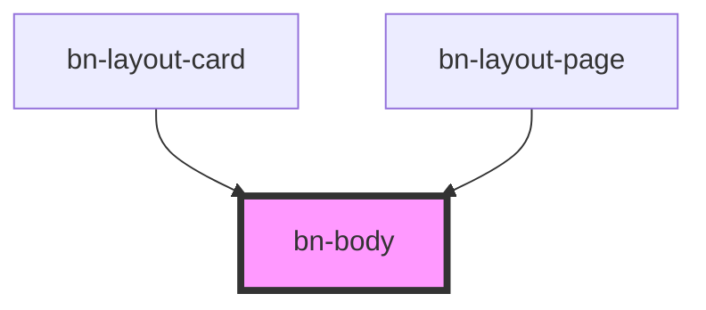

# bn-body

Content area within a [`<bn-page>`](../bn-page/readme.md). Place visualization components (tables, charts) and other content inside it.

## Usage

```html
<bn-page format="hd" orientation="landscape">
  <bn-body>
    <bn-table scenarios="ac1,pl1"></bn-table>
  </bn-body>
</bn-page>
```

`<bn-body>` is a required child of `<bn-page>`. It defines the main content region between the title and footer.

<!-- Auto Generated Below -->


## Properties

| Property        | Attribute        | Description                                                                                                             | Type     | Default     |
| --------------- | ---------------- | ----------------------------------------------------------------------------------------------------------------------- | -------- | ----------- |
| `selectedStyle` | `selected-style` | Name of the component style to use (the `name` of a `<bn-component-style>`). Its values go on top of the default style. | `string` | `undefined` |


## Dependencies

### Used by

 - [bn-layout-card](../bn-layout-card)
 - [bn-layout-page](../bn-layout-page)

### Graph


----------------------------------------------

developed by Bino Bi
