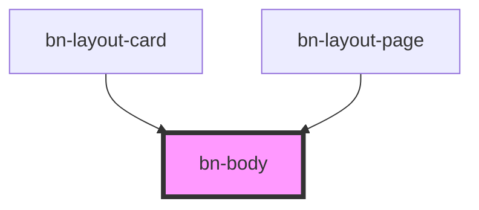

# bn-body

**bn-body** determines the area in which the content of the report is placed.
the **bn-body** is a child element of bn-page and mandatory for a valid report template.

**Example**<br />

````html
<bn-page name="Example bn-body" format="letter" orientation="landscape">
        <bn-body> ... </bn-body>
</bn-page>
````
<!-- Auto Generated Below -->


## Dependencies

### Used by

 - [bn-layout-card](../bn-layout-card)
 - [bn-layout-page](../bn-layout-page)

### Graph


----------------------------------------------

developed by Bino Bi
