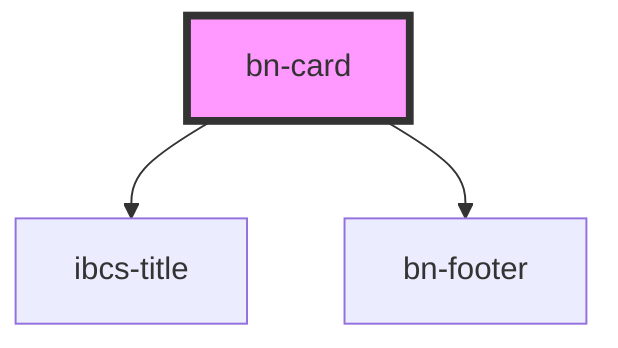

# bn-card

**bn-card** is used to group report content into a box (with optional border).
A **bn-card** provides its own header element analogous to the report-page and its header element.
In addition it prides space for a logo/pictogram which can be displayed in the top right corner of the card.


The **bn-card** can be used within the bn-content element

## Mixins
@withStyle
@withTranslation

**Example**<br />

````html
        <bn-card
                business-unit = "Business Unit"
                date-end      = '2021-11-14'
                date-format   = 'quarter'
                date-link     = 'interval'
                date-start    = '2020-11-14'
                footer-text   = "*Footer Text"
                image         = "https://licensebuttons.net/l/by-nc/3.0/88x31.png"
                internationalisation = null
                internationalisation-mode = "all"
                measures      = '[{"name": "Marktwert", "unit": "mEUR"}]'
                order         = 'ac1';
                order-direction = 'desc'
                scenarios     = 'ac1'
                show-border   ="true"
        >
          
            </br></br></br>
            ---------------------Example Card---------------------
            </br></br></br>
        </bn-card>
````

**Output**<br />


**Default Attributes**
````html
        <bn-card
            business-unit = null
            date-end      = null
            date-format   = 'auto'
            date-link     = null
            date-start    = null
            footer-text   = null
            image         = null
            internationalisation = null
            internationalisation-mode = 'meta'
            measures      = null
            order         = null
            order-direction = 'asc'
            scenarios     = null
            show-border   ="true"
        >
  
            </br></br></br>
            ---------------------Example Card---------------------
            </br></br></br>
        </bn-card>
````


<!-- Auto Generated Below -->


## Properties

| Property                   | Attribute                   | Description                                                                                                                                                                                                                                                                                                                                                                                                                                                                                                                                                                                                                                                                                                 | Type     | Default      |
| -------------------------- | --------------------------- | ----------------------------------------------------------------------------------------------------------------------------------------------------------------------------------------------------------------------------------------------------------------------------------------------------------------------------------------------------------------------------------------------------------------------------------------------------------------------------------------------------------------------------------------------------------------------------------------------------------------------------------------------------------------------------------------------------------- | -------- | ------------ |
| `businessUnit`             | `business-unit`             | Name of the business unit displayed in card header. If empty string (`''` or `null`) the business unit row is omitted                                                                                                                                                                                                                                                                                                                                                                                                                                                                                                                                                                                       | `string` | `''`         |
| `dateEnd`                  | `date-end`                  | String of end date <br /><br /> format:<br /> ``` yyyy-MM-dd ```                                                                                                                                                                                                                                                                                                                                                                                                                                                                                                                                                                                                                                            | `string` | `undefined`  |
| `dateFormat`               | `date-format`               | Date format <br /><br /> values:<br /> ``` year // quarter // month // week // day // hour // auto // none ``` <br /><br />  detail:<br /> ```year: "YYYY"```<br /> ```quarter:  "Q[Q] YYYY"```<br /> ```month: "MMM YYYY"```<br /> ```week: "[KW]WW YYYY"```<br /> ```day: "DD.MM.YYYY"```<br /> ```time: "DD.MM.YYYY HH:mm:ss"```<br /> ```none: "DD.MM.YYYY"```<br />                                                                                                                                                                                                                                                                                                                                    | `string` | `'none'`     |
| `dateLink`                 | `date-link`                 | Format in which the start and end date are linked. <br /><br /> If empty string (`''` or `null`) the date row is omitted <br /><br /> values:<br /> ``` avg // interval // cum // start // end // ytd // ytg // cum // mat // none // null``` <br /><br />  detail:<br /> ```avg: "Ø[DATE]"```<br /> ```interval: "[DATE]..[DATE2]"```<br /> ```start: ".[DATE]"```<br /> ```end: "[DATE]."```<br /> ```ytd: "_[DATE]"```<br /> ```ytg: "[DATE]_"```<br /> ```cum: "[DATE]_[DATE2]"```<br /> ```mat: "~[DATE]"```<br /> ```none: "[DATE]"```<br />                                                                                                                                                          | `string` | `'none'`     |
| `dateStart`                | `date-start`                | String of start date <br /><br /> format:<br /> ``` yyyy-MM-dd ```                                                                                                                                                                                                                                                                                                                                                                                                                                                                                                                                                                                                                                          | `string` | `undefined`  |
| `footerText`               | `footer-text`               | Custom text for footer which is displayed in the bottom-left of the card element<br /> If empty string (`''` or `null`) the footer row is omitted <br /><br /> example:<br /> ``` Hello, Footer!```                                                                                                                                                                                                                                                                                                                                                                                                                                                                                                         | `string` | `undefined`  |
| `image`                    | `image`                     | Url of the cards logo/ pictogram. <br /> if not http it looks up the url in the components asset folder <br /> If empty string (`''` or `null`) the image is omitted <br /><br /> example:<br /> ```debug/concordia.png```                                                                                                                                                                                                                                                                                                                                                                                                                                                                                  | `string` | `''`         |
| `internationalisation`     | `internationalisation`      | Lookup Map of translation tokens. (TODO: SHE)                                                                                                                                                                                                                                                                                                                                                                                                                                                                                                                                                                                                                                                               | `string` | `undefined`  |
| `internationalisationMode` | `internationalisation-mode` | Mode of Translation <br /><br /> values:<br /> ``` none // meta // all ```                                                                                                                                                                                                                                                                                                                                                                                                                                                                                                                                                                                                                                  | `string` | `"meta"`     |
| `measures`                 | `measures`                  | Stringified Array of measure objects {name: string, unit: string} <br /><br /> If all units are the same the redundant units will be reduced and names concatenated.<br /> If unit is empty string (`''` or `null`) the row is omitted <br /><br /> example:<br /> ``` [{"name": "Bruttoumsatz", "unit": "mEUR"}] ```                                                                                                                                                                                                                                                                                                                                                                                       | `string` | `undefined`  |
| `order`                    | `order`                     | List of the primary scenarios on which the order direction are applied. <br /><br /> If order is set to a scenario it has also exists in scenariolist.<br /> If order is empty string (`''` or `null`) the order arrow is omitted <br /><br /> values:<br /> ``` category // categoryindex // rowgroup // rowgroup // rowgroupindex // ac // fc // py // pl // null ```                                                                                                                                                                                                                                                                                                                                     | `string` | `'category'` |
| `orderDirection`           | `order-direction`           | Sets sorting order directon <br /><br /> values:<br /> ``` asc // desc ```                                                                                                                                                                                                                                                                                                                                                                                                                                                                                                                                                                                                                                  | `string` | `'asc'`      |
| `scenarios`                | `scenarios`                 | List of scenarios displayed in card header. <br /><br /> If scenarios is empty string (`''` or `null`) the scenarios are omitted <br /><br /> values:<br /> ```ac // fc // py // pl // null```                                                                                                                                                                                                                                                                                                                                                                                                                                                                                                              | `string` | `undefined`  |
| `showBorder`               | `show-border`               | show or hides the cards border <br /><br /> values:<br /> ``` true // false ```                                                                                                                                                                                                                                                                                                                                                                                                                                                                                                                                                                                                                             | `string` | `"true"`     |
| `variances` _(required)_   | `variances`                 | List of Variance Map. <br /> <br />   Variance chart can be added by seperating the scenarios   of each chart with ```;```<br />   The additonal variances which   are calculated form the given scenarios.   the scenarios used in the variances have also   be defined in the *scenarios* property. <br /> <br />   the variance is defiend as  (Scenario A -  ScenarioB)   neu. neg and pos post fix defines which value is *good*   a negative or a positive value. <br /> <br />   if empty variance charts are hidden <br /> <br />   each variance creates a chart <br /> <br />   pattern:<br />  ```d<scenarioB>_<scenarioA>_[pos/neg/neu]```     example: <br />```'dpp1_ac1_neg,dfc1_ac1_neg'``` | `string` | `undefined`  |


## Dependencies

### Depends on

- ibcs-title
- [bn-footer](../bn-footer)

### Graph


----------------------------------------------

developed by Bino Bi
