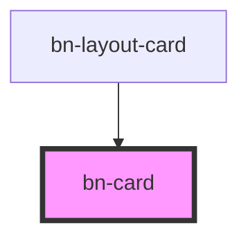

# bn-page

Component which represent the report page. It is the user-root component.
(It is the first component a users sees and adds child componens to it)


A bn-page components only allows childs of the types: ```bn-body, bn-header and bn-footer```
Each Child-element must be used only once.

<!-- Auto Generated Below -->


## Dependencies

### Used by

 - [bn-layout-card](../bn-layout-card)

### Graph


----------------------------------------------

developed by Bino Bi
