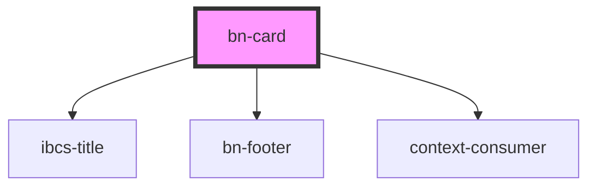

# bn-title

<!-- Auto Generated Below -->

## Properties

| Property                   | Attribute                   | Description                                                                                                                                                                                                                                                                                                                        | Type     | Default      |
| -------------------------- | --------------------------- | ---------------------------------------------------------------------------------------------------------------------------------------------------------------------------------------------------------------------------------------------------------------------------------------------------------------------------------- | -------- | ------------ |
| `businessUnit`             | `business-unit`             | (optional) Name of business unit. If empty buisnes unit row is omitted                                                                                                                                                                                                                                                             | `string` | `undefined`  |
| `dateEnd`                  | `date-end`                  | (optional) String of end date  format: yyyy-MM-dd                                                                                                                                                                                                                                                                                  | `string` | `undefined`  |
| `dateFormat`               | `date-format`               | (optional) String of end date (format: yyyy-MM-dd)  values: year \| quarter \| month \| week \| day \| hour \| auto \| fallback  detail: year: "YYYY", quarter:  "Q[Q] YYYY", month: "MMM YYYY", week: "[KW]WW YYYY", day: "DD.MM.YYYY", time: "DD.MM.YYYY HH:mm:ss", fallback: "DD.MM.YYYY",                                      | `string` | `'fallback'` |
| `dateLink`                 | `date-link`                 | (optional) String of end date (format: yyyy-MM-dd)  values: avg \| interval \| cum \| start \| end \| ytd \| ytg \| cum \| mat \| none \|  detail:  avg: "Ø[DATE]",  interval:  "[DATE]..[DATE2]",  start: ".[DATE]",  end: "[DATE].",  ytd: "_[DATE]",  ytg: "[DATE]_",  cum: "[DATE]_[DATE2]",  mat: "~[DATE]",  none: "[DATE]", | `string` | `'none'`     |
| `dateStart`                | `date-start`                | (optional) String of start date  format: yyyy-MM-dd                                                                                                                                                                                                                                                                                | `string` | `undefined`  |
| `footerText`               | `footer-text`               | Custom Text for Footer  alues: generic string                                                                                                                                                                                                                                                                                      | `string` | `undefined`  |
| `image`                    | `image`                     | Url of the cards logo/ pictogram. if not http it looks up the url in the components asset folder  detail:  debug/concordia.png                                                                                                                                                                                                     | `string` | `''`         |
| `internationalisation`     | `internationalisation`      |                                                                                                                                                                                                                                                                                                                                    | `string` | `undefined`  |
| `internationalisationMode` | `internationalisation-mode` | Mode of Translation,  values: none\| meta\| all  default: meta                                                                                                                                                                                                                                                                     | `string` | `"meta"`     |
| `measures`                 | `measures`                  | (optional) stringified Array of measure Objects {name: string, unit: string}  IF all units are the same the redundant units will be reduced and names concatenated IF unit is null  the 'in' label is omitted  example: [{"name": "Bruttoumsatz", "unit": "mEUR"}]                                                                 | `string` | `undefined`  |
| `order`                    | `order`                     | (optional) List of the primary scenarios on which the order direction are applied  valid scenarios are If order is set to a scenario it has also exists in scenariolist  values: category \| categoryindex \| rowgroup \| rowgroup \| rowgroupindex \| ac \| fc \| py \| pl                                                        | `string` | `undefined`  |
| `orderDirection`           | `order-direction`           | (optional) set sorting order directon  values: asc \| desc                                                                                                                                                                                                                                                                         | `string` | `'asc'`      |
| `scenarios`                | `scenarios`                 | (optional) List of scenarios. Valid scenarios are  values: ac \| fc \| py \| pl \| null                                                                                                                                                                                                                                            | `string` | `undefined`  |
| `showBorder` _(required)_  | `show-border`               | show or hides the cards border  alues: true \| false                                                                                                                                                                                                                                                                               | `string` | `undefined`  |

## Dependencies

### Depends on

- ibcs-title
- [bn-footer](../bn-footer)
- context-consumer

### Graph

----------------------------------------------

*Built with [StencilJS](https://stenciljs.com/)*
