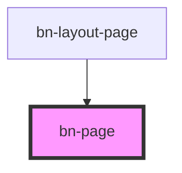

# bn-page

Component which represent the report page. It is the user-root component.
(It is the first component a users sees and adds child componens to it)


A bn-page components only allows childs of the types: ```bn-body, bn-header and bn-footer```
Each Child-element must be used only once.

<!-- Auto Generated Below -->


## Properties

| Property      | Attribute     | Description                                                                                                                                                                                 | Type     | Default     |
| ------------- | ------------- | ------------------------------------------------------------------------------------------------------------------------------------------------------------------------------------------- | -------- | ----------- |
| `format`      | `format`      | Defines the size of the page <br /><br /> values: <br /> ``` xga // hd // full-hd // 4k // 4k2k // a4 // a3 // a2 // a1 // a0 // letter // legal ``` <br /><br /> default: <br /> ```xga``` | `string` | `undefined` |
| `orientation` | `orientation` | Defines page orientation <br /><br /> values: <br /> ``` landscape // portrait ``` <br /><br /> default: <br /> based on the given format                                                   | `string` | `undefined` |


## Dependencies

### Used by

 - [bn-layout-page](../bn-layout-page)

### Graph


----------------------------------------------

developed by Bino Bi
