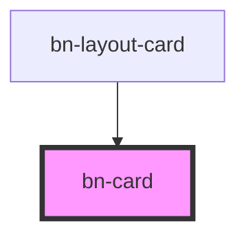

# bn-card

Card container for grouping content within a page layout. Cards are typically used inside [`<bn-layout-page>`](../bn-layout-page/readme.md) grid slots.

## Usage

```html
<bn-card>
  <bn-title business-unit="Sales" scenarios="ac1,pl1"></bn-title>
  <bn-body>
    <bn-chart-structure scenarios="ac1,pl1"></bn-chart-structure>
  </bn-body>
</bn-card>
```

For a higher-level card with built-in title, body, and footer layout, use [`<bn-layout-card>`](../bn-layout-card/readme.md) instead.

<!-- Auto Generated Below -->


## Properties

| Property        | Attribute        | Description                                                                                                             | Type     | Default     |
| --------------- | ---------------- | ----------------------------------------------------------------------------------------------------------------------- | -------- | ----------- |
| `selectedStyle` | `selected-style` | Name of the component style to use (the `name` of a `<bn-component-style>`). Its values go on top of the default style. | `string` | `undefined` |


## Dependencies

### Used by

 - [bn-layout-card](../bn-layout-card)

### Graph


----------------------------------------------

developed by Bino Bi
