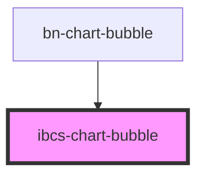

# bn-chart-bubble

IBCS-compliant bubble chart ([IBCS chart template C10](https://www.ibcs.com/resource/chart-template-10/)):
XY position plus an **area-proportional** bubble size as a third measure,
value labels inside the bubbles, a size legend, scenario comparison
overlays (10D), pie-share bubbles (10E), variance axes (10F), and trellis
facets (10G).

## Basic Usage

```html
<bn-chart-bubble
  datasets="portfolio"
  x='{"measure":"ac1","label":"Market attractiveness","refLine":0.5}'
  y='{"measure":"ac2","label":"Relative market share"}'
  size='{"measure":"ac3","label":"Net sales","unit":"mEUR"}'>
</bn-chart-bubble>
```

Bubble **area** is proportional to the size value (values must be >= 0).
`compare-with="pp"` overlays the same slot numbers from another scenario
family behind the primary set, styled by that family's rule-set treatment;
`share='{"measure":"ac4"}'` draws a pie sector (fraction 0..1) from
12 o'clock inside each bubble.

## Cross-chart size scaling

Every chart referencing the same `bn-scaling-group` renders an identical
value→area mapping (the group value is bubble area in px² per data unit):

```html
<bn-scaling-group name="netsales-area" value="800"></bn-scaling-group>
<bn-chart-bubble size='{"measure":"ac3","label":"Net sales","unit":"mEUR","group":"netsales-area"}' …>
<bn-chart-bubble size='{"measure":"ac3","label":"Net sales","unit":"mEUR","group":"netsales-area"}' …>
```

In group mode bubbles render true-size — they may intentionally overflow
the panel (a warning is raised). For cross-chart **axis** comparability,
pin `min`/`max` identically on the charts.

Series hues come from the component style's `seriesColors` (override via a
named `bn-component-style`); scenario treatments (solid/tinted/hatched/
outlined) and display names resolve through the rule-set system
(`bn-ruleset`). Not part of this component: comment/annotation layers,
interactivity, and auto-SI scaling.

See `examples/bubble.html` for pages replicating the IBCS reference
examples 10A/10B/10D/10E/10F/10G.

<!-- Auto Generated Below -->


## Overview

Inner presentational element of `bn-chart-bubble`: owns the
{@link BubbleChart} orchestrator and emits its SVG string. All props
arrive validated and parsed from the facade.

## Properties

| Property              | Attribute            | Description                                                                               | Type                                        | Default      |
| --------------------- | -------------------- | ----------------------------------------------------------------------------------------- | ------------------------------------------- | ------------ |
| `aspect`              | `aspect`             | Plot aspect ratio, width/height.                                                          | `number`                                    | `16 / 9`     |
| `chartTitle`          | `chart-title`        |                                                                                           | `string`                                    | `""`         |
| `compareFamily`       | `compare-family`     | Comparison scenario family, or `null` (10D overlay).                                      | `string`                                    | `null`       |
| `containerWidth`      | `container-width`    |                                                                                           | `number`                                    | `0`          |
| `dataVersion`         | `data-version`       | Bumped by the facade when the dataset changes; triggers re-render.                        | `number`                                    | `0`          |
| `errors`              | --                   | The facade's error dispatcher — data warnings are synced through it (stable ids).         | `ErrorDispatcher`                           | `undefined`  |
| `facet`               | --                   |                                                                                           | `FacetConfig`                               | `null`       |
| `filter`              | `filter`             |                                                                                           | `string`                                    | `""`         |
| `i18n`                | --                   |                                                                                           | `Map<string, string>`                       | `new Map()`  |
| `labels` _(required)_ | --                   |                                                                                           | `LabelConfig`                               | `undefined`  |
| `legend` _(required)_ | --                   |                                                                                           | `LegendConfig`                              | `undefined`  |
| `limit`               | `limit`              |                                                                                           | `number`                                    | `0`          |
| `pointLevel`          | `point-level`        |                                                                                           | `"category" \| "rowGroup" \| "subCategory"` | `"category"` |
| `ruleSetConfig`       | --                   |                                                                                           | `RuleSetConfig`                             | `undefined`  |
| `seriesLevel`         | `series-level`       |                                                                                           | `"category" \| "rowGroup"`                  | `null`       |
| `share`               | --                   |                                                                                           | `ShareConfig`                               | `null`       |
| `size` _(required)_   | --                   |                                                                                           | `SizeConfig`                                | `undefined`  |
| `sizeAreaPerUnit`     | `size-area-per-unit` | Scaling-group mode: area px² per data unit (0 = local sizing).                            | `number`                                    | `0`          |
| `styles`              | --                   |                                                                                           | `XYChartStyle`                              | `undefined`  |
| `tableName`           | `table-name`         | Name of the dataset (table or view in the scoped alasql database).                        | `string`                                    | `""`         |
| `translate`           | --                   | Facade-bound translator for warning messages (resolves `.key` in the facade's namespace). | `(key: string, data?: object) => string`    | `undefined`  |
| `x` _(required)_      | --                   |                                                                                           | `AxisConfig`                                | `undefined`  |
| `y` _(required)_      | --                   |                                                                                           | `AxisConfig`                                | `undefined`  |


## Dependencies

### Used by

 - [bn-chart-bubble](.)

### Graph


----------------------------------------------

developed by Bino Bi
