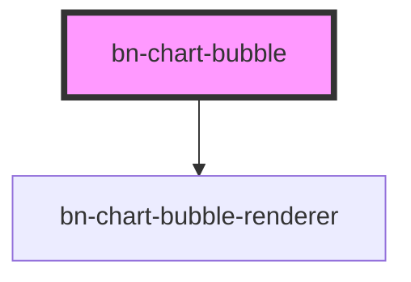

# bn-chart-bubble

IBCS-compliant bubble chart ([IBCS chart template C10](https://www.ibcs.com/resource/chart-template-10/)):
XY position plus an **area-proportional** bubble size as a third measure,
value labels inside the bubbles, a size legend, scenario comparison
overlays (10D), pie-share bubbles (10E), variance axes (10F), and trellis
facets (10G).

## Basic Usage

```html
<bn-chart-bubble
  datasets="portfolio"
  x='{"measure":"ac1","label":"Market attractiveness","refLine":0.5}'
  y='{"measure":"ac2","label":"Relative market share"}'
  size='{"measure":"ac3","label":"Net sales","unit":"mEUR"}'>
</bn-chart-bubble>
```

Bubble **area** is proportional to the size value (values must be >= 0).
`compare-with="pp"` overlays the same slot numbers from another scenario
family behind the primary set, styled by that family's rule-set treatment;
`share='{"measure":"ac4"}'` draws a pie sector (fraction 0..1) from
12 o'clock inside each bubble.

An axis with a relative variance (`dr…`, template 10F) is in percent. Its
ticks print `20%`, and `min`, `max`, `refLine` and `highlight` are written
in percent: `x='{"measure":"drac1_pp1","min":-40,"max":40,"refLine":0}'`.
A relative variance as `size` prints its value label in percent as well.

## Cross-chart size scaling

Every chart referencing the same `bn-scaling-group` renders an identical
value→area mapping (the group value is bubble area in px² per data unit):

```html
<bn-scaling-group name="netsales-area" value="800"></bn-scaling-group>
<bn-chart-bubble size='{"measure":"ac3","label":"Net sales","unit":"mEUR","group":"netsales-area"}' …>
<bn-chart-bubble size='{"measure":"ac3","label":"Net sales","unit":"mEUR","group":"netsales-area"}' …>
```

In group mode bubbles render true-size - they may intentionally overflow
the panel (a warning is raised). For cross-chart **axis** comparability,
pin `min`/`max` identically on the charts.

Series hues come from the component style's `seriesColors` (override via a
named `bn-component-style`); scenario treatments (solid/tinted/hatched/
outlined) and display names resolve through the rule-set system
(`bn-ruleset`). Not part of this component: comment/annotation layers,
interactivity, and auto-SI scaling.

See `examples/bubble.html` for pages replicating the IBCS reference
examples 10A/10B/10D/10E/10F/10G.

<!-- Auto Generated Below -->


## Overview

SVG bubble chart following IBCS template C10.

Subscribes to a dataset (via `withDataset`) and renders an XY bubble
portfolio: bubble **area** is proportional to the size measure, marks
compose series hues with scenario treatments, an optional comparison
family overlays behind the primary set (10D), and `share` draws pie
sectors inside the bubbles (10E). The heavy SVG rendering is performed
by the inner `bn-chart-bubble-renderer` element; this facade validates props,
resolves auto-detected metadata, and computes styles.

## Properties

| Property            | Attribute        | Description                                                                                                                                                                                                                                                                                                             | Type     | Default     |
| ------------------- | ---------------- | ----------------------------------------------------------------------------------------------------------------------------------------------------------------------------------------------------------------------------------------------------------------------------------------------------------------------- | -------- | ----------- |
| `aspect`            | `aspect`         | Plot aspect ratio as `"w:h"` (default `"16:9"`). XY charts have no data-driven height; this is the explicit height control.                                                                                                                                                                                             | `string` | `"16:9"`    |
| `chartTitle`        | `chart-title`    | Custom chart title                                                                                                                                                                                                                                                                                                      | `string` | `""`        |
| `compareWith`       | `compare-with`   | Comparison scenario family (`ac`/`pp`/`fc`/`pl`) overlaid behind the primary set from the same slot numbers (IBCS 10D). Must differ from the primary family; invalid with variance-token axes.                                                                                                                          | `string` | `""`        |
| `datasets`          | `datasets`       | Name of the dataset to render (the `name` of a `<bn-dataset>`). A name that starts with `$` reads a `<bn-datasource>` directly, which gives a warning.                                                                                                                                                                  | `string` | `undefined` |
| `facet`             | `facet`          | Small-multiple panels (IBCS 10E/10F/10G). JSON object: `{"level":"rowgroup"\|"category","columns":6}`. The facet level must sit above the series level in the hierarchy.                                                                                                                                                | `string` | `""`        |
| `filter`            | `filter`         | AlaSQL WHERE clause fragment injected into the data query to filter rows before rendering (e.g. `"rowGroup = 'Revenue'"`).                                                                                                                                                                                              | `string` | `""`        |
| `i18nNamespace`     | `i18n-namespace` | Namespace of the translations to use (the `namespace` of a `<bn-internationalization>`). Without it the component takes the `i18n-namespace` of the nearest ancestor that has one, then the built-in texts.                                                                                                             | `string` | `undefined` |
| `labels`            | `labels`         | Point labeling. JSON object: `{"points":"auto"\|"none"\|"all"\|["VAB"], "values":true,"max":12}`. Bubble charts label every point by default; `values` renders the value inside the bubble.                                                                                                                             | `string` | `""`        |
| `legend`            | `legend`         | Legend (series colors, bubble size caption, comparison scenarios). JSON object: `{"show":true,"position":"right"\|"bottom"}`.                                                                                                                                                                                           | `string` | `""`        |
| `level`             | `level`          | Point identity level: `auto` (deepest populated level from the dataset meta), `category`, or `subcategory`.                                                                                                                                                                                                             | `string` | `"auto"`    |
| `limit`             | `limit`          | Maximum number of bubbles per panel (0 = unlimited); keeps the top N by size.                                                                                                                                                                                                                                           | `number` | `0`         |
| `ruleset`           | `ruleset`        | Name of a registered IBCS rule set (see `bn-ruleset`) used for scenario treatments and display names. Supports `"inherited-closest"` / `"inherited-page"` to take over the value from an ancestor `bn-layout-card` / `bn-layout-page`.                                                                                  | `string` | `undefined` |
| `scale`             | `scale`          | Font-size auto-fit: `""`/`auto` shrink to the parent width (with/without a warning), `none` disables, a number applies a fixed factor.                                                                                                                                                                                  | `string` | `undefined` |
| `selectedStyle`     | `selected-style` | Name of the component style to use (the `name` of a `<bn-component-style>`). Its values go on top of the default style.                                                                                                                                                                                                 | `string` | `undefined` |
| `seriesLevel`       | `series-level`   | Series (color) grouping level: `auto` (parent of the point level), `rowgroup`, `category`, or `none` (single series).                                                                                                                                                                                                   | `string` | `"auto"`    |
| `share`             | `share`          | Pie-share slices inside the bubbles (IBCS 10E). JSON object or bare token; the measure holds a fraction 0..1 of the bubble.                                                                                                                                                                                             | `string` | `""`        |
| `size` _(required)_ | `size`           | Bubble size mapping (required). Bubble **area** is proportional to the value; values must be >= 0. JSON object or bare token: `{"measure":"ac3","label":"Net sales","unit":"mEUR", "group":"netsales-area"}`. `group` references a `bn-scaling-group` for cross-chart value→area synchronization.                       | `string` | `undefined` |
| `x` _(required)_    | `x`              | X axis mapping. JSON object (`AxisSpec`) or a bare measure token as shorthand: `{"measure":"ac1","label":"Market attractiveness", "refLine":0.5}`. A relative variance (`dr…`) gives an axis in percent: the ticks print `20%`, and `min`, `max`, `refLine` and `highlight` are written in percent too (`20` for 20 %). | `string` | `undefined` |
| `y` _(required)_    | `y`              | Y axis mapping - same shape as `x`.                                                                                                                                                                                                                                                                                     | `string` | `undefined` |


## Methods

### `getLayoutState(options?: LayoutStateOptions) => Promise<ComponentLayoutState>`

Lazily generates this chart's layout state: host box (context- and
component-relative, CSS px), the canvas region, point count and
diagnostics. With `detail: "full"` the rendered marks and labels are
listed with their geometry (tag-classified - XY marks carry no ids).

#### Parameters

| Name      | Type                 | Description                                              |
| --------- | -------------------- | -------------------------------------------------------- |
| `options` | `LayoutStateOptions` | - `{ detail: "summary" \| "full" }`, default `"summary"` |

#### Returns

Type: `Promise<ComponentLayoutState>`


## Dependencies

### Depends on

- bn-chart-bubble-renderer

### Graph


----------------------------------------------

developed by Bino Bi
