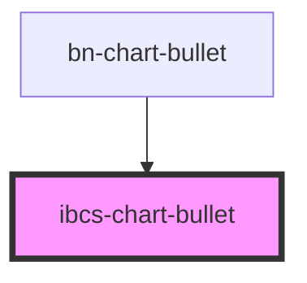

# bn-chart-bullet

IBCS bullet graph: one horizontal row per KPI with a solid actual bar and
a target marker, following Faisst's IBCS evaluation of Stephen Few's
bullet graph. The default mode applies the three IBCS improvements:
**normalized targets** (every row is scaled to fractions of its target,
so one continuous target line spans all rows and KPIs become visually
comparable), **integrated variance bars** between actual and target in
the IBCS variance colors (favorable/unfavorable), and **no arbitrary
third range band**.

## Basic Usage

```html
<bn-chart-bullet datasets="kpis"></bn-chart-bullet>
```

That is a complete chart: `actual` auto-detects `ac1` (else the first
available scenario), `target` auto-detects `pl1` > `pp1` > `fc1`, the row
level and order come from the dataset meta. Explicit form:

```html
<bn-chart-bullet
  datasets="kpis"
  chart-title="KPI overview vs. plan - 2026"
  actual='{"measure":"ac1","label":"AC","unit":"norm."}'
  target='{"measure":"pl1","label":"Plan"}'>
</bn-chart-bullet>
```

Only plain scenario slots (`ac1`…`pl4`) are allowed for `actual`/`target`
- the bullet variance is implicit (actual vs target), variance tokens
have no meaning here.

## Classic mode

`normalize="none"` gives the classic Stephen Few look: per-row scales
with tick strips and per-row target ticks. `ranges="[0.6, 0.9]"` adds up
to two qualitative gray bands as fractions of the row target (IBCS
rejects a third band of arbitrary length); ranges are ignored in the
default normalized mode.

```html
<bn-chart-bullet datasets="kpis" normalize="none" ranges="[0.6, 0.9]" variances="none"></bn-chart-bullet>
```

## Semantics

- The favorable/unfavorable reading of a variance follows the row's
  `operation` column: `"-"` marks cost-type KPIs, inverting the sentiment
  (actual below a cost target is favorable).
- Rows are aggregated with a plain `SUM` per level value (no
  operation-driven sign flip), so cost KPIs show positive magnitudes;
  `limit` truncates to the first N rows - there is no REST aggregate,
  summing heterogeneous KPIs would be meaningless.
- Rows whose target is missing or not positive cannot be normalized and
  render as label + value only (with a warning); without any target
  scenario the chart falls back to plain actual bars.

<!-- Auto Generated Below -->


## Overview

Inner presentational element of `bn-chart-bullet`: owns the
{@link BulletChart} orchestrator and emits its SVG string. All props
arrive validated and parsed from the facade.

## Properties

| Property              | Attribute         | Description                                                                               | Type                                                                                                                                                                                              | Default                     |
| --------------------- | ----------------- | ----------------------------------------------------------------------------------------- | ------------------------------------------------------------------------------------------------------------------------------------------------------------------------------------------------- | --------------------------- |
| `actual` _(required)_ | --                |                                                                                           | `BulletMeasureConfig`                                                                                                                                                                             | `undefined`                 |
| `chartTitle`          | `chart-title`     |                                                                                           | `string`                                                                                                                                                                                          | `""`                        |
| `containerWidth`      | `container-width` |                                                                                           | `number`                                                                                                                                                                                          | `0`                         |
| `dataVersion`         | `data-version`    | Bumped by the facade when the dataset changes; triggers re-render.                        | `number`                                                                                                                                                                                          | `0`                         |
| `errors`              | --                | The facade's error dispatcher - data warnings are synced through it (stable ids).         | `ErrorDispatcher`                                                                                                                                                                                 | `undefined`                 |
| `filter`              | `filter`          |                                                                                           | `string`                                                                                                                                                                                          | `""`                        |
| `i18n`                | --                |                                                                                           | `Map<string, string>`                                                                                                                                                                             | `new Map()`                 |
| `labels` _(required)_ | --                |                                                                                           | `BulletLabelConfig`                                                                                                                                                                               | `undefined`                 |
| `level`               | `level`           |                                                                                           | `AggregationLevel.CATEGORY \| AggregationLevel.CATEGORYINDEX \| AggregationLevel.ROWGROUP \| AggregationLevel.ROWGROUPINDEX \| AggregationLevel.SUBCATEGORY \| AggregationLevel.SUBCATEGORYINDEX` | `AggregationLevel.CATEGORY` |
| `limit`               | `limit`           |                                                                                           | `number`                                                                                                                                                                                          | `0`                         |
| `normalize`           | `normalize`       |                                                                                           | `"none" \| "target"`                                                                                                                                                                              | `"target"`                  |
| `order` _(required)_  | --                |                                                                                           | `Order`                                                                                                                                                                                           | `undefined`                 |
| `ranges`              | --                |                                                                                           | `number[]`                                                                                                                                                                                        | `[]`                        |
| `ruleSetConfig`       | --                |                                                                                           | `RuleSetConfig`                                                                                                                                                                                   | `undefined`                 |
| `showVariances`       | `show-variances`  |                                                                                           | `boolean`                                                                                                                                                                                         | `true`                      |
| `styles`              | --                |                                                                                           | `BulletChartStyle`                                                                                                                                                                                | `undefined`                 |
| `tableName`           | `table-name`      | Name of the dataset (table or view in the scoped alasql database).                        | `string`                                                                                                                                                                                          | `""`                        |
| `target`              | --                |                                                                                           | `BulletMeasureConfig`                                                                                                                                                                             | `null`                      |
| `translate`           | --                | Facade-bound translator for warning messages (resolves `.key` in the facade's namespace). | `(key: string, data?: object) => string`                                                                                                                                                          | `undefined`                 |


## Dependencies

### Used by

 - [bn-chart-bullet](.)

### Graph


----------------------------------------------

developed by Bino Bi
