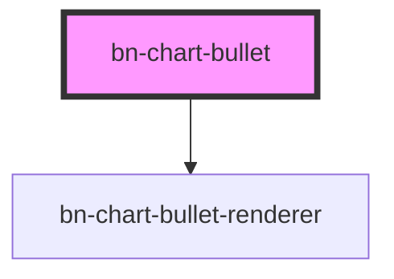

# bn-chart-bullet

IBCS bullet graph: one horizontal row per KPI with a solid actual bar and
a target marker, following Faisst's IBCS evaluation of Stephen Few's
bullet graph. The default mode applies the three IBCS improvements:
**normalized targets** (every row is scaled to fractions of its target,
so one continuous target line spans all rows and KPIs become visually
comparable), **integrated variance bars** between actual and target in
the IBCS variance colors (favorable/unfavorable), and **no arbitrary
third range band**.

## Basic Usage

```html
<bn-chart-bullet datasets="kpis"></bn-chart-bullet>
```

That is a complete chart: `actual` auto-detects `ac1` (else the first
available scenario), `target` auto-detects `pl1` > `pp1` > `fc1`, the row
level and order come from the dataset meta. Explicit form:

```html
<bn-chart-bullet
  datasets="kpis"
  chart-title="KPI overview vs. plan - 2026"
  actual='{"measure":"ac1","label":"AC","unit":"norm."}'
  target='{"measure":"pl1","label":"Plan"}'>
</bn-chart-bullet>
```

Only plain scenario slots (`ac1`…`pl4`) are allowed for `actual`/`target`
- the bullet variance is implicit (actual vs target), variance tokens
have no meaning here.

## Classic mode

`normalize="none"` gives the classic Stephen Few look: per-row scales
with tick strips and per-row target ticks. `ranges="[0.6, 0.9]"` adds up
to two qualitative gray bands as fractions of the row target (IBCS
rejects a third band of arbitrary length); ranges are ignored in the
default normalized mode.

```html
<bn-chart-bullet datasets="kpis" normalize="none" ranges="[0.6, 0.9]" variances="none"></bn-chart-bullet>
```

## Semantics

- The favorable/unfavorable reading of a variance follows the row's
  `operation` column: `"-"` marks cost-type KPIs, inverting the sentiment
  (actual below a cost target is favorable).
- Rows are aggregated with a plain `SUM` per level value (no
  operation-driven sign flip), so cost KPIs show positive magnitudes.
  A level value that mixes `"+"` and `"-"` rows is a net value: its `"-"`
  rows are subtracted (revenue 100 and cost 30 give 70), the sentiment is
  `"+"` and the warning `WARN_bullet-mixed-operation` is set.
- `limit` truncates to the first N rows - there is no REST aggregate,
  summing heterogeneous KPIs would be meaningless.
- Rows whose target is missing or not positive cannot be normalized and
  render as label + value only (with a warning); without any target
  scenario the chart falls back to plain actual bars.
- A negative actual value has no bar: the row shows its value as text and
  the warning `WARN_bullet-actual-negative` is set.

<!-- Auto Generated Below -->


## Overview

IBCS bullet graph: one horizontal row per KPI with a solid actual bar and
a target marker.

Subscribes to a dataset (via `withDataset`) and renders in the IBCS
default mode with **normalized targets** - every row is scaled to
fractions of its target so one continuous target line spans all rows and
KPIs become visually comparable - plus integrated variance bars in the
IBCS variance colors. The classic Stephen Few look is opt-in via
`normalize="none"` (per-row scales) and `ranges` (max two qualitative
gray bands). Actual and target scenarios are auto-detected from the
dataset meta when not set. The heavy SVG rendering is performed by the
inner `bn-chart-bullet-renderer` element; this facade validates props, resolves
auto-detected metadata, and computes styles.

## Properties

| Property         | Attribute         | Description                                                                                                                                                                                                                                                                             | Type     | Default     |
| ---------------- | ----------------- | --------------------------------------------------------------------------------------------------------------------------------------------------------------------------------------------------------------------------------------------------------------------------------------- | -------- | ----------- |
| `actual`         | `actual`          | Actual-value measure. JSON object or a bare scenario slot as shorthand: `{"measure":"ac1","label":"Revenue","unit":"EUR k"}`. Only plain scenario slots (`ac1`…`pl4`) are allowed - variance tokens are not. Empty or `"auto"` auto-detects (`ac1`, else the first available scenario). | `string` | `""`        |
| `chartTitle`     | `chart-title`     | Custom chart title                                                                                                                                                                                                                                                                      | `string` | `""`        |
| `datasets`       | `datasets`        | Name of the dataset to render (the `name` of a `<bn-dataset>`). A name that starts with `$` reads a `<bn-datasource>` directly, which gives a warning.                                                                                                                                  | `string` | `undefined` |
| `filter`         | `filter`          | AlaSQL WHERE clause fragment injected into the data query to filter rows before rendering (e.g. `"rowGroup = 'Revenue'"`).                                                                                                                                                              | `string` | `""`        |
| `i18nNamespace`  | `i18n-namespace`  | Namespace of the translations to use (the `namespace` of a `<bn-internationalization>`). Without it the component takes the `i18n-namespace` of the nearest ancestor that has one, then the built-in texts.                                                                             | `string` | `undefined` |
| `labels`         | `labels`          | Value labels. JSON object: `{"show":"auto"\|"none","decimals":1}`.                                                                                                                                                                                                                      | `string` | `""`        |
| `level`          | `level`           | KPI row level: `auto` (deepest populated level from the dataset meta), `rowgroup`, `category`, or `subcategory`.                                                                                                                                                                        | `string` | `"auto"`    |
| `limit`          | `limit`           | Maximum number of KPI rows (0 = unlimited). Truncates - there is no REST aggregate, summing heterogeneous KPIs would be meaningless.                                                                                                                                                    | `number` | `0`         |
| `normalizeMode`  | `normalize`       | Target normalization: `target` (default - rows share an aligned target position, the IBCS-comparable form) or `none` (classic per-row scales with tick strips).                                                                                                                         | `string` | `"target"`  |
| `order`          | `order`           | Sort key(s) of the KPI rows: hierarchy columns or scenario slots (e.g. `"ac1"`), comma-separated for multi-level sorting. Empty or `"auto"` uses the dataset's suggested order.                                                                                                         | `string` | `""`        |
| `orderDirection` | `order-direction` | Sorting direction: `asc` or `desc`.                                                                                                                                                                                                                                                     | `string` | `""`        |
| `ranges`         | `ranges`          | Qualitative range bands as a JSON array of ascending fractions of the target, at most two - e.g. `[0.6, 0.9]` (IBCS rejects a third band of arbitrary length). Classic mode only; ignored while `normalize` is `"target"`.                                                              | `string` | `""`        |
| `ruleset`        | `ruleset`         | Name of a registered IBCS rule set (see `bn-ruleset`) used for scenario treatments and display names. Supports `"inherited-closest"` / `"inherited-page"` to take over the value from an ancestor `bn-layout-card` / `bn-layout-page`.                                                  | `string` | `undefined` |
| `scale`          | `scale`           | Font-size auto-fit: `""`/`auto` shrink to the parent height (with/without a warning), `none` disables, a number applies a fixed factor.                                                                                                                                                 | `string` | `undefined` |
| `selectedStyle`  | `selected-style`  | Name of the component style to use (the `name` of a `<bn-component-style>`). Its values go on top of the default style.                                                                                                                                                                 | `string` | `undefined` |
| `target`         | `target`          | Target measure - same shape as `actual`. Empty or `"auto"` auto-detects (`pl1` > `pp1` > `fc1`); without any target scenario the chart renders actual bars only.                                                                                                                        | `string` | `""`        |
| `variances`      | `variances`       | Variance bars between actual and target: `auto` (default - drawn in normalized mode, favorable/unfavorable in the IBCS variance colors) or `none`.                                                                                                                                      | `string` | `"auto"`    |


## Methods

### `getLayoutState(options?: LayoutStateOptions) => Promise<ComponentLayoutState>`

Lazily generates this chart's layout state: host box (context- and
component-relative, CSS px), the canvas region and diagnostics. With
`detail: "full"` the rendered marks and labels are listed with their
geometry (tag-classified - bullet marks carry no ids).

#### Parameters

| Name      | Type                 | Description                                              |
| --------- | -------------------- | -------------------------------------------------------- |
| `options` | `LayoutStateOptions` | - `{ detail: "summary" \| "full" }`, default `"summary"` |

#### Returns

Type: `Promise<ComponentLayoutState>`


## Dependencies

### Depends on

- bn-chart-bullet-renderer

### Graph


----------------------------------------------

developed by Bino Bi
