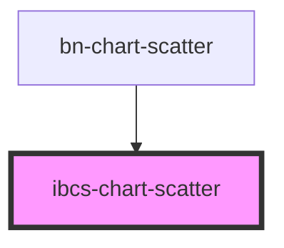

# ibcs-chart-scatter

<!-- Auto Generated Below -->

## Overview

Inner presentational element of `bn-chart-scatter`: owns the
{@link ScatterChart} orchestrator and emits its SVG string. All props
arrive validated and parsed from the facade.

## Properties

| Property              | Attribute         | Description                                                                               | Type                                        | Default      |
| --------------------- | ----------------- | ----------------------------------------------------------------------------------------- | ------------------------------------------- | ------------ |
| `aspect`              | `aspect`          | Plot aspect ratio, width/height.                                                          | `number`                                    | `16 / 9`     |
| `chartTitle`          | `chart-title`     |                                                                                           | `string`                                    | `""`         |
| `containerWidth`      | `container-width` |                                                                                           | `number`                                    | `0`          |
| `dataVersion`         | `data-version`    | Bumped by the facade when the dataset changes; triggers re-render.                        | `number`                                    | `0`          |
| `errors`              | --                | The facade's error dispatcher — data warnings are synced through it (stable ids).         | `ErrorDispatcher`                           | `undefined`  |
| `facet`               | --                |                                                                                           | `FacetConfig`                               | `null`       |
| `filter`              | `filter`          |                                                                                           | `string`                                    | `""`         |
| `i18n`                | --                |                                                                                           | `Map<string, string>`                       | `new Map()`  |
| `iso`                 | --                |                                                                                           | `IsoConfig`                                 | `null`       |
| `labels` _(required)_ | --                |                                                                                           | `LabelConfig`                               | `undefined`  |
| `legend` _(required)_ | --                |                                                                                           | `LegendConfig`                              | `undefined`  |
| `limit`               | `limit`           |                                                                                           | `number`                                    | `0`          |
| `pointLevel`          | `point-level`     |                                                                                           | `"category" \| "rowGroup" \| "subCategory"` | `"category"` |
| `ruleSetConfig`       | --                |                                                                                           | `RuleSetConfig`                             | `undefined`  |
| `seriesLevel`         | `series-level`    |                                                                                           | `"category" \| "rowGroup"`                  | `null`       |
| `styles`              | --                |                                                                                           | `XYChartStyle`                              | `undefined`  |
| `tableName`           | `table-name`      | Name of the dataset (table or view in the scoped alasql database).                        | `string`                                    | `""`         |
| `translate`           | --                | Facade-bound translator for warning messages (resolves `.key` in the facade's namespace). | `(key: string, data?: object) => string`    | `undefined`  |
| `x` _(required)_      | --                |                                                                                           | `AxisConfig`                                | `undefined`  |
| `y` _(required)_      | --                |                                                                                           | `AxisConfig`                                | `undefined`  |

## Dependencies

### Used by

 - [bn-chart-scatter](.)

### Graph

----------------------------------------------

developed by Bino Bi
