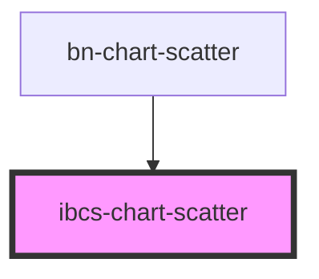

# bn-chart-scatter

IBCS-compliant XY scattergram ([IBCS chart template C09](https://www.ibcs.com/resource/chart-template-09/)):
two numeric value axes, points colored by series, selective proximate labels,
optional highlight bands, and hyperbolic iso-lines `x·y = k` for a third
derived measure.

## Basic Usage

```html
<bn-chart-scatter
  datasets="products"
  x='{"measure":"ac1","label":"Margin","unit":"% of net sales"}'
  y='{"measure":"ac2","label":"Net sales","unit":"mEUR"}'>
</bn-chart-scatter>
```

A bare token is shorthand for the object form: `x="ac1"` equals
`x='{"measure":"ac1"}'`. Measures accept scenario columns (`ac1`…`pl4`) or
variance tokens (`dac1_pp1`, `drac1_pl1` - the sentiment suffix is optional
on axes). All plain scenario measures must share one scenario family; the
family selects the IBCS mark treatment through the rule set.

An axis with a relative variance (`dr…`) is in percent. Its ticks print
`20%`, and `min`, `max`, `refLine` and `highlight` are written in percent:
`x='{"measure":"drac1_pp1","min":-40,"max":40,"refLine":0}'`.

## Iso-lines and highlight bands (09A-09D)

```html
<bn-chart-scatter
  datasets="products"
  x='{"measure":"ac1","label":"Margin","unit":"%","min":0,"max":40}'
  y='{"measure":"ac2","label":"Net sales","unit":"mUSD","highlight":{"from":30}}'
  iso='{"values":[100,200,300],"label":"Gross profit","unit":"mUSD","highlight":{"from":300}}'
  labels='{"points":"auto","max":12}'>
</bn-chart-scatter>
```

Iso-lines require a strictly positive domain on both axes; values are drawn
as delivered - scale in the DataSet SQL (no auto-SI scaling). One row is one
point: duplicate identities keep the first row and raise a warning instead of
aggregating implicitly.

Point identity defaults to the deepest populated hierarchy level
(`level="auto"`), the series color grouping to its parent
(`series-level="auto"`); `facet` splits the plot into small-multiple panels
on a level above the series. `aspect` ("w:h") controls the plot height -
XY charts have no data-driven height.

See `examples/scatter.html` for pages replicating the IBCS reference
examples 09A-09D.

<!-- Auto Generated Below -->


## Overview

Inner presentational element of `bn-chart-scatter`: owns the
{@link ScatterChart} orchestrator and emits its SVG string. All props
arrive validated and parsed from the facade.

## Properties

| Property              | Attribute         | Description                                                                               | Type                                        | Default      |
| --------------------- | ----------------- | ----------------------------------------------------------------------------------------- | ------------------------------------------- | ------------ |
| `aspect`              | `aspect`          | Plot aspect ratio, width/height.                                                          | `number`                                    | `16 / 9`     |
| `chartTitle`          | `chart-title`     |                                                                                           | `string`                                    | `""`         |
| `containerWidth`      | `container-width` |                                                                                           | `number`                                    | `0`          |
| `dataVersion`         | `data-version`    | Bumped by the facade when the dataset changes; triggers re-render.                        | `number`                                    | `0`          |
| `errors`              | --                | The facade's error dispatcher - data warnings are synced through it (stable ids).         | `ErrorDispatcher`                           | `undefined`  |
| `facet`               | --                |                                                                                           | `FacetConfig`                               | `null`       |
| `filter`              | `filter`          |                                                                                           | `string`                                    | `""`         |
| `i18n`                | --                |                                                                                           | `Map<string, string>`                       | `new Map()`  |
| `iso`                 | --                |                                                                                           | `IsoConfig`                                 | `null`       |
| `labels` _(required)_ | --                |                                                                                           | `LabelConfig`                               | `undefined`  |
| `legend` _(required)_ | --                |                                                                                           | `LegendConfig`                              | `undefined`  |
| `limit`               | `limit`           |                                                                                           | `number`                                    | `0`          |
| `pointLevel`          | `point-level`     |                                                                                           | `"category" \| "rowGroup" \| "subCategory"` | `"category"` |
| `ruleSetConfig`       | --                |                                                                                           | `RuleSetConfig`                             | `undefined`  |
| `seriesLevel`         | `series-level`    |                                                                                           | `"category" \| "rowGroup"`                  | `null`       |
| `styles`              | --                |                                                                                           | `XYChartStyle`                              | `undefined`  |
| `tableName`           | `table-name`      | Name of the dataset (table or view in the scoped alasql database).                        | `string`                                    | `""`         |
| `translate`           | --                | Facade-bound translator for warning messages (resolves `.key` in the facade's namespace). | `(key: string, data?: object) => string`    | `undefined`  |
| `x` _(required)_      | --                |                                                                                           | `AxisConfig`                                | `undefined`  |
| `y` _(required)_      | --                |                                                                                           | `AxisConfig`                                | `undefined`  |


## Dependencies

### Used by

 - [bn-chart-scatter](.)

### Graph


----------------------------------------------

developed by Bino Bi
