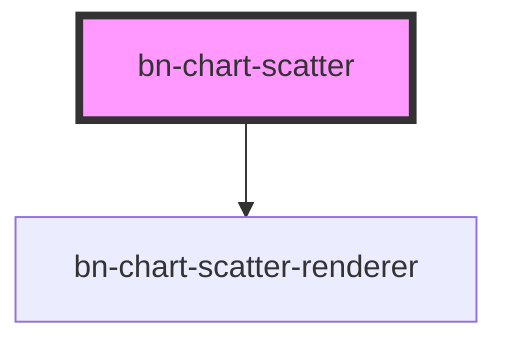

# bn-chart-scatter

IBCS-compliant XY scattergram ([IBCS chart template C09](https://www.ibcs.com/resource/chart-template-09/)):
two numeric value axes, points colored by series, selective proximate labels,
optional highlight bands, and hyperbolic iso-lines `x·y = k` for a third
derived measure.

## Basic Usage

```html
<bn-chart-scatter
  datasets="products"
  x='{"measure":"ac1","label":"Margin","unit":"% of net sales"}'
  y='{"measure":"ac2","label":"Net sales","unit":"mEUR"}'>
</bn-chart-scatter>
```

A bare token is shorthand for the object form: `x="ac1"` equals
`x='{"measure":"ac1"}'`. Measures accept scenario columns (`ac1`…`pl4`) or
variance tokens (`dac1_pp1`, `drac1_pl1` - the sentiment suffix is optional
on axes). All plain scenario measures must share one scenario family; the
family selects the IBCS mark treatment through the rule set.

An axis with a relative variance (`dr…`) is in percent. Its ticks print
`20%`, and `min`, `max`, `refLine` and `highlight` are written in percent:
`x='{"measure":"drac1_pp1","min":-40,"max":40,"refLine":0}'`.

## Iso-lines and highlight bands (09A-09D)

```html
<bn-chart-scatter
  datasets="products"
  x='{"measure":"ac1","label":"Margin","unit":"%","min":0,"max":40}'
  y='{"measure":"ac2","label":"Net sales","unit":"mUSD","highlight":{"from":30}}'
  iso='{"values":[100,200,300],"label":"Gross profit","unit":"mUSD","highlight":{"from":300}}'
  labels='{"points":"auto","max":12}'>
</bn-chart-scatter>
```

Iso-lines need axes that do not start below 0, an axis from 0 is fine. `factor`
in `iso` brings the product `x·y` to the unit of the lines. Values are drawn
as delivered - scale in the DataSet SQL (no auto-SI scaling). One row is one
point: duplicate identities keep the first row and raise a warning instead of
aggregating implicitly.

Point identity defaults to the deepest populated hierarchy level
(`level="auto"`), the series color grouping to its parent
(`series-level="auto"`); `facet` splits the plot into small-multiple panels
on a level above the series. `aspect` ("w:h") controls the plot height -
XY charts have no data-driven height.

See `examples/scatter.html` for pages replicating the IBCS reference
examples 09A-09D.

<!-- Auto Generated Below -->


## Overview

SVG scattergram following IBCS template C09.

Subscribes to a dataset (via `withDataset`) and renders an XY point cloud
with series hues, selective labels, highlight bands, and hyperbolic
iso-lines (`x·y = k`). The heavy SVG rendering is performed by the inner
`bn-chart-scatter-renderer` element; this facade validates props, resolves
auto-detected metadata, and computes styles.

## Properties

| Property         | Attribute        | Description                                                                                                                                                                                                                                                                                                                                                                                                                                                                                                                                                                                                                                                                                                                                                                                                     | Type     | Default     |
| ---------------- | ---------------- | --------------------------------------------------------------------------------------------------------------------------------------------------------------------------------------------------------------------------------------------------------------------------------------------------------------------------------------------------------------------------------------------------------------------------------------------------------------------------------------------------------------------------------------------------------------------------------------------------------------------------------------------------------------------------------------------------------------------------------------------------------------------------------------------------------------- | -------- | ----------- |
| `aspect`         | `aspect`         | Plot aspect ratio as `"w:h"` (default `"16:9"`). XY charts have no data-driven height; this is the explicit height control.                                                                                                                                                                                                                                                                                                                                                                                                                                                                                                                                                                                                                                                                                     | `string` | `"16:9"`    |
| `chartTitle`     | `chart-title`    | Custom chart title                                                                                                                                                                                                                                                                                                                                                                                                                                                                                                                                                                                                                                                                                                                                                                                              | `string` | `""`        |
| `datasets`       | `datasets`       | Name of the dataset to render (the `name` of a `<bn-dataset>`). A name that starts with `$` reads a `<bn-datasource>` directly, which gives a warning.                                                                                                                                                                                                                                                                                                                                                                                                                                                                                                                                                                                                                                                          | `string` | `undefined` |
| `facet`          | `facet`          | Small-multiple panels (IBCS 10E/10F/10G style). JSON object: `{"level":"rowgroup"\|"category","columns":6}`. The facet level must sit above the series level in the hierarchy.                                                                                                                                                                                                                                                                                                                                                                                                                                                                                                                                                                                                                                  | `string` | `""`        |
| `filter`         | `filter`         | AlaSQL WHERE clause fragment injected into the data query to filter rows before rendering (e.g. `"rowGroup = 'Revenue'"`).                                                                                                                                                                                                                                                                                                                                                                                                                                                                                                                                                                                                                                                                                      | `string` | `""`        |
| `i18nNamespace`  | `i18n-namespace` | Namespace of the translations to use (the `namespace` of a `<bn-internationalization>`). Without it the component takes the `i18n-namespace` of the nearest ancestor that has one, then the built-in texts.                                                                                                                                                                                                                                                                                                                                                                                                                                                                                                                                                                                                     | `string` | `undefined` |
| `iso`            | `iso`            | Hyperbolic iso-lines `x·y·factor = value` (IBCS 09C/09D). JSON object: `{"values":"auto"\|[1,2,3],"label":"Gross profit","unit":"mUSD", "factor":0.01,"highlight":{"from":3}}`. `factor` (default 1) brings the product to the unit of the lines: 0.01 for a margin in percent, 0.001 for millions from units and thousands. `values` and `highlight.from` are in that unit. No axis may start below 0.                                                                                                                                                                                                                                                                                                                                                                                                         | `string` | `""`        |
| `labels`         | `labels`         | Point labeling. JSON object: `{"points":"auto"\|"none"\|"all"\|["VAB"], "max":12}` (IBCS requires selective, proximate labels). An entry of the list can be `{"name":"VAB","side":"n"}`: the label then stands on that side of its point (`n`, `ne`, `e`, `se`, `s`, `sw`, `w`, `nw`), also outside the plot or on another mark.                                                                                                                                                                                                                                                                                                                                                                                                                                                                                | `string` | `""`        |
| `legend`         | `legend`         | Series-color legend. JSON object: `{"show":true,"position":"right"\|"bottom", "align":"start"}`. `align` moves it along its side: `start` (default), `center` or `end`.                                                                                                                                                                                                                                                                                                                                                                                                                                                                                                                                                                                                                                         | `string` | `""`        |
| `level`          | `level`          | Point identity level: `auto` (deepest populated level from the dataset meta), `category`, or `subcategory`.                                                                                                                                                                                                                                                                                                                                                                                                                                                                                                                                                                                                                                                                                                     | `string` | `"auto"`    |
| `limit`          | `limit`          | Maximum number of points per panel (0 = unlimited). Scatter keeps the first N rows in dataset order.                                                                                                                                                                                                                                                                                                                                                                                                                                                                                                                                                                                                                                                                                                            | `number` | `0`         |
| `ruleset`        | `ruleset`        | Name of a registered IBCS rule set (see `bn-ruleset`) used for scenario treatments and display names. Supports `"inherited-closest"` / `"inherited-page"` to take over the value from an ancestor `bn-layout-card` / `bn-layout-page`.                                                                                                                                                                                                                                                                                                                                                                                                                                                                                                                                                                          | `string` | `undefined` |
| `scale`          | `scale`          | Font-size auto-fit: `""`/`auto` shrink to the parent width (with/without a warning), `none` disables, a number applies a fixed factor.                                                                                                                                                                                                                                                                                                                                                                                                                                                                                                                                                                                                                                                                          | `string` | `undefined` |
| `selectedStyle`  | `selected-style` | Name of the component style to use (the `name` of a `<bn-component-style>`). Its values go on top of the default style.                                                                                                                                                                                                                                                                                                                                                                                                                                                                                                                                                                                                                                                                                         | `string` | `undefined` |
| `seriesLevel`    | `series-level`   | Series (color) grouping level: `auto` (parent of the point level), `rowgroup`, `category`, or `none` (single series).                                                                                                                                                                                                                                                                                                                                                                                                                                                                                                                                                                                                                                                                                           | `string` | `"auto"`    |
| `x` _(required)_ | `x`              | X axis mapping. JSON object (`AxisSpec`) or a bare measure token as shorthand: `{"measure":"ac1","label":"Margin","unit":"%","min":0, "max":40,"step":5,"refLine":0.5,"highlight":{"from":30}}`. `step` is the distance between two ticks, without it the chart picks one. `titlePosition` is `outside` (default: the title has a row of its own, above the plot for y and below the tick labels for x) or `beside`: the name and below it the unit, left of the top of the y axis and right of the end of the x axis. The measure is a scenario column (`ac1`…`pl4`) or a variance token (`d…`/`dr…`, sentiment suffix optional). A relative variance (`dr…`) gives an axis in percent: the ticks print `20%`, and `min`, `max`, `step`, `refLine` and `highlight` are written in percent too (`20` for 20 %). | `string` | `undefined` |
| `y` _(required)_ | `y`              | Y axis mapping - same shape as `x`.                                                                                                                                                                                                                                                                                                                                                                                                                                                                                                                                                                                                                                                                                                                                                                             | `string` | `undefined` |


## Methods

### `getBaseline() => Promise<Baseline>`

The line this chart wants to be aligned on, in CSS px from the host's
top-left corner. `y` is the x axis (the bottom of the plot frame), `x` the y axis (its left edge), of the first panel when faceted. Empty before the chart has drawn.

#### Returns

Type: `Promise<Baseline>`


### `getLayoutState(options?: LayoutStateOptions) => Promise<ComponentLayoutState>`

Lazily generates this chart's layout state: host box (context- and
component-relative, CSS px), the canvas region, point count and
diagnostics. With `detail: "full"` the rendered marks and labels are
listed with their geometry (tag-classified - XY marks carry no ids).

#### Parameters

| Name      | Type                 | Description                                              |
| --------- | -------------------- | -------------------------------------------------------- |
| `options` | `LayoutStateOptions` | - `{ detail: "summary" \| "full" }`, default `"summary"` |

#### Returns

Type: `Promise<ComponentLayoutState>`


## Dependencies

### Depends on

- bn-chart-scatter-renderer

### Graph


----------------------------------------------

developed by Bino Bi
