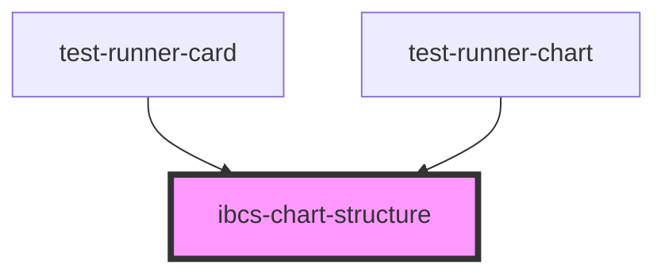

# ibcs-chart-structure

<!-- Auto Generated Below -->

## Properties

| Property             | Attribute              | Description | Type                                                                                                                                                                                              | Default                                                       |
| -------------------- | ---------------------- | ----------- | ------------------------------------------------------------------------------------------------------------------------------------------------------------------------------------------------- | ------------------------------------------------------------- |
| `chartTitle`         | `chart-title`          |             | `string`                                                                                                                                                                                          | `""`                                                          |
| `data`               | --                     |             | `IStructureChartDataRow[]`                                                                                                                                                                        | `[]`                                                          |
| `dataFormatDigits`   | --                     |             | `IDataFormatDigits`                                                                                                                                                                               | `{ percent: 2, decimal: 1 }`                                  |
| `filter`             | `filter`               |             | `string`                                                                                                                                                                                          | `""`                                                          |
| `hideCategories`     | `hide-categories`      |             | `boolean`                                                                                                                                                                                         | `false`                                                       |
| `i18n`               | --                     |             | `Map<string, string>`                                                                                                                                                                             | `new Map()`                                                   |
| `level`              | `level`                |             | `AggregationLevel.CATEGORY \| AggregationLevel.CATEGORYINDEX \| AggregationLevel.ROWGROUP \| AggregationLevel.ROWGROUPINDEX \| AggregationLevel.SUBCATEGORY \| AggregationLevel.SUBCATEGORYINDEX` | `AggregationLevel.CATEGORY`                                   |
| `limit`              | `limit`                |             | `number`                                                                                                                                                                                          | `0`                                                           |
| `measureScale`       | `measure-scale`        |             | `string`                                                                                                                                                                                          | `"_"`                                                         |
| `measureUnit`        | `measure-unit`         |             | `string`                                                                                                                                                                                          | `""`                                                          |
| `order`              | --                     |             | `IOrder`                                                                                                                                                                                          | `{     hierarchy: [],     direction: OrderDirection.ASC,   }` |
| `pixelPerPercentage` | `pixel-per-percentage` |             | `number`                                                                                                                                                                                          | `50`                                                          |
| `pixelPerUnit`       | `pixel-per-unit`       |             | `number`                                                                                                                                                                                          | `10`                                                          |
| `scenarios`          | --                     |             | `string[]`                                                                                                                                                                                        | `[]`                                                          |
| `showMeasureScale`   | `show-measure-scale`   |             | `boolean`                                                                                                                                                                                         | `true`                                                        |
| `styles`             | --                     |             | `IStructureChartStyles \| undefined`                                                                                                                                                              | `undefined`                                                   |
| `variances`          | --                     |             | `string[]`                                                                                                                                                                                        | `[]`                                                          |

## Dependencies

### Used by

 - [test-runner-card](../../test-runner)
 - [test-runner-chart](../../test-runner)

### Graph

----------------------------------------------

*Built with [StencilJS](https://stenciljs.com/)*
