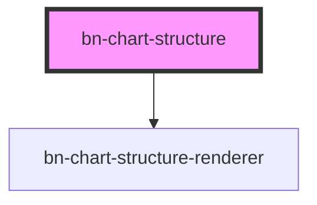

# bn-chart-structure

Categorical/structural horizontal bar chart following IBCS standards. Renders data by category as horizontal bars with support for up to 4 scenarios and unlimited variance sub-charts.

## Basic Usage

```html
<bn-chart-structure scenarios="ac1,pl1" variances="dac1_pl1_pos"></bn-chart-structure>
```

## Scenarios

```html
<!-- Actual vs Plan -->
<bn-chart-structure scenarios="ac1,pl1"></bn-chart-structure>

<!-- Auto-detect from dataset metadata -->
<bn-chart-structure scenarios="auto"></bn-chart-structure>
```

Available scenarios: `ac1`-`ac4`, `pp1`-`pp4`, `fc1`-`fc4`, `pl1`-`pl4`.

## Variances

Add variance sub-charts beside the main chart:

```html
<bn-chart-structure
  scenarios="ac1,pl1"
  variances="dac1_pl1_pos,drac1_pl1_pos">
</bn-chart-structure>
```

## Aggregation Level

```html
<bn-chart-structure level="category" scenarios="ac1"></bn-chart-structure>
<bn-chart-structure level="subcategory" scenarios="ac1"></bn-chart-structure>
<bn-chart-structure level="rowcategory" scenarios="ac1"></bn-chart-structure>
```

## Sorting

```html
<bn-chart-structure order="category" order-direction="asc" scenarios="ac1"></bn-chart-structure>
<bn-chart-structure order="ac1" order-direction="desc" scenarios="ac1"></bn-chart-structure>
```

## Stacking

Stack bars by scenario, or by the next lower level of the hierarchy:

```html
<bn-chart-structure
  scenarios="ac1"
  stack='{"by":"dimensions","mode":"absolute","order":"asc"}'>
</bn-chart-structure>
```

Stack config properties:
- `by`: `"scenarios"` (the scenarios of the `scenarios` attribute) or `"dimensions"` (the level below `level`, for example categories inside a row group)
- `mode`: `"absolute"`, `"relative"`, or `"absolute-relative"`
- `order`: `"asc"`, `"desc"`, or `"dataset"`

Negative values: positive segments stack outward from the axis on the positive
side, negative segments on the other side, and the total label shows the signed
sum (10, -4 and 6 give 12). In the relative modes the share of a segment is its
value divided by the sum of the absolute values of the stack, so a stack with
negative segments keeps its 100 % length but its shares do not add up to 100 %.

## Scaling

```html
<bn-chart-structure measure-scale="M" scenarios="ac1"></bn-chart-structure>
<bn-chart-structure scale="auto" scenarios="ac1"></bn-chart-structure>

<!-- Bar scale in data units per em: 1 em of bar = 1M units -->
<bn-chart-structure unit-scaling="1M" scenarios="ac1"></bn-chart-structure>

<!-- Shared scale across components -->
<bn-scaling-group name="revenue" value="1M"></bn-scaling-group>
<bn-chart-structure unit-scaling="revenue" scenarios="ac1"></bn-chart-structure>
```

See the [Scaling guide](../../../doc/scaling.md) for the full model.

## Full Example

```html
<bn-context locale="en">
  <bn-datasource name="regions_raw">
    [
      {"category":"North","ac1":250,"pl1":230},
      {"category":"South","ac1":180,"pl1":200},
      {"category":"East","ac1":120,"pl1":110},
      {"category":"West","ac1":95,"pl1":100}
    ]
  </bn-datasource>

  <bn-dataset name="regions" datasources="regions_raw">
    SELECT category, SUM(ac1) as ac1, SUM(pl1) as pl1 FROM regions_raw GROUP BY category
  </bn-dataset>

  <bn-page format="hd" orientation="landscape">
    <bn-body>
      <bn-chart-structure
        datasets="regions"
        scenarios="ac1,pl1"
        variances="dac1_pl1_pos"
        order="ac1"
        order-direction="desc">
      </bn-chart-structure>
    </bn-body>
  </bn-page>
</bn-context>
```

<!-- Auto Generated Below -->


## Overview

SVG structure (categorical) bar chart following IBCS standards.

Subscribes to a dataset (via `withDataset`) and renders horizontal bar
charts grouped by category, with up to four scenario layers, optional
variance sub-charts, stacking, and proportional auto-scaling (height-
based). The heavy SVG rendering is performed by the inner
`bn-chart-structure-renderer` element; this outer component validates props,
resolves auto-detected metadata, and computes styles.

## Properties

| Property                         | Attribute                    | Description                                                                                                                                                                                                                                                                                                                                                                                                                                                                                                                                                                                                                                                                                                                                                                                                                                                                                                                                                                                                                                                                                                                                                                                                                                                                                                          | Type                                     | Default      |
| -------------------------------- | ---------------------------- | -------------------------------------------------------------------------------------------------------------------------------------------------------------------------------------------------------------------------------------------------------------------------------------------------------------------------------------------------------------------------------------------------------------------------------------------------------------------------------------------------------------------------------------------------------------------------------------------------------------------------------------------------------------------------------------------------------------------------------------------------------------------------------------------------------------------------------------------------------------------------------------------------------------------------------------------------------------------------------------------------------------------------------------------------------------------------------------------------------------------------------------------------------------------------------------------------------------------------------------------------------------------------------------------------------------------- | ---------------------------------------- | ------------ |
| `chartTitle`                     | `chart-title`                | Title displayed above the chart. When empty, the title is derived from the variance scenario labels (if variances are configured).                                                                                                                                                                                                                                                                                                                                                                                                                                                                                                                                                                                                                                                                                                                                                                                                                                                                                                                                                                                                                                                                                                                                                                                   | `string`                                 | `""`         |
| `dataFormatDigitsDecimal`        | `data-format-digits-decimal` | Number of decimal digits of the value labels                                                                                                                                                                                                                                                                                                                                                                                                                                                                                                                                                                                                                                                                                                                                                                                                                                                                                                                                                                                                                                                                                                                                                                                                                                                                         | `number`                                 | `1`          |
| `dataFormatDigitsPercent`        | `data-format-digits-percent` | Number of decimal digits of the percent labels (relative variances, shares of a 100 % stack)                                                                                                                                                                                                                                                                                                                                                                                                                                                                                                                                                                                                                                                                                                                                                                                                                                                                                                                                                                                                                                                                                                                                                                                                                         | `number`                                 | `2`          |
| `dataFormatPercentSign`          | `data-format-percent-sign`   | `false` prints the labels of relative variances without the percent sign (`+22`).                                                                                                                                                                                                                                                                                                                                                                                                                                                                                                                                                                                                                                                                                                                                                                                                                                                                                                                                                                                                                                                                                                                                                                                                                                    | `boolean`                                | `true`       |
| `datasets`                       | `datasets`                   | Name of the dataset to render (the `name` of a `<bn-dataset>`). A name that starts with `$` reads a `<bn-datasource>` directly, which gives a warning.                                                                                                                                                                                                                                                                                                                                                                                                                                                                                                                                                                                                                                                                                                                                                                                                                                                                                                                                                                                                                                                                                                                                                               | `string`                                 | `undefined`  |
| `filter`                         | `filter`                     | AlaSQL WHERE clause fragment injected into the data query to filter rows before rendering.                                                                                                                                                                                                                                                                                                                                                                                                                                                                                                                                                                                                                                                                                                                                                                                                                                                                                                                                                                                                                                                                                                                                                                                                                           | `string`                                 | `""`         |
| `i18nNamespace`                  | `i18n-namespace`             | Namespace of the translations to use (the `namespace` of a `<bn-internationalization>`). Without it the component takes the `i18n-namespace` of the nearest ancestor that has one, then the built-in texts.                                                                                                                                                                                                                                                                                                                                                                                                                                                                                                                                                                                                                                                                                                                                                                                                                                                                                                                                                                                                                                                                                                          | `string`                                 | `undefined`  |
| `italicCategories`               | `italic-categories`          | Rows that are printed in italics, as a JSON array of values of the level column, for example the rest rows.                                                                                                                                                                                                                                                                                                                                                                                                                                                                                                                                                                                                                                                                                                                                                                                                                                                                                                                                                                                                                                                                                                                                                                                                          | `string`                                 | `""`         |
| `level` _(required)_             | `level`                      | Aggregation level that determines which hierarchy dimension each bar represents.  \| Value              \| Bars represent            \| \|--------------------\|---------------------------\| \| `"rowGroup"`       \| Row groups                \| \| `"rowGroupIndex"`  \| Row groups (dataset order)\| \| `"category"`       \| Categories                \| \| `"categoryIndex"`  \| Categories (dataset order)\| \| `"subCategory"`    \| Sub-categories            \| \| `"subCategoryIndex"` \| Sub-categories (dataset order)\| \| `"auto"`           \| Auto-detect from dataset metadata (no warning) \| \| not set / `""`     \| Auto-detect with `AUTO_level` warning          \|  Index variants preserve the original dataset order instead of sorting alphabetically. When `stack.by` is `"dimensions"`, the chart automatically stacks by the next-lower level (e.g. level `"rowGroup"` stacks by category).                                                                                                                                                                                                                                                                                                                                                                                         | `string`                                 | `undefined`  |
| `limit`                          | `limit`                      | Maximum number of bars to display. Excess rows are aggregated into a "REST" summary bar. `0` means no limit (all rows are shown).                                                                                                                                                                                                                                                                                                                                                                                                                                                                                                                                                                                                                                                                                                                                                                                                                                                                                                                                                                                                                                                                                                                                                                                    | `number`                                 | `0`          |
| `measureScale`                   | `measure-scale`              | SI prefix applied to data values, dividing them for display (e.g. `"k"` divides by 1 000, showing 14 000 as "14").  Common prefixes: `"k"` (×10³), `"M"` (×10⁶), `"G"` (×10⁹), `"T"` (×10¹²). Use `"_"` for no prefix (raw values).  \| Special value \| Behavior                                                     \| \|---------------\|--------------------------------------------------------------\| \| `"GREATEST"`  \| Auto-select prefix based on the largest value in the dataset \| \| `"LEAST"`     \| Auto-select prefix based on the smallest value               \|  The selected prefix is shown in the chart footer when `show-measure-scale` is enabled.                                                                                                                                                                                                                                                                                                                                                                                                                                                                                                                                                                                                                                         | `string`                                 | `"greatest"` |
| `measureUnit`                    | `measure-unit`               | Unit label displayed alongside the SI prefix in the chart footer (e.g. "EUR", "USD", "pcs"). Only visible when `show-measure-scale` is on.                                                                                                                                                                                                                                                                                                                                                                                                                                                                                                                                                                                                                                                                                                                                                                                                                                                                                                                                                                                                                                                                                                                                                                           | `string`                                 | `""`         |
| `order` _(required)_             | `order`                      | Comma-separated list of columns that define the sort order of bars. When ordering by a scenario column, that scenario must also be listed in `scenarios`.  Valid values: `category`, `categoryIndex`, `rowGroup`, `rowGroupIndex`, `subCategory`, `subCategoryIndex`, `ac1`-`ac4`, `fc1`-`fc4`, `pp1`-`pp4`, `pl1`-`pl4`, and a variance like `dac1_pp1` or `drac1_pp1` (its scenarios need not be in `scenarios`). A variance sorts before the other columns of the list. A row with the category `REST` stays last under every order.  \| Value          \| Behavior                                            \| \|----------------\|-----------------------------------------------------\| \| `"ac1"`        \| Sort bars by the ac1 scenario values                \| \| `"category"`   \| Sort bars alphabetically by category name           \| \| `"auto"`       \| Auto-detect from dataset metadata (no warning)      \| \| not set / `""` \| Auto-detect with `AUTO_order` warning               \|                                                                                                                                                                                                                                                                                                     | `string`                                 | `undefined`  |
| `orderDirection` _(required)_    | `order-direction`            | Sort direction applied to the columns specified in `order`.  Values: `"asc"` (ascending) \| `"desc"` (descending).                                                                                                                                                                                                                                                                                                                                                                                                                                                                                                                                                                                                                                                                                                                                                                                                                                                                                                                                                                                                                                                                                                                                                                                                   | `string`                                 | `undefined`  |
| `orderMark`                      | `order-mark`                 | Marks the column the rows are sorted by with an arrow: beside the name of the scenario, or beside the title of the variance, that comes first in `order`. No mark for an order by a dimension, and none with `stack`.                                                                                                                                                                                                                                                                                                                                                                                                                                                                                                                                                                                                                                                                                                                                                                                                                                                                                                                                                                                                                                                                                                | `boolean`                                | `false`      |
| `percentageScaling` _(required)_ | `percentage-scaling`         | Percentage points displayed per 1 em of bar length for relative variances - a larger value means shorter bars.  \| Value             \| Behavior                                                      \| \|-------------------\|---------------------------------------------------------------\| \| `"auto"`          \| Auto-fit to available width                                   \| \| not set / invalid \| Same as auto with `AUTO_percentageScaling` warning            \| \| `"10"`, `"2.5"`   \| Percentage points per em; optional SI suffix `k`/`K`/`M`/`G`/`T` \| \| group name        \| References a `<bn-scaling-group>` for synchronized scaling    \|                                                                                                                                                                                                                                                                                                                                                                                                                                                                                                                                                                                                                                             | `number \| string`                       | `undefined`  |
| `referenceLine`                  | `reference-line`             | A line across the bars at one value of the axis, as a JSON string: `value` and an optional `label`. In a 100 % stack the value is a percent.                                                                                                                                                                                                                                                                                                                                                                                                                                                                                                                                                                                                                                                                                                                                                                                                                                                                                                                                                                                                                                                                                                                                                                         | `string`                                 | `""`         |
| `rowLines`                       | `row-lines`                  | Draws thin lines between the rows, over all segments of the chart. A number is a line after every n-th row (`row-lines="5"`). A list is a line after each of these rows, counted from the first row (`row-lines="4,9,14"`, or a JSON array). The count starts again behind a sum row. Default: no lines.                                                                                                                                                                                                                                                                                                                                                                                                                                                                                                                                                                                                                                                                                                                                                                                                                                                                                                                                                                                                             | `number \| string`                       | `0`          |
| `ruleset`                        | `ruleset`                    | Name of a registered IBCS rule set (see `bn-ruleset`) used for scenario ordering, look and names. Supports `"inherited-closest"` / `"inherited-page"` to take over the value from an ancestor `bn-layout-card` / `bn-layout-page`.                                                                                                                                                                                                                                                                                                                                                                                                                                                                                                                                                                                                                                                                                                                                                                                                                                                                                                                                                                                                                                                                                   | `string`                                 | `undefined`  |
| `scale`                          | `scale`                      | Controls proportional scaling of the chart to fit the available parent height.  \| Value               \| Behavior                                                                          \| \|---------------------\|-----------------------------------------------------------------------------------\| \| not set / `""`      \| Auto-scale to fit parent height; emit `AUTO_scale` warning with the applied factor \| \| `"none"`            \| No scaling (render at base font size regardless of available space)                \| \| `"auto"`            \| Auto-scale to fit parent height silently (no warning)                             \| \| `"0.5"`, `"1.2"`, … \| Fixed factor - apply `baseFontSize × factor`                                      \|                                                                                                                                                                                                                                                                                                                                                                                                                                                                                                                                          | `string`                                 | `undefined`  |
| `scenarioLabelPosition`          | `scenario-label-position`    | Where the name of the scenario of a chart with plain bars stands: `bottom` below the last bar, `top` above the first one.                                                                                                                                                                                                                                                                                                                                                                                                                                                                                                                                                                                                                                                                                                                                                                                                                                                                                                                                                                                                                                                                                                                                                                                            | `"bottom" \| "top"`                      | `"bottom"`   |
| `scenarios` _(required)_         | `scenarios`                  | Comma-separated list of scenario columns to display as bars. Up to 4 scenarios are supported; additional values are ignored.  Valid scenario names: `ac1`-`ac4`, `fc1`-`fc4`, `pp1`-`pp4`, `pl1`-`pl4`.  \| Value         \| Behavior                                                    \| \|---------------\|-------------------------------------------------------------\| \| `"ac1,fc1"`   \| Show the listed scenarios                                   \| \| `"auto"`      \| Auto-detect from dataset metadata (no warning)              \| \| not set / `""` \| Auto-detect from dataset metadata (emits `AUTO_scenarios` warning) \| \| `"none"`      \| Draw no scenario: the chart shows only its variances, the first one carries the categories \|                                                                                                                                                                                                                                                                                                                                                                                                                                                                                                                                                    | `string`                                 | `undefined`  |
| `selectedStyle`                  | `selected-style`             | Name of the component style to use (the `name` of a `<bn-component-style>`). Its values go on top of the default style.                                                                                                                                                                                                                                                                                                                                                                                                                                                                                                                                                                                                                                                                                                                                                                                                                                                                                                                                                                                                                                                                                                                                                                                              | `string`                                 | `undefined`  |
| `showCategories`                 | `show-categories`            | Whether to display category labels on the left side of the chart.                                                                                                                                                                                                                                                                                                                                                                                                                                                                                                                                                                                                                                                                                                                                                                                                                                                                                                                                                                                                                                                                                                                                                                                                                                                    | `boolean`                                | `true`       |
| `showMeasureScale`               | `show-measure-scale`         | Toggles display of the SI prefix and unit label in the chart footer (e.g. "k EUR").                                                                                                                                                                                                                                                                                                                                                                                                                                                                                                                                                                                                                                                                                                                                                                                                                                                                                                                                                                                                                                                                                                                                                                                                                                  | `boolean`                                | `false`      |
| `stack`                          | `stack`                      | Stacking configuration as a JSON string. When set, bars are drawn as stacked segments instead of side-by-side.  **Properties:**  \| Key     \| Values                                        \| Description                                        \| \|---------\|-----------------------------------------------\|----------------------------------------------------\| \| `by`    \| `"scenarios"` \\| `"dimensions"`               \| **Required.** What to stack.                       \| \| `mode`  \| `"absolute"` \\| `"relative"` \\| `"absolute-relative"` \| Stacking mode. Default: `"absolute"`.        \| \| `order` \| `"asc"` \\| `"desc"` \\| `"dataset"`           \| Segment sort order. Default: `"dataset"`.          \|  - `by: "scenarios"` - stacks the scenarios listed in the `scenarios` prop end-to-end. - `by: "dimensions"` - stacks by the next-lower hierarchy level derived from `level`   (e.g. level `"rowGroup"` stacks by category). Only the first scenario is used;   extra scenarios trigger a `WARN_stack_dimensions_scenarios` warning. - `mode: "relative"` - normalizes each bar to 100%, showing proportions. - `mode: "absolute-relative"` - absolute bars with percentage labels.  Segment colors are configurable via the `stackColors` array in component styles. | `string`                                 | `""`         |
| `sumDataset`                     | `sum-dataset`                | Name of a dataset with the values of the total row: the scenario columns, in one row or added up over its rows. The chart then computes no total. Every scenario column that the chart does not draw is shown at the total only, and `sum-scenarios` limits them.                                                                                                                                                                                                                                                                                                                                                                                                                                                                                                                                                                                                                                                                                                                                                                                                                                                                                                                                                                                                                                                    | `string`                                 | `""`         |
| `sumScenarios`                   | `sum-scenarios`              | Scenarios that are shown at the total row only, comma separated, for example `pl1`. The chart adds them up from its dataset. Such a scenario must not be in `scenarios`. Needs `sums` with a total row. In a bridge it is a bar above the reference total, and its variance to the total of the series is a thin bar below the variance of the total. Else its value stands in the total row with the others.                                                                                                                                                                                                                                                                                                                                                                                                                                                                                                                                                                                                                                                                                                                                                                                                                                                                                                        | `string`                                 | `""`         |
| `sumTitle`                       | `sum-title`                  | Label of the sum row over all rows.                                                                                                                                                                                                                                                                                                                                                                                                                                                                                                                                                                                                                                                                                                                                                                                                                                                                                                                                                                                                                                                                                                                                                                                                                                                                                  | `string`                                 | `""`         |
| `sums`                           | `sums`                       | Sum rows. `groups` adds a row below the rows of each `rowGroup` (level `category`), `total` a row over all rows, `all` both. A sum row has no bar: it prints the sum in bold, in a stack one number per series with a small square in the colour of the series. In a 100 % stack it is a bar of shares. A sum row does not count for the scale.                                                                                                                                                                                                                                                                                                                                                                                                                                                                                                                                                                                                                                                                                                                                                                                                                                                                                                                                                                      | `"all" \| "groups" \| "none" \| "total"` | `"none"`     |
| `unitScaling` _(required)_       | `unit-scaling`               | Data units displayed per 1 em of bar length (horizontal bars) - map-scale semantics: a larger value means smaller bars.  \| Value              \| Behavior                                                    \| \|--------------------\|-------------------------------------------------------------\| \| `"auto"`           \| Auto-fit bars to fill the available container width         \| \| not set / invalid  \| Same as auto, but emits `AUTO_unitScaling` warning          \| \| `"250000"`, `"1M"` \| Units per em; optional SI suffix `k`/`K`/`M`/`G`/`T`        \| \| group name         \| References a `<bn-scaling-group>` for synchronized scaling  \|  When using a custom value that causes the chart to exceed its container, an `ERR_overflow` error is emitted.                                                                                                                                                                                                                                                                                                                                                                                                                                                                                                                               | `number \| string`                       | `undefined`  |
| `valueSuffix`                    | `value-suffix`               | Text printed right after every value label, for example a unit that IBCS repeats in each row. Variance labels do not get it.                                                                                                                                                                                                                                                                                                                                                                                                                                                                                                                                                                                                                                                                                                                                                                                                                                                                                                                                                                                                                                                                                                                                                                                         | `string`                                 | `""`         |
| `varianceWaterfall`              | `variance-waterfall`         | Draws each absolute variance as a walk down the rows: a bar starts where the bar of the row before ended, and thin lines join them. A sum row is a bar from the axis, and the rows after the sum row of a group start again. Relative variances stay pins. With `sums="total"` and a fixed `unit-scaling` the first absolute variance becomes a bridge in the base chart: the reference total is a bar above the first row, the total of the series a bar below the last one, both at the scale of the rows, the walk runs between their ends, and the variance of the total is a thin bar below the total row. No effect with `stack`.                                                                                                                                                                                                                                                                                                                                                                                                                                                                                                                                                                                                                                                                              | `boolean`                                | `false`      |
| `variances` _(required)_         | `variances`                  | Comma-separated list of variance definitions. Each variance adds a separate sub-chart next to the main bar chart.  **Pattern:** `d<base>_<comparison>_<sentiment>` (absolute) or `dr<base>_<comparison>_<sentiment>` (relative / percentage).  - `base` / `comparison`: scenario names that must also appear in `scenarios`. - `sentiment`: `pos` (positive is good), `neg` (negative is good), `neu` (neutral).   `op` acts like `pos` and `opinv` like `neg`, because chart values carry their operation sign.  When empty, no variance charts are shown.                                                                                                                                                                                                                                                                                                                                                                                                                                                                                                                                                                                                                                                                                                                                                          | `string`                                 | `undefined`  |


## Methods

### `getBaseline() => Promise<Baseline>`

The line this chart wants to be aligned on, in CSS px from the host's
top-left corner. The vertical value axis of the base segment gives `x` and its top end `y`. Empty before the chart has drawn.

#### Returns

Type: `Promise<Baseline>`


### `getLayoutState(options?: LayoutStateOptions) => Promise<ComponentLayoutState>`

Lazily generates this chart's layout state: host box (context- and
component-relative, CSS px), one `canvas:<segment>` region per rendered
segment (base + variances), metadata (scenarios, bar count), diagnostics
and resolved scaling. With `detail: "full"` every bar, label and axis of
every segment is listed with its geometry.

#### Parameters

| Name      | Type                 | Description                                              |
| --------- | -------------------- | -------------------------------------------------------- |
| `options` | `LayoutStateOptions` | - `{ detail: "summary" \| "full" }`, default `"summary"` |

#### Returns

Type: `Promise<ComponentLayoutState>`


## Dependencies

### Depends on

- bn-chart-structure-renderer

### Graph


----------------------------------------------

developed by Bino Bi
