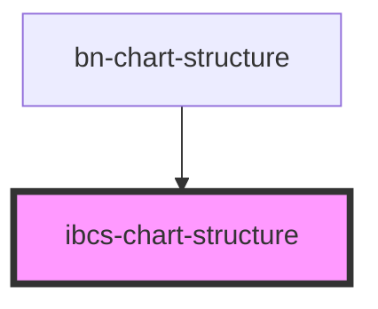

# bn-chart-structure

Categorical/structural horizontal bar chart following IBCS standards. Renders data by category as horizontal bars with support for up to 4 scenarios and unlimited variance sub-charts.

## Basic Usage

```html
<bn-chart-structure scenarios="ac1,pl1" variances="dac1_pl1_pos"></bn-chart-structure>
```

## Scenarios

```html
<!-- Actual vs Plan -->
<bn-chart-structure scenarios="ac1,pl1"></bn-chart-structure>

<!-- Auto-detect from dataset metadata -->
<bn-chart-structure scenarios="auto"></bn-chart-structure>
```

Available scenarios: `ac1`-`ac4`, `pp1`-`pp4`, `fc1`-`fc4`, `pl1`-`pl4`.

## Variances

Add variance sub-charts beside the main chart:

```html
<bn-chart-structure
  scenarios="ac1,pl1"
  variances="dac1_pl1_pos,drac1_pl1_pos">
</bn-chart-structure>
```

## Aggregation Level

```html
<bn-chart-structure level="category" scenarios="ac1"></bn-chart-structure>
<bn-chart-structure level="subcategory" scenarios="ac1"></bn-chart-structure>
<bn-chart-structure level="rowcategory" scenarios="ac1"></bn-chart-structure>
```

## Sorting

```html
<bn-chart-structure order="category" order-direction="asc" scenarios="ac1"></bn-chart-structure>
<bn-chart-structure order="ac1" order-direction="desc" scenarios="ac1"></bn-chart-structure>
```

## Stacking

Stack bars by scenario, category, subcategory, or row group:

```html
<bn-chart-structure
  scenarios="ac1"
  stack='{"by":"category","mode":"absolute","order":"asc"}'>
</bn-chart-structure>
```

Stack config properties:
- `by`: `"scenario"`, `"category"`, `"subcategory"`, or `"rowgroup"`
- `mode`: `"absolute"`, `"relative"`, or `"absolute-relative"`
- `order`: `"asc"`, `"desc"`, or `"dataset"`

## Scaling

```html
<bn-chart-structure measure-scale="M" scenarios="ac1"></bn-chart-structure>
<bn-chart-structure scale="auto" scenarios="ac1"></bn-chart-structure>

<!-- Bar scale in data units per em: 1 em of bar = 1M units -->
<bn-chart-structure unit-scaling="1M" scenarios="ac1"></bn-chart-structure>

<!-- Shared scale across components -->
<bn-scaling-group name="revenue" value="1M"></bn-scaling-group>
<bn-chart-structure unit-scaling="revenue" scenarios="ac1"></bn-chart-structure>
```

See the [Scaling guide](../../../doc/scaling.md) for the full model.

## Full Example

```html
<bn-context locale="en">
  <bn-datasource name="regions">
    [
      {"category":"North","ac1":250,"pl1":230},
      {"category":"South","ac1":180,"pl1":200},
      {"category":"East","ac1":120,"pl1":110},
      {"category":"West","ac1":95,"pl1":100}
    ]
  </bn-datasource>

  <bn-dataset name="regions" datasources="regions">
    SELECT category, SUM(ac1) as ac1, SUM(pl1) as pl1 FROM regions GROUP BY category
  </bn-dataset>

  <bn-page format="hd" orientation="landscape">
    <bn-body>
      <bn-chart-structure
        scenarios="ac1,pl1"
        variances="dac1_pl1_pos"
        order="ac1"
        order-direction="desc">
      </bn-chart-structure>
    </bn-body>
  </bn-page>
</bn-context>
```

<!-- Auto Generated Below -->


## Properties

| Property             | Attribute              | Description                                                                                                                                                                                                                                     | Type                                                                                                                                                                                              | Default                                                       |
| -------------------- | ---------------------- | ----------------------------------------------------------------------------------------------------------------------------------------------------------------------------------------------------------------------------------------------- | ------------------------------------------------------------------------------------------------------------------------------------------------------------------------------------------------- | ------------------------------------------------------------- |
| `chartTitle`         | `chart-title`          |                                                                                                                                                                                                                                                 | `string`                                                                                                                                                                                          | `""`                                                          |
| `dataFormatDigits`   | --                     |                                                                                                                                                                                                                                                 | `DataFormatDigits`                                                                                                                                                                                | `{ percent: 2, decimal: 1 }`                                  |
| `dataVersion`        | `data-version`         | Bumped by `bn-chart-structure` when the dataset changes; triggers re-render.                                                                                                                                                                    | `number`                                                                                                                                                                                          | `0`                                                           |
| `filter`             | `filter`               |                                                                                                                                                                                                                                                 | `string`                                                                                                                                                                                          | `""`                                                          |
| `hideCategories`     | `hide-categories`      |                                                                                                                                                                                                                                                 | `boolean`                                                                                                                                                                                         | `false`                                                       |
| `i18n`               | --                     |                                                                                                                                                                                                                                                 | `Map<string, string>`                                                                                                                                                                             | `new Map()`                                                   |
| `level`              | `level`                |                                                                                                                                                                                                                                                 | `AggregationLevel.CATEGORY \| AggregationLevel.CATEGORYINDEX \| AggregationLevel.ROWGROUP \| AggregationLevel.ROWGROUPINDEX \| AggregationLevel.SUBCATEGORY \| AggregationLevel.SUBCATEGORYINDEX` | `AggregationLevel.CATEGORY`                                   |
| `limit`              | `limit`                |                                                                                                                                                                                                                                                 | `number`                                                                                                                                                                                          | `0`                                                           |
| `measureScale`       | `measure-scale`        |                                                                                                                                                                                                                                                 | `string`                                                                                                                                                                                          | `"_"`                                                         |
| `measureUnit`        | `measure-unit`         |                                                                                                                                                                                                                                                 | `string`                                                                                                                                                                                          | `""`                                                          |
| `order`              | --                     |                                                                                                                                                                                                                                                 | `Order`                                                                                                                                                                                           | `{     hierarchy: [],     direction: OrderDirection.ASC,   }` |
| `parentDimensions`   | --                     |                                                                                                                                                                                                                                                 | `ParentDimensions`                                                                                                                                                                                | `{ width: 0, height: 0 }`                                     |
| `pixelPerPercentage` | `pixel-per-percentage` |                                                                                                                                                                                                                                                 | `number`                                                                                                                                                                                          | `50`                                                          |
| `pixelPerUnit`       | `pixel-per-unit`       |                                                                                                                                                                                                                                                 | `number`                                                                                                                                                                                          | `10`                                                          |
| `reportAutoScaling`  | --                     | Internal wrapper channel: called with the auto-fitted values (px for one data unit / px per 1.0 fraction) whenever one of them was auto-resolved, so the outer `bn-chart-structure` can surface them in its AUTO_* warnings. Not for end users. | `(report: AutoScalingReport) => void`                                                                                                                                                             | `undefined`                                                   |
| `ruleSetConfig`      | --                     |                                                                                                                                                                                                                                                 | `RuleSetConfig`                                                                                                                                                                                   | `undefined`                                                   |
| `scenarios`          | --                     |                                                                                                                                                                                                                                                 | `string[]`                                                                                                                                                                                        | `[]`                                                          |
| `showMeasureScale`   | `show-measure-scale`   |                                                                                                                                                                                                                                                 | `boolean`                                                                                                                                                                                         | `true`                                                        |
| `stackConfig`        | --                     |                                                                                                                                                                                                                                                 | `StackConfigParsed`                                                                                                                                                                               | `null`                                                        |
| `styles`             | --                     |                                                                                                                                                                                                                                                 | `StructureChartStyle`                                                                                                                                                                             | `undefined`                                                   |
| `tableName`          | `table-name`           | Name of the dataset (table or view in the shared alasql database).                                                                                                                                                                              | `string`                                                                                                                                                                                          | `""`                                                          |
| `variances`          | --                     |                                                                                                                                                                                                                                                 | `string[]`                                                                                                                                                                                        | `[]`                                                          |


## Dependencies

### Used by

 - [bn-chart-structure](.)

### Graph


----------------------------------------------

developed by Bino Bi
