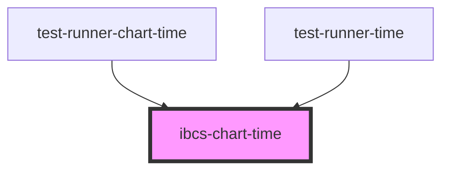

# ibcs-chart-structure

<!-- Auto Generated Below -->

## Properties

| Property                          | Attribute                              | Description | Type                                                                                                                                                                                                                                                | Default                                                       |
| --------------------------------- | -------------------------------------- | ----------- | --------------------------------------------------------------------------------------------------------------------------------------------------------------------------------------------------------------------------------------------------- | ------------------------------------------------------------- |
| `axisLabelsMode`                  | `axis-labels-mode`                     |             | `AxisLabelsMode.LONG \| AxisLabelsMode.SHORT \| AxisLabelsMode.SMART`                                                                                                                                                                               | `AxisLabelsMode.SMART`                                        |
| `chartTitle`                      | `chart-title`                          |             | `string \| undefined`                                                                                                                                                                                                                               | `undefined`                                                   |
| `data`                            | --                                     |             | `ITimeChartDataRow[]`                                                                                                                                                                                                                               | `[]`                                                          |
| `dataFormatDigits`                | --                                     |             | `IDataFormatDigits`                                                                                                                                                                                                                                 | `{ percent: 2, decimal: 1 }`                                  |
| `dateInterval`                    | `date-interval`                        |             | `DateDistance.AUTO \| DateDistance.DAY \| DateDistance.HOUR \| DateDistance.MILLISECOND \| DateDistance.MINUTE \| DateDistance.MONTH \| DateDistance.NONE \| DateDistance.QUARTER \| DateDistance.SECOND \| DateDistance.WEEK \| DateDistance.YEAR` | `DateDistance.AUTO`                                           |
| `filter`                          | `filter`                               |             | `string`                                                                                                                                                                                                                                            | `""`                                                          |
| `hideAxisLabels`                  | `hide-axis-labels`                     |             | `boolean`                                                                                                                                                                                                                                           | `false`                                                       |
| `i18n`                            | --                                     |             | `Map<string, string>`                                                                                                                                                                                                                               | `new Map()`                                                   |
| `intervalSpanLimit`               | `interval-span-limit`                  |             | `number`                                                                                                                                                                                                                                            | `28`                                                          |
| `leftSideOffsetForHorizontalSync` | `left-side-offset-for-horizontal-sync` |             | `number`                                                                                                                                                                                                                                            | `-1`                                                          |
| `level`                           | `level`                                |             | `AggregationLevel.CATEGORY \| AggregationLevel.CATEGORYINDEX \| AggregationLevel.ROWGROUP \| AggregationLevel.ROWGROUPINDEX \| AggregationLevel.SUBCATEGORY \| AggregationLevel.SUBCATEGORYINDEX`                                                   | `AggregationLevel.CATEGORY`                                   |
| `limit`                           | `limit`                                |             | `number`                                                                                                                                                                                                                                            | `0`                                                           |
| `measureScale`                    | `measure-scale`                        |             | `string`                                                                                                                                                                                                                                            | `"_"`                                                         |
| `measureUnit`                     | `measure-unit`                         |             | `string`                                                                                                                                                                                                                                            | `""`                                                          |
| `order`                           | --                                     |             | `IOrder`                                                                                                                                                                                                                                            | `{     hierarchy: [],     direction: OrderDirection.ASC,   }` |
| `pixelPerPercentage`              | `pixel-per-percentage`                 |             | `number`                                                                                                                                                                                                                                            | `50`                                                          |
| `pixelPerUnit`                    | `pixel-per-unit`                       |             | `number`                                                                                                                                                                                                                                            | `2`                                                           |
| `scenarios`                       | --                                     |             | `string[]`                                                                                                                                                                                                                                          | `[]`                                                          |
| `showMeasureScale`                | `show-measure-scale`                   |             | `boolean`                                                                                                                                                                                                                                           | `true`                                                        |
| `styles`                          | --                                     |             | `ITimeChartStyles \| undefined`                                                                                                                                                                                                                     | `undefined`                                                   |
| `variances`                       | --                                     |             | `string[]`                                                                                                                                                                                                                                          | `[]`                                                          |

## Dependencies

### Used by

 - [test-runner-chart-time](../../test-runner)
 - [test-runner-time](../../test-runner)

### Graph

----------------------------------------------

*Built with [StencilJS](https://stenciljs.com/)*
