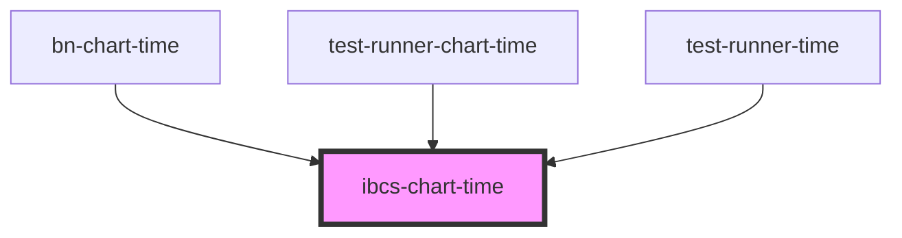

# bn-chart-time

**bn-chart-time**  is a report element and renderes data as time-chart.
It supports the main chart with up to 4 scenarios and additonal variance charts (unlimited)

The **bn-chart-time** can be used within the bn-content element

## Mixins
@withStyle
@withComponentStatus
@withDataset
@withTranslation

**Example**
```html
 <bn-body>
      <bn-chart-time
        internationalisation = null
        internationalisationMode = 'meta'
        level='category'
        order='category'
        order-direction='asc'
        scenarios='ac1,py1'
        styles=''
        unit-scaling='10'
        datasets="$marktwert"
      >
      </bn-chart-time>
</bn-body>
```
**Output**


**Custom BinoChartSyles Example**
```json
     {
      "scaleFactors": {
        barWidthYOffset: 0.95,
        fontNettoHeight: 0.7,
        needleWidthOffset: 0.7,
        barHeightOffset: 0.4,
        barWidthOffset: 0.3,
        pt2Px: 1.2,
        axisWidth: 0.1,
        rowHeight: 1.8,
      },
      "fontStyles": {
        font: "16px Calibri",
        size: 16,
        color: "#000000",
        backgroud: "#ffffff",
        leading: 1.8,
      },
      "axisStyles": {
        ac: {stroke: "#121212", fill: "#121212", width: 0.1},
        fc: {stroke: "#121212", fill: "#ffffff", width: 0.1, "dasharray": "10 5 5 5"},
        pp: {stroke: "#606060", fill: "#606060", width: 0.1},
        pl: {stroke: "#121212", fill: "#ffffff", width: 0.1},
      },
      "barStyles": {
        ac: {stroke: "#121212", fill: "#121212", width: 0.1},
        fc: {stroke: "#121212", fill: "#ffffff", width: 0.5, fillpattern: "fc"},
        pp: {stroke: "#606060", fill: "#606060", width: 0.1},
        pl: {stroke: "#121212", fill: "#ffffff", width: 0.1},
      },
      "varianceStyles": {
        pos: {stroke: "#AAFF00", fill: "#AAFF00", width: 0.1},
        neg: {stroke: "#FF0A0A", fill: "#FF0A0A", width: 0.1},
      },
      "padding": {
        top: 10,
        left: 10,
        right: 10,
        bottom: 10,
      },
      "pattern": new Map([["marker-up", {foreground: "", background: "", bgOffset: 0}],
        ["marker-down", {foreground: "", background: "", bgOffset: 0}]]),
    }
```
<!-- Auto Generated Below -->


## Properties

| Property                          | Attribute                              | Description | Type                                                                                                                                                                                                                                                | Default                                                       |
| --------------------------------- | -------------------------------------- | ----------- | --------------------------------------------------------------------------------------------------------------------------------------------------------------------------------------------------------------------------------------------------- | ------------------------------------------------------------- |
| `axisLabelsMode`                  | `axis-labels-mode`                     |             | `AxisLabelsMode.LONG \| AxisLabelsMode.SHORT \| AxisLabelsMode.SMART`                                                                                                                                                                               | `AxisLabelsMode.SMART`                                        |
| `chartMode`                       | `chart-mode`                           |             | `ChartMode.AUTO \| ChartMode.BAR \| ChartMode.LINE`                                                                                                                                                                                                 | `ChartMode.BAR`                                               |
| `chartTitle`                      | `chart-title`                          |             | `string`                                                                                                                                                                                                                                            | `undefined`                                                   |
| `containerWidth`                  | `container-width`                      |             | `number`                                                                                                                                                                                                                                            | `0`                                                           |
| `data`                            | --                                     |             | `TimeChartDataRow[]`                                                                                                                                                                                                                                | `[]`                                                          |
| `dataFormatDigits`                | --                                     |             | `DataFormatDigits`                                                                                                                                                                                                                                  | `{ percent: 2, decimal: 1 }`                                  |
| `dateInterval`                    | `date-interval`                        |             | `DateDistance.AUTO \| DateDistance.DAY \| DateDistance.HOUR \| DateDistance.MILLISECOND \| DateDistance.MINUTE \| DateDistance.MONTH \| DateDistance.NONE \| DateDistance.QUARTER \| DateDistance.SECOND \| DateDistance.WEEK \| DateDistance.YEAR` | `DateDistance.AUTO`                                           |
| `filter`                          | `filter`                               |             | `string`                                                                                                                                                                                                                                            | `""`                                                          |
| `hideAxisLabels`                  | `hide-axis-labels`                     |             | `boolean`                                                                                                                                                                                                                                           | `false`                                                       |
| `i18n`                            | --                                     |             | `Map<string, string>`                                                                                                                                                                                                                               | `new Map()`                                                   |
| `intervalSpanLimit`               | `interval-span-limit`                  |             | `number`                                                                                                                                                                                                                                            | `28`                                                          |
| `leftSideOffsetForHorizontalSync` | `left-side-offset-for-horizontal-sync` |             | `number`                                                                                                                                                                                                                                            | `-1`                                                          |
| `level`                           | `level`                                |             | `AggregationLevel.CATEGORY \| AggregationLevel.CATEGORYINDEX \| AggregationLevel.ROWGROUP \| AggregationLevel.ROWGROUPINDEX \| AggregationLevel.SUBCATEGORY \| AggregationLevel.SUBCATEGORYINDEX`                                                   | `AggregationLevel.CATEGORY`                                   |
| `limit`                           | `limit`                                |             | `number`                                                                                                                                                                                                                                            | `0`                                                           |
| `lineFullWidth`                   | `line-full-width`                      |             | `boolean`                                                                                                                                                                                                                                           | `true`                                                        |
| `maxBars`                         | `max-bars`                             |             | `number`                                                                                                                                                                                                                                            | `28`                                                          |
| `measureScale`                    | `measure-scale`                        |             | `string`                                                                                                                                                                                                                                            | `"_"`                                                         |
| `measureUnit`                     | `measure-unit`                         |             | `string`                                                                                                                                                                                                                                            | `""`                                                          |
| `order`                           | --                                     |             | `Order`                                                                                                                                                                                                                                             | `{     hierarchy: [],     direction: OrderDirection.ASC,   }` |
| `parentDimensions`                | --                                     |             | `ParentDimensions`                                                                                                                                                                                                                                  | `{ width: 0, height: 0 }`                                     |
| `pixelPerPercentage`              | `pixel-per-percentage`                 |             | `number`                                                                                                                                                                                                                                            | `50`                                                          |
| `pixelPerUnit`                    | `pixel-per-unit`                       |             | `number`                                                                                                                                                                                                                                            | `2`                                                           |
| `scenarios`                       | --                                     |             | `string[]`                                                                                                                                                                                                                                          | `[]`                                                          |
| `showMeasureScale`                | `show-measure-scale`                   |             | `boolean`                                                                                                                                                                                                                                           | `true`                                                        |
| `showOverlayAvg`                  | `show-overlay-avg`                     |             | `boolean`                                                                                                                                                                                                                                           | `false`                                                       |
| `showOverlayMedian`               | `show-overlay-median`                  |             | `boolean`                                                                                                                                                                                                                                           | `false`                                                       |
| `stackConfig`                     | --                                     |             | `StackConfigParsed`                                                                                                                                                                                                                                 | `null`                                                        |
| `styles`                          | --                                     |             | `TimeChartStyle`                                                                                                                                                                                                                                    | `undefined`                                                   |
| `variances`                       | --                                     |             | `string[]`                                                                                                                                                                                                                                          | `[]`                                                          |


## Dependencies

### Used by

 - [bn-chart-time](.)
 - [test-runner-chart-time](../../test-runner)
 - [test-runner-time](../../test-runner)

### Graph


----------------------------------------------

developed by Bino Bi
