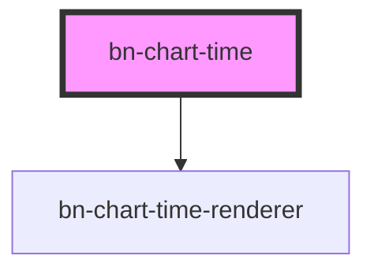

# bn-chart-time

Time series chart rendering data as vertical bars or lines following IBCS standards. Supports up to 4 scenarios in the main chart and unlimited variance sub-charts.

## Basic Usage

```html
<bn-chart-time scenarios="ac1,pl1" variances="dac1_pl1_pos"></bn-chart-time>
```

## Scenarios

```html
<!-- Actual vs Previous Period -->
<bn-chart-time scenarios="ac1,pp1"></bn-chart-time>

<!-- Auto-detect from dataset metadata -->
<bn-chart-time scenarios="auto"></bn-chart-time>
```

Available scenarios: `ac1`-`ac4`, `pp1`-`pp4`, `fc1`-`fc4`, `pl1`-`pl4`. Each scenario is rendered with IBCS-standard visual encoding (solid for actual, hatched for forecast, etc.).

## Date Interval

Controls the temporal aggregation level:

```html
<bn-chart-time date-interval="month" scenarios="ac1"></bn-chart-time>
<bn-chart-time date-interval="quarter" scenarios="ac1"></bn-chart-time>
<bn-chart-time date-interval="auto" scenarios="ac1"></bn-chart-time>
```

Values: `year`, `quarter`, `month`, `week`, `day`, `hour`, `minute`, `second`, `millisecond`, `auto`.

With `auto` the chart takes the finest interval that gives fewer periods than
`interval-span-limit` (default 28) between the first and the last date. The
limit only chooses this interval. It never cuts the series: every period
between the first and the last date is drawn.

## Chart Mode

```html
<!-- Bar chart (default) -->
<bn-chart-time chart-mode="bar" scenarios="ac1"></bn-chart-time>

<!-- Line chart -->
<bn-chart-time chart-mode="line" scenarios="ac1"></bn-chart-time>

<!-- Auto: switches to line when data points exceed max-bars -->
<bn-chart-time chart-mode="auto" max-bars="28" scenarios="ac1"></bn-chart-time>
```

## Variances

Add variance sub-charts below the main chart:

```html
<bn-chart-time
  scenarios="ac1,pl1"
  variances="dac1_pl1_pos,drac1_pl1_pos">
</bn-chart-time>
```

Each variance generates a separate sub-chart. See the [Data Model](../../../doc/data-model.md) for naming conventions.

## Stacking

Stack the scenarios of a period on top of each other:

```html
<!-- Stack the scenarios -->
<bn-chart-time
  scenarios="ac1,ac2"
  stack='{"by":"scenarios","mode":"absolute","order":"asc"}'>
</bn-chart-time>

<!-- Relative stacking (100% stacked) -->
<bn-chart-time
  scenarios="ac1,ac2"
  stack='{"by":"scenarios","mode":"relative"}'>
</bn-chart-time>
```

Stack config properties:
- `by`: `"scenarios"` or `"dimensions"` (only the first scenario, one segment per period)
- `mode`: `"absolute"`, `"relative"`, or `"absolute-relative"`
- `order`: `"asc"`, `"desc"`, or `"dataset"`

Negative values: positive segments stack outward from the axis on the positive
side, negative segments on the other side, and the total label shows the signed
sum (10, -4 and 6 give 12). In the relative modes the share of a segment is its
value divided by the sum of the absolute values of the stack, so a stack with
negative segments keeps its 100 % length but its shares do not add up to 100 %.

## Overlays

```html
<!-- Show average line -->
<bn-chart-time show-overlay-avg="true" scenarios="ac1"></bn-chart-time>

<!-- Show median line -->
<bn-chart-time show-overlay-median="true" scenarios="ac1"></bn-chart-time>
```

Average and median are taken over the periods that have a value for the
scenario. Periods without one, such as the forecast months of an AC/FC chart,
are left out.

## Scaling

```html
<bn-chart-time measure-scale="M" scenarios="ac1"></bn-chart-time>
<bn-chart-time scale="auto" scenarios="ac1"></bn-chart-time>

<!-- Bar scale in data units per em: 1 em of bar = 1M units -->
<bn-chart-time unit-scaling="1M" scenarios="ac1"></bn-chart-time>

<!-- Shared scale across components -->
<bn-scaling-group name="revenue" value="1M"></bn-scaling-group>
<bn-chart-time unit-scaling="revenue" scenarios="ac1"></bn-chart-time>
```

See the [Scaling guide](../../../doc/scaling.md) for the full model.

## Full Example

```html
<bn-context locale="en">
  <bn-datasource name="monthly_raw">
    [
      {"date":"2024-01-01","category":"Sales","ac1":120,"pl1":110},
      {"date":"2024-02-01","category":"Sales","ac1":135,"pl1":115},
      {"date":"2024-03-01","category":"Sales","ac1":128,"pl1":120},
      {"date":"2024-04-01","category":"Sales","ac1":142,"pl1":125}
    ]
  </bn-datasource>

  <bn-dataset name="monthly" datasources="monthly_raw">
    SELECT date, SUM(ac1) as ac1, SUM(pl1) as pl1 FROM monthly_raw GROUP BY date
  </bn-dataset>

  <bn-page format="hd" orientation="landscape">
    <bn-body>
      <bn-chart-time
        datasets="monthly"
        scenarios="ac1,pl1"
        variances="dac1_pl1_pos"
        date-interval="month"
        measure-scale="k">
      </bn-chart-time>
    </bn-body>
  </bn-page>
</bn-context>
```

<!-- Auto Generated Below -->


## Overview

SVG time-series chart following IBCS standards.

Subscribes to a dataset (via `withDataset`) and renders date-axis bar or
line charts with up to four scenario layers, optional variance sub-charts,
stacking, and proportional auto-scaling. Date normalization and interval
detection are delegated to `DateStringFactory`. The heavy SVG rendering
is performed by the inner `bn-chart-time-renderer` element; this outer component
validates props, resolves auto-detected metadata, and computes styles.

## Properties

| Property                         | Attribute                    | Description                                                                                                                                                                                                                                                                                                                                                                                                                                                                                                                                                                                                                                                                                                                                                                                                                                                                                                                                                                                                                                                                                                                                                                                                                                                                                                                                                                                                                                                                                                                                                                                                                                                                                                                                                                                                                                                                                                                                                                                                                                                                                                                                                                                                                                                                                                                                                                                                                                                                  | Type               | Default      |
| -------------------------------- | ---------------------------- | ---------------------------------------------------------------------------------------------------------------------------------------------------------------------------------------------------------------------------------------------------------------------------------------------------------------------------------------------------------------------------------------------------------------------------------------------------------------------------------------------------------------------------------------------------------------------------------------------------------------------------------------------------------------------------------------------------------------------------------------------------------------------------------------------------------------------------------------------------------------------------------------------------------------------------------------------------------------------------------------------------------------------------------------------------------------------------------------------------------------------------------------------------------------------------------------------------------------------------------------------------------------------------------------------------------------------------------------------------------------------------------------------------------------------------------------------------------------------------------------------------------------------------------------------------------------------------------------------------------------------------------------------------------------------------------------------------------------------------------------------------------------------------------------------------------------------------------------------------------------------------------------------------------------------------------------------------------------------------------------------------------------------------------------------------------------------------------------------------------------------------------------------------------------------------------------------------------------------------------------------------------------------------------------------------------------------------------------------------------------------------------------------------------------------------------------------------------------------------- | ------------------ | ------------ |
| `axisLabelsMode` _(required)_    | `axis-labels-mode`           | Axis Labels Mode defines in which mode the labels are rendered. long, and short mode uses the long an short styles for the date smart only displays relevant information if a change/ transition occured (eg.  only on 1.Jan  the year is displayed) two-row prints short labels and puts the parent period (the year of a month, quarter or week) in a second row, under the first period and where it changes. With scenario-switch the scenario names stand in the same row. <br /><br /> values:<br /> ```smart // long // short // two-row```                                                                                                                                                                                                                                                                                                                                                                                                                                                                                                                                                                                                                                                                                                                                                                                                                                                                                                                                                                                                                                                                                                                                                                                                                                                                                                                                                                                                                                                                                                                                                                                                                                                                                                                                                                                                                                                                                                                           | `string`           | `undefined`  |
| `axisLabelsStep`                 | `axis-labels-step`           | Prints only every n-th category label, starting with the first period. 2 labels every second period. Bar mode only.                                                                                                                                                                                                                                                                                                                                                                                                                                                                                                                                                                                                                                                                                                                                                                                                                                                                                                                                                                                                                                                                                                                                                                                                                                                                                                                                                                                                                                                                                                                                                                                                                                                                                                                                                                                                                                                                                                                                                                                                                                                                                                                                                                                                                                                                                                                                                          | `number`           | `1`          |
| `axisTitlePosition`              | `axis-title-position`        | Where the axis title stands (the chart title, or the name of a variance). <br /><br /> values:<br /> ```left // right // none```                                                                                                                                                                                                                                                                                                                                                                                                                                                                                                                                                                                                                                                                                                                                                                                                                                                                                                                                                                                                                                                                                                                                                                                                                                                                                                                                                                                                                                                                                                                                                                                                                                                                                                                                                                                                                                                                                                                                                                                                                                                                                                                                                                                                                                                                                                                                             | `string`           | `"left"`     |
| `chartMode`                      | `chart-mode`                 | Chart Mode - controls how the chart is rendered <br /><br /> values:<br /> ```bar // line // auto``` <br /><br /> When set to 'auto', the chart will switch to line mode when the number of data points exceeds maxBars.                                                                                                                                                                                                                                                                                                                                                                                                                                                                                                                                                                                                                                                                                                                                                                                                                                                                                                                                                                                                                                                                                                                                                                                                                                                                                                                                                                                                                                                                                                                                                                                                                                                                                                                                                                                                                                                                                                                                                                                                                                                                                                                                                                                                                                                     | `string`           | `"bar"`      |
| `chartTitle`                     | `chart-title`                | Custom chart title                                                                                                                                                                                                                                                                                                                                                                                                                                                                                                                                                                                                                                                                                                                                                                                                                                                                                                                                                                                                                                                                                                                                                                                                                                                                                                                                                                                                                                                                                                                                                                                                                                                                                                                                                                                                                                                                                                                                                                                                                                                                                                                                                                                                                                                                                                                                                                                                                                                           | `string`           | `""`         |
| `dataFormatDigitsDecimal`        | `data-format-digits-decimal` | Number of decimal digits of the value labels                                                                                                                                                                                                                                                                                                                                                                                                                                                                                                                                                                                                                                                                                                                                                                                                                                                                                                                                                                                                                                                                                                                                                                                                                                                                                                                                                                                                                                                                                                                                                                                                                                                                                                                                                                                                                                                                                                                                                                                                                                                                                                                                                                                                                                                                                                                                                                                                                                 | `number`           | `1`          |
| `dataFormatDigitsPercent`        | `data-format-digits-percent` | Number of decimal digits of the percent labels (relative variances)                                                                                                                                                                                                                                                                                                                                                                                                                                                                                                                                                                                                                                                                                                                                                                                                                                                                                                                                                                                                                                                                                                                                                                                                                                                                                                                                                                                                                                                                                                                                                                                                                                                                                                                                                                                                                                                                                                                                                                                                                                                                                                                                                                                                                                                                                                                                                                                                          | `number`           | `2`          |
| `dataFormatPercentSign`          | `data-format-percent-sign`   | `false` prints the labels of relative variances without the percent sign (`+11.6`). The title of the row (`ΔPY%`) still names the unit.                                                                                                                                                                                                                                                                                                                                                                                                                                                                                                                                                                                                                                                                                                                                                                                                                                                                                                                                                                                                                                                                                                                                                                                                                                                                                                                                                                                                                                                                                                                                                                                                                                                                                                                                                                                                                                                                                                                                                                                                                                                                                                                                                                                                                                                                                                                                      | `boolean`          | `true`       |
| `datasets`                       | `datasets`                   | Name of the dataset to render (the `name` of a `<bn-dataset>`). A name that starts with `$` reads a `<bn-datasource>` directly, which gives a warning.                                                                                                                                                                                                                                                                                                                                                                                                                                                                                                                                                                                                                                                                                                                                                                                                                                                                                                                                                                                                                                                                                                                                                                                                                                                                                                                                                                                                                                                                                                                                                                                                                                                                                                                                                                                                                                                                                                                                                                                                                                                                                                                                                                                                                                                                                                                       | `string`           | `undefined`  |
| `dateInterval` _(required)_      | `date-interval`              | Axis Date Interval <br /><br /> values:<br /> ```year // quarter // month // week // day // hour // minute // second // millisecond // auto``` <br /><br /> When set to ```auto```, dateInterval is detected from the dataset silently. When left blank, dateInterval is detected from the dataset with a warning.                                                                                                                                                                                                                                                                                                                                                                                                                                                                                                                                                                                                                                                                                                                                                                                                                                                                                                                                                                                                                                                                                                                                                                                                                                                                                                                                                                                                                                                                                                                                                                                                                                                                                                                                                                                                                                                                                                                                                                                                                                                                                                                                                           | `string`           | `undefined`  |
| `filter`                         | `filter`                     | AlaSQL WHERE clause fragment injected into the data query to filter rows before rendering (e.g. `"rowGroup = 'Revenue'"`).                                                                                                                                                                                                                                                                                                                                                                                                                                                                                                                                                                                                                                                                                                                                                                                                                                                                                                                                                                                                                                                                                                                                                                                                                                                                                                                                                                                                                                                                                                                                                                                                                                                                                                                                                                                                                                                                                                                                                                                                                                                                                                                                                                                                                                                                                                                                                   | `string`           | `""`         |
| `i18nNamespace`                  | `i18n-namespace`             | Namespace of the translations to use (the `namespace` of a `<bn-internationalization>`). Without it the component takes the `i18n-namespace` of the nearest ancestor that has one, then the built-in texts.                                                                                                                                                                                                                                                                                                                                                                                                                                                                                                                                                                                                                                                                                                                                                                                                                                                                                                                                                                                                                                                                                                                                                                                                                                                                                                                                                                                                                                                                                                                                                                                                                                                                                                                                                                                                                                                                                                                                                                                                                                                                                                                                                                                                                                                                  | `string`           | `undefined`  |
| `intervalSpanLimit`              | `interval-span-limit`        | Max number of columns. Only used to choose the date interval when dateInterval is AUTO: the finest interval that gives fewer periods than this. The series is never cut.                                                                                                                                                                                                                                                                                                                                                                                                                                                                                                                                                                                                                                                                                                                                                                                                                                                                                                                                                                                                                                                                                                                                                                                                                                                                                                                                                                                                                                                                                                                                                                                                                                                                                                                                                                                                                                                                                                                                                                                                                                                                                                                                                                                                                                                                                                     | `number`           | `28`         |
| `lineFullWidth`                  | `line-full-width`            | When true (default), line charts stretch to fill the full parent width instead of using fixed per-data-point spacing. Has no effect in bar mode. <br /><br /> values:<br /> ```true // false```                                                                                                                                                                                                                                                                                                                                                                                                                                                                                                                                                                                                                                                                                                                                                                                                                                                                                                                                                                                                                                                                                                                                                                                                                                                                                                                                                                                                                                                                                                                                                                                                                                                                                                                                                                                                                                                                                                                                                                                                                                                                                                                                                                                                                                                                              | `boolean`          | `true`       |
| `maxBars`                        | `max-bars`                   | Max Bars - threshold for auto-switching to line mode <br /><br /> When chartMode is set to 'auto' and the number of data points exceeds this value, the chart will render as a line chart.                                                                                                                                                                                                                                                                                                                                                                                                                                                                                                                                                                                                                                                                                                                                                                                                                                                                                                                                                                                                                                                                                                                                                                                                                                                                                                                                                                                                                                                                                                                                                                                                                                                                                                                                                                                                                                                                                                                                                                                                                                                                                                                                                                                                                                                                                   | `number`           | `28`         |
| `measureScale`                   | `measure-scale`              | Sets the SiPrefix of the Mesaurements and converts the original value. <br /><br /> values:  <br /> ```_ // k // M // G // T // P // E // Z // Y // m // my (μ) // n // p // f // a // z // y // GREATEST // LEAST``` <br /><br /> SiPrefix overview: ```     "Y":  1E+24,```<br /> ```    "Z":  1E+21,```<br /> ```   "E":  1E+18,```<br /> ```     "P":  1E+15,```<br /> ```     "T":  1E+12,```<br /> ```     "G":  1000000000,```<br /> ```     "M":  1000000,```<br /> ```     "k":  1000,```<br /> <br /> ```     "m":  0.001,```<br /> ```    "my" (μ):  0.000001,```<br /> ```     "n":  0.000000001,```<br /> ```     "p":  0.000000000001,```<br /> ```     "f":  0.000000000000001,```<br /> ```     "a":  0.000000000000000001,```<br /> ```     "z":  0.000000000000000000001,```<br /> ```     "y":  0.000000000000000000000001,```<br /> <br /><br /> Special modes: ```GREATEST``` seaches for the bigest (farest to zero) Value in the dataset and sets this value to SiPrefix<br /> ```LEAST```    searches for smallest (closest to zero) Value in the dataset and sets this value to SiPrefix<br /> <br /><br /> ```_```        is the value for no SiPrefix the value is displayed as in the dataset stored.                                                                                                                                                                                                                                                                                                                                                                                                                                                                                                                                                                                                                                                                                                                                                                                                                                                                                                                                                                                                                                                                                                                                                                                                                                            | `string`           | `"greatest"` |
| `measureUnit`                    | `measure-unit`               | measureUnit displayed in table.                                                                                                                                                                                                                                                                                                                                                                                                                                                                                                                                                                                                                                                                                                                                                                                                                                                                                                                                                                                                                                                                                                                                                                                                                                                                                                                                                                                                                                                                                                                                                                                                                                                                                                                                                                                                                                                                                                                                                                                                                                                                                                                                                                                                                                                                                                                                                                                                                                              | `string`           | `""`         |
| `percentageScaling` _(required)_ | `percentage-scaling`         | Percentage points displayed per 1 em of pin/bar length for relative variances - a larger value means shorter pins.  \| Value             \| Behavior                                                      \| \|-------------------\|---------------------------------------------------------------\| \| `"auto"`          \| Auto-fit to available height (same two-pass as unit-scaling)  \| \| not set / invalid \| Same as auto with `AUTO_percentageScaling` warning            \| \| `"10"`, `"2.5"`   \| Percentage points per em; optional SI suffix `k`/`K`/`M`/`G`/`T` \| \| group name        \| References a `<bn-scaling-group>` for synchronized scaling    \|                                                                                                                                                                                                                                                                                                                                                                                                                                                                                                                                                                                                                                                                                                                                                                                                                                                                                                                                                                                                                                                                                                                                                                                                                                                                                                                                                                                                                                                                                                                                                                                                                                                                                                                                                                                                 | `number \| string` | `undefined`  |
| `referenceColumn`                | `reference-column`           | With `scenario-switch`: draws the reference (the first scenario that is not part of the series) as a column behind the series in every period, in place of the marker. Further scenarios stay markers. Without `scenario-switch` it has no effect.                                                                                                                                                                                                                                                                                                                                                                                                                                                                                                                                                                                                                                                                                                                                                                                                                                                                                                                                                                                                                                                                                                                                                                                                                                                                                                                                                                                                                                                                                                                                                                                                                                                                                                                                                                                                                                                                                                                                                                                                                                                                                                                                                                                                                           | `boolean`          | `false`      |
| `ruleset`                        | `ruleset`                    | Name of a registered IBCS rule set (see `bn-ruleset`) used for scenario ordering, look and names. Supports `"inherited-closest"` / `"inherited-page"` to take over the value from an ancestor `bn-layout-card` / `bn-layout-page`.                                                                                                                                                                                                                                                                                                                                                                                                                                                                                                                                                                                                                                                                                                                                                                                                                                                                                                                                                                                                                                                                                                                                                                                                                                                                                                                                                                                                                                                                                                                                                                                                                                                                                                                                                                                                                                                                                                                                                                                                                                                                                                                                                                                                                                           | `string`           | `undefined`  |
| `scale`                          | `scale`                      | Controls proportional scaling of the chart to fit the available parent width.  \| Value               \| Behavior                                                                          \| \|---------------------\|-----------------------------------------------------------------------------------\| \| not set / `""`      \| Auto-scale to fit parent width; emit `AUTO_scale` warning with the applied factor  \| \| `"none"`            \| No scaling (render at base font size regardless of available space)                \| \| `"auto"`            \| Auto-scale to fit parent width silently (no warning)                              \| \| `"0.5"`, `"1.2"`, … \| Fixed factor - apply `baseFontSize × factor`                                      \|                                                                                                                                                                                                                                                                                                                                                                                                                                                                                                                                                                                                                                                                                                                                                                                                                                                                                                                                                                                                                                                                                                                                                                                                                                                                                                                                                                                                                                                                                                                                                                                                                                                                                                   | `string`           | `undefined`  |
| `scalingIndicator`               | `scaling-indicator`          | Scaling indicator: a light band behind the columns, from the axis up to this value, with the value at its right end. Two charts with different scales show the same value, so the reader sees the difference. Bar mode only.                                                                                                                                                                                                                                                                                                                                                                                                                                                                                                                                                                                                                                                                                                                                                                                                                                                                                                                                                                                                                                                                                                                                                                                                                                                                                                                                                                                                                                                                                                                                                                                                                                                                                                                                                                                                                                                                                                                                                                                                                                                                                                                                                                                                                                                 | `number`           | `undefined`  |
| `scenarioSwitch`                 | `scenario-switch`            | For a series that changes its scenario along the time axis, for example AC up to this year and PL after it. In a period where the first scenario has no value, the next scenario with a value is drawn in its place with its value label. A vertical line marks the change, and the scenario names stand under the axis. Variances with the same reference and type share one row. A chart with one scenario gets the name of that scenario under the axis. Bar mode, without a stack or with a stack by dimensions.                                                                                                                                                                                                                                                                                                                                                                                                                                                                                                                                                                                                                                                                                                                                                                                                                                                                                                                                                                                                                                                                                                                                                                                                                                                                                                                                                                                                                                                                                                                                                                                                                                                                                                                                                                                                                                                                                                                                                         | `boolean`          | `false`      |
| `scenarios` _(required)_         | `scenarios`                  | List of Scenarios Map. <br /> <br /> per chart there are up to 4 different scenarios supported. The first 4 scenarios in the list are used, the rest ignored.  <br /> <br />  values:<br /> ```ac // fc // pp // pl  [1-4] // auto```  example:<br /> ```ac1,ac2,ac3,ac4``` <br /> <br />  When set to ```auto```, scenarios are detected from the dataset silently.  When left blank, scenarios are detected from the dataset with a warning.  When set to ```none```, no scenario is drawn: the chart shows only its variances,  and the lowest variance carries the category labels.                                                                                                                                                                                                                                                                                                                                                                                                                                                                                                                                                                                                                                                                                                                                                                                                                                                                                                                                                                                                                                                                                                                                                                                                                                                                                                                                                                                                                                                                                                                                                                                                                                                                                                                                                                                                                                                                                      | `string`           | `undefined`  |
| `selectedStyle`                  | `selected-style`             | Name of the component style to use (the `name` of a `<bn-component-style>`). Its values go on top of the default style.                                                                                                                                                                                                                                                                                                                                                                                                                                                                                                                                                                                                                                                                                                                                                                                                                                                                                                                                                                                                                                                                                                                                                                                                                                                                                                                                                                                                                                                                                                                                                                                                                                                                                                                                                                                                                                                                                                                                                                                                                                                                                                                                                                                                                                                                                                                                                      | `string`           | `undefined`  |
| `showCategories`                 | `show-categories`            |                                                                                                                                                                                                                                                                                                                                                                                                                                                                                                                                                                                                                                                                                                                                                                                                                                                                                                                                                                                                                                                                                                                                                                                                                                                                                                                                                                                                                                                                                                                                                                                                                                                                                                                                                                                                                                                                                                                                                                                                                                                                                                                                                                                                                                                                                                                                                                                                                                                                              | `boolean`          | `true`       |
| `showMeasureScale`               | `show-measure-scale`         | Toggles display of measure units in table header <br /><br /> values: <br /> ```true // false```                                                                                                                                                                                                                                                                                                                                                                                                                                                                                                                                                                                                                                                                                                                                                                                                                                                                                                                                                                                                                                                                                                                                                                                                                                                                                                                                                                                                                                                                                                                                                                                                                                                                                                                                                                                                                                                                                                                                                                                                                                                                                                                                                                                                                                                                                                                                                                             | `boolean`          | `false`      |
| `showOverlayAvg`                 | `show-overlay-avg`           |                                                                                                                                                                                                                                                                                                                                                                                                                                                                                                                                                                                                                                                                                                                                                                                                                                                                                                                                                                                                                                                                                                                                                                                                                                                                                                                                                                                                                                                                                                                                                                                                                                                                                                                                                                                                                                                                                                                                                                                                                                                                                                                                                                                                                                                                                                                                                                                                                                                                              | `boolean`          | `true`       |
| `showOverlayMedian`              | `show-overlay-median`        |                                                                                                                                                                                                                                                                                                                                                                                                                                                                                                                                                                                                                                                                                                                                                                                                                                                                                                                                                                                                                                                                                                                                                                                                                                                                                                                                                                                                                                                                                                                                                                                                                                                                                                                                                                                                                                                                                                                                                                                                                                                                                                                                                                                                                                                                                                                                                                                                                                                                              | `boolean`          | `false`      |
| `stack`                          | `stack`                      | Stacking configuration for the chart as a JSON string.  When set, bars/columns are drawn stacked (additive layers) instead of side-by-side. In line mode (`chart-mode="line"`), stacking produces a stacked area chart with filled regions between cumulative lines.  **JSON schema:** ```json {   "by": "scenarios" \| "dimensions",   "mode": "absolute" \| "relative" \| "absolute-relative",   "order": "asc" \| "desc" \| "dataset",   "notation": "none" \| "scenario",   "legend": "left" \| "right" \| "both" \| "none",   "percentMark": true \| false } ```  - `by` (required): What a stack is made of.   - `"scenarios"` - stack the scenarios from the `scenarios` prop as layers,     four at most.   - `"dimensions"` - one segment per value of the `category` column of the     dataset, ordered by `categoryIndex`, else by first appearance. There is     no limit on the number of series, and a series keeps its colour in     every period. The first scenario is drawn. With `scenario-switch` the     scenario that has values in the period is drawn, so one axis can go     from AC to FC to PL. - `mode` (optional, default `"absolute"`):   - `"absolute"` - additive stacking, axis shows absolute units.   - `"relative"` - 100% stacking, axis shows 0%-100%. `unit-scaling` is     interpreted as pixels per percentage point (e.g. `0.4` → 40px full     stack); `"auto"` fits the stack to the available height as usual.   - `"absolute-relative"` - bar height is absolute (real value), but     segment labels inside show percentages. - `order` (optional, default `"dataset"`): Segment order within each stack.   `"asc"` / `"desc"` sort segments by value; `"dataset"` preserves the   original data/scenario order. - `notation` (optional, default `"none"`): with `"scenario"` a segment takes   the look of its scenario. A forecast segment is hatched over the shade of   its series, a plan segment is outlined, and the first series takes the   fill of the scenario from `barStyles`. - `legend` (optional, default `"left"`): where the series names stand. Left   of the first column, right of the last column with a value, at both, or   nowhere. - `percentMark` (optional, default `false`): for `mode: "relative"`. The   shares are plain numbers without the % sign, with   `data-format-digits-percent` digits, and one `100%` mark stands at the   upper end of the stack, on the side of the series names. | `string`           | `""`         |
| `syncSpaceLeft`                  | `sync-space-left`            |                                                                                                                                                                                                                                                                                                                                                                                                                                                                                                                                                                                                                                                                                                                                                                                                                                                                                                                                                                                                                                                                                                                                                                                                                                                                                                                                                                                                                                                                                                                                                                                                                                                                                                                                                                                                                                                                                                                                                                                                                                                                                                                                                                                                                                                                                                                                                                                                                                                                              | `number`           | `-1`         |
| `totals`                         | `totals`                     | Total columns at their own scale, as JSON: `{"by":"all","aggregation":"sum","unitScaling":280,"label":"2025","width":1.6}`.  - `unitScaling` - data units per em of column height, like `unit-scaling`.   Left out, the totals use the scale of the chart. - `by` - what a total covers. `all` (default): one column right of the last   period for all periods. `year`, `quarter`, `month`, `week`: one column   behind the periods of each of them, on the axis. - `aggregation` - `sum` (default), `average` or `last`. With `sum` a column   stacks one part per scenario of the series: the first scenario, and with   `scenario-switch` the ones that follow it. Else it is one column, hatched   when a forecast is in its value and outlined for a plan. - `dataset` - name of a dataset with one row per total (`date` and the   scenario columns). The chart takes the values from it and computes none.   With `average` or `last` the values of a row are one column. - `label` - text under the column of `by: all`. The other columns take the name of their period. - `width` - width in widths of a period column, default 1.  The first other scenario is the reference behind a column. Each variance row gets the variance of each total at the scale of the row. With `scaling-indicator` a column has its own band, and with `by: all` a line links it to the band of the periods. Plain columns only: not with `stack` and not in line mode. The chart needs a fixed `unit-scaling`, and every part of a total must be positive.                                                                                                                                                                                                                                                                                                                                                                                                                                                                                                                                                                                                                                                                                                                                                                                                                                                                                                                       | `string`           | `""`         |
| `unitScaling` _(required)_       | `unit-scaling`               | Data units displayed per 1 em of bar length (vertical bars) - map-scale semantics: a larger value means smaller bars.  \| Value              \| Behavior                                                    \| \|--------------------\|-------------------------------------------------------------\| \| `"auto"`           \| Auto-fit bars to fill the available container height        \| \| not set / invalid  \| Same as auto, but emits `AUTO_unitScaling` warning          \| \| `"250000"`, `"1M"` \| Units per em; optional SI suffix `k`/`K`/`M`/`G`/`T`        \| \| group name         \| References a `<bn-scaling-group>` for synchronized scaling  \|                                                                                                                                                                                                                                                                                                                                                                                                                                                                                                                                                                                                                                                                                                                                                                                                                                                                                                                                                                                                                                                                                                                                                                                                                                                                                                                                                                                                                                                                                                                                                                                                                                                                                                                                                                                                       | `number \| string` | `undefined`  |
| `varianceWaterfall`              | `variance-waterfall`         | Draws each row of absolute variances as a walk: a column starts where the column before ended, and thin lines join them. A period without a value keeps the level. Relative variances stay pins. With `totals` of `by: all` at the scale of the chart (no `unitScaling` in `totals`, aggregation `sum`) the first row of absolute variances becomes a bridge: the reference total stands before the first period, the total of the series behind the last one, and the walk runs between their ends. With `sync-space-left` the reference total stands inside that space, so the space must have room for it. Behind a total column on the axis (`by` other than `all`) a walk starts again. Bar mode, plain columns: no effect in line mode and with `stack`.                                                                                                                                                                                                                                                                                                                                                                                                                                                                                                                                                                                                                                                                                                                                                                                                                                                                                                                                                                                                                                                                                                                                                                                                                                                                                                                                                                                                                                                                                                                                                                                                                                                                                                               | `boolean`          | `false`      |
| `variances` _(required)_         | `variances`                  | List of Variance Map. <br /> <br />   Variance chart can be added by seperating the scenarios   of each chart with ```;```<br />   The additonal variances which   are calculated form the given scenarios.   the scenarios used in the variances have also   be defined in the *scenarios* property. <br /> <br />   the variance is defiend as  (Scenario A -  ScenarioB)   neu. neg and pos post fix defines which value is *good*   a negative or a positive value.   op and opinv are accepted for pages that share variances with   tables. Chart values carry their operation sign, so op acts like pos   and opinv like neg. <br /> <br />   if empty variance charts are hidden <br /> <br />   each variance creates a chart <br /> <br />   pattern:<br />  ```d<scenarioB>_<scenarioA>_[pos/neg/neu/op/opinv]```     example: <br />```'dpp1_ac1_neg,dfc1_ac1_neg'```                                                                                                                                                                                                                                                                                                                                                                                                                                                                                                                                                                                                                                                                                                                                                                                                                                                                                                                                                                                                                                                                                                                                                                                                                                                                                                                                                                                                                                                                                                                                                                                            | `string`           | `undefined`  |


## Methods

### `getBaseline() => Promise<Baseline>`

The line this chart wants to be aligned on, in CSS px from the host's
top-left corner. A horizontal axis line gives `y` and its left end `x`. The category axis of the base segment sits at zero, so negative bars hang below it. Empty before the chart has drawn.

#### Returns

Type: `Promise<Baseline>`


### `getLayoutState(options?: LayoutStateOptions) => Promise<ComponentLayoutState>`

Lazily generates this chart's layout state: host box (context- and
component-relative, CSS px), one `canvas:<segment>` region per rendered
segment (base + variances), metadata (scenarios, bar count), diagnostics
and resolved scaling. With `detail: "full"` every bar, label and axis of
every segment is listed with its geometry.

#### Parameters

| Name      | Type                 | Description                                              |
| --------- | -------------------- | -------------------------------------------------------- |
| `options` | `LayoutStateOptions` | - `{ detail: "summary" \| "full" }`, default `"summary"` |

#### Returns

Type: `Promise<ComponentLayoutState>`


## Dependencies

### Depends on

- bn-chart-time-renderer

### Graph


----------------------------------------------

developed by Bino Bi
