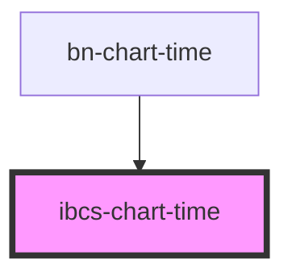

# bn-chart-time

Time series chart rendering data as vertical bars or lines following IBCS standards. Supports up to 4 scenarios in the main chart and unlimited variance sub-charts.

## Basic Usage

```html
<bn-chart-time scenarios="ac1,pl1" variances="dac1_pl1_pos"></bn-chart-time>
```

## Scenarios

```html
<!-- Actual vs Previous Period -->
<bn-chart-time scenarios="ac1,pp1"></bn-chart-time>

<!-- Auto-detect from dataset metadata -->
<bn-chart-time scenarios="auto"></bn-chart-time>
```

Available scenarios: `ac1`-`ac4`, `pp1`-`pp4`, `fc1`-`fc4`, `pl1`-`pl4`. Each scenario is rendered with IBCS-standard visual encoding (solid for actual, hatched for forecast, etc.).

## Date Interval

Controls the temporal aggregation level:

```html
<bn-chart-time date-interval="month" scenarios="ac1"></bn-chart-time>
<bn-chart-time date-interval="quarter" scenarios="ac1"></bn-chart-time>
<bn-chart-time date-interval="auto" scenarios="ac1"></bn-chart-time>
```

Values: `year`, `quarter`, `month`, `week`, `day`, `hour`, `minute`, `second`, `millisecond`, `auto`.

## Chart Mode

```html
<!-- Bar chart (default) -->
<bn-chart-time chart-mode="bar" scenarios="ac1"></bn-chart-time>

<!-- Line chart -->
<bn-chart-time chart-mode="line" scenarios="ac1"></bn-chart-time>

<!-- Auto: switches to line when data points exceed max-bars -->
<bn-chart-time chart-mode="auto" max-bars="28" scenarios="ac1"></bn-chart-time>
```

## Variances

Add variance sub-charts below the main chart:

```html
<bn-chart-time
  scenarios="ac1,pl1"
  variances="dac1_pl1_pos,drac1_pl1_pos">
</bn-chart-time>
```

Each variance generates a separate sub-chart. See the [Data Model](../../../doc/data-model.md) for naming conventions.

## Stacking

Stack bars by scenario, category, subcategory, or row group:

```html
<!-- Stack by category -->
<bn-chart-time
  scenarios="ac1"
  stack='{"by":"category","mode":"absolute","order":"asc"}'>
</bn-chart-time>

<!-- Relative stacking (100% stacked) -->
<bn-chart-time
  scenarios="ac1"
  stack='{"by":"category","mode":"relative"}'>
</bn-chart-time>
```

Stack config properties:
- `by`: `"scenario"`, `"category"`, `"subcategory"`, or `"rowgroup"`
- `mode`: `"absolute"`, `"relative"`, or `"absolute-relative"`
- `order`: `"asc"`, `"desc"`, or `"dataset"`

## Aggregation Level

```html
<bn-chart-time level="category" scenarios="ac1"></bn-chart-time>
<bn-chart-time level="subcategory" scenarios="ac1"></bn-chart-time>
<bn-chart-time level="rowcategory" scenarios="ac1"></bn-chart-time>
```

## Sorting

```html
<bn-chart-time order="category" order-direction="asc" scenarios="ac1"></bn-chart-time>
<bn-chart-time order="ac1" order-direction="desc" scenarios="ac1"></bn-chart-time>
```

## Overlays

```html
<!-- Show average line -->
<bn-chart-time show-overlay-avg="true" scenarios="ac1"></bn-chart-time>

<!-- Show median line -->
<bn-chart-time show-overlay-median="true" scenarios="ac1"></bn-chart-time>
```

## Scaling

```html
<bn-chart-time measure-scale="M" scenarios="ac1"></bn-chart-time>
<bn-chart-time scale="auto" scenarios="ac1"></bn-chart-time>

<!-- Bar scale in data units per em: 1 em of bar = 1M units -->
<bn-chart-time unit-scaling="1M" scenarios="ac1"></bn-chart-time>

<!-- Shared scale across components -->
<bn-scaling-group name="revenue" value="1M"></bn-scaling-group>
<bn-chart-time unit-scaling="revenue" scenarios="ac1"></bn-chart-time>
```

See the [Scaling guide](../../../doc/scaling.md) for the full model.

## Full Example

```html
<bn-context locale="en">
  <bn-datasource name="monthly">
    [
      {"date":"2024-01-01","category":"Sales","ac1":120,"pl1":110},
      {"date":"2024-02-01","category":"Sales","ac1":135,"pl1":115},
      {"date":"2024-03-01","category":"Sales","ac1":128,"pl1":120},
      {"date":"2024-04-01","category":"Sales","ac1":142,"pl1":125}
    ]
  </bn-datasource>

  <bn-dataset name="monthly" datasources="monthly">
    SELECT date, SUM(ac1) as ac1, SUM(pl1) as pl1 FROM monthly GROUP BY date
  </bn-dataset>

  <bn-page format="hd" orientation="landscape">
    <bn-body>
      <bn-chart-time
        scenarios="ac1,pl1"
        variances="dac1_pl1_pos"
        date-interval="month"
        measure-scale="k">
      </bn-chart-time>
    </bn-body>
  </bn-page>
</bn-context>
```

<!-- Auto Generated Below -->


## Properties

| Property                          | Attribute                              | Description                                                                                                                                                                                                                                | Type                                                                                                                                                                                                                                                | Default                                                       |
| --------------------------------- | -------------------------------------- | ------------------------------------------------------------------------------------------------------------------------------------------------------------------------------------------------------------------------------------------ | --------------------------------------------------------------------------------------------------------------------------------------------------------------------------------------------------------------------------------------------------- | ------------------------------------------------------------- |
| `axisLabelsMode`                  | `axis-labels-mode`                     |                                                                                                                                                                                                                                            | `AxisLabelsMode.LONG \| AxisLabelsMode.SHORT \| AxisLabelsMode.SMART`                                                                                                                                                                               | `AxisLabelsMode.SMART`                                        |
| `chartMode`                       | `chart-mode`                           |                                                                                                                                                                                                                                            | `ChartMode.AUTO \| ChartMode.BAR \| ChartMode.LINE`                                                                                                                                                                                                 | `ChartMode.BAR`                                               |
| `chartTitle`                      | `chart-title`                          |                                                                                                                                                                                                                                            | `string`                                                                                                                                                                                                                                            | `undefined`                                                   |
| `containerWidth`                  | `container-width`                      |                                                                                                                                                                                                                                            | `number`                                                                                                                                                                                                                                            | `0`                                                           |
| `dataFormatDigits`                | --                                     |                                                                                                                                                                                                                                            | `DataFormatDigits`                                                                                                                                                                                                                                  | `{ percent: 2, decimal: 1 }`                                  |
| `dataVersion`                     | `data-version`                         | Bumped by `bn-chart-time` when the dataset changes; triggers re-render.                                                                                                                                                                    | `number`                                                                                                                                                                                                                                            | `0`                                                           |
| `dateInterval`                    | `date-interval`                        |                                                                                                                                                                                                                                            | `DateDistance.AUTO \| DateDistance.DAY \| DateDistance.HOUR \| DateDistance.MILLISECOND \| DateDistance.MINUTE \| DateDistance.MONTH \| DateDistance.NONE \| DateDistance.QUARTER \| DateDistance.SECOND \| DateDistance.WEEK \| DateDistance.YEAR` | `DateDistance.AUTO`                                           |
| `filter`                          | `filter`                               |                                                                                                                                                                                                                                            | `string`                                                                                                                                                                                                                                            | `""`                                                          |
| `hideAxisLabels`                  | `hide-axis-labels`                     |                                                                                                                                                                                                                                            | `boolean`                                                                                                                                                                                                                                           | `false`                                                       |
| `i18n`                            | --                                     |                                                                                                                                                                                                                                            | `Map<string, string>`                                                                                                                                                                                                                               | `new Map()`                                                   |
| `intervalSpanLimit`               | `interval-span-limit`                  |                                                                                                                                                                                                                                            | `number`                                                                                                                                                                                                                                            | `28`                                                          |
| `leftSideOffsetForHorizontalSync` | `left-side-offset-for-horizontal-sync` |                                                                                                                                                                                                                                            | `number`                                                                                                                                                                                                                                            | `-1`                                                          |
| `level`                           | `level`                                |                                                                                                                                                                                                                                            | `AggregationLevel.CATEGORY \| AggregationLevel.CATEGORYINDEX \| AggregationLevel.ROWGROUP \| AggregationLevel.ROWGROUPINDEX \| AggregationLevel.SUBCATEGORY \| AggregationLevel.SUBCATEGORYINDEX`                                                   | `AggregationLevel.CATEGORY`                                   |
| `limit`                           | `limit`                                |                                                                                                                                                                                                                                            | `number`                                                                                                                                                                                                                                            | `0`                                                           |
| `lineFullWidth`                   | `line-full-width`                      |                                                                                                                                                                                                                                            | `boolean`                                                                                                                                                                                                                                           | `true`                                                        |
| `maxBars`                         | `max-bars`                             |                                                                                                                                                                                                                                            | `number`                                                                                                                                                                                                                                            | `28`                                                          |
| `measureScale`                    | `measure-scale`                        |                                                                                                                                                                                                                                            | `string`                                                                                                                                                                                                                                            | `"_"`                                                         |
| `measureUnit`                     | `measure-unit`                         |                                                                                                                                                                                                                                            | `string`                                                                                                                                                                                                                                            | `""`                                                          |
| `order`                           | --                                     |                                                                                                                                                                                                                                            | `Order`                                                                                                                                                                                                                                             | `{     hierarchy: [],     direction: OrderDirection.ASC,   }` |
| `parentDimensions`                | --                                     |                                                                                                                                                                                                                                            | `ParentDimensions`                                                                                                                                                                                                                                  | `{ width: 0, height: 0 }`                                     |
| `pixelPerPercentage`              | `pixel-per-percentage`                 |                                                                                                                                                                                                                                            | `number`                                                                                                                                                                                                                                            | `50`                                                          |
| `pixelPerUnit`                    | `pixel-per-unit`                       |                                                                                                                                                                                                                                            | `number`                                                                                                                                                                                                                                            | `2`                                                           |
| `reportAutoScaling`               | --                                     | Internal wrapper channel: called with the auto-fitted values (px for one data unit / px per 1.0 fraction) whenever one of them was auto-resolved, so the outer `bn-chart-time` can surface them in its AUTO_* warnings. Not for end users. | `(report: AutoScalingReport) => void`                                                                                                                                                                                                               | `undefined`                                                   |
| `ruleSetConfig`                   | --                                     |                                                                                                                                                                                                                                            | `RuleSetConfig`                                                                                                                                                                                                                                     | `undefined`                                                   |
| `scenarios`                       | --                                     |                                                                                                                                                                                                                                            | `string[]`                                                                                                                                                                                                                                          | `[]`                                                          |
| `showMeasureScale`                | `show-measure-scale`                   |                                                                                                                                                                                                                                            | `boolean`                                                                                                                                                                                                                                           | `true`                                                        |
| `showOverlayAvg`                  | `show-overlay-avg`                     |                                                                                                                                                                                                                                            | `boolean`                                                                                                                                                                                                                                           | `false`                                                       |
| `showOverlayMedian`               | `show-overlay-median`                  |                                                                                                                                                                                                                                            | `boolean`                                                                                                                                                                                                                                           | `false`                                                       |
| `stackConfig`                     | --                                     |                                                                                                                                                                                                                                            | `StackConfigParsed`                                                                                                                                                                                                                                 | `null`                                                        |
| `styles`                          | --                                     |                                                                                                                                                                                                                                            | `TimeChartStyle`                                                                                                                                                                                                                                    | `undefined`                                                   |
| `tableName`                       | `table-name`                           | Name of the dataset (table or view in the shared alasql database).                                                                                                                                                                         | `string`                                                                                                                                                                                                                                            | `""`                                                          |
| `variances`                       | --                                     |                                                                                                                                                                                                                                            | `string[]`                                                                                                                                                                                                                                          | `[]`                                                          |


## Dependencies

### Used by

 - [bn-chart-time](.)

### Graph


----------------------------------------------

developed by Bino Bi
