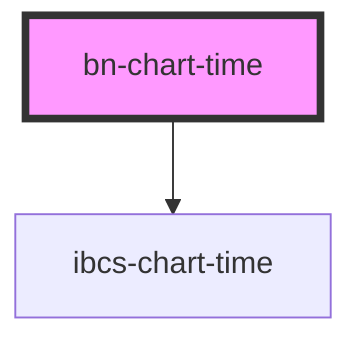

# bn-chart-time

**bn-chart-time**  is a report element and renderes data as time-chart.
It supports the main chart with up to 4 scenarios and additonal variance charts (unlimited)

The **bn-chart-time** can be used within the bn-content element

## Mixins
@withStyle
@withComponentStatus
@withDataset
@withTranslation

**Example**
```html
 <bn-body>
      <bn-chart-time
        internationalisation = null
        internationalisationMode = 'meta'
        level='category'
        order='category'
        order-direction='asc'
        scenarios='ac1,py1'
        styles=''
        unit-scaling='10'
        datasets="$marktwert"
      >
      </bn-chart-time>
</bn-body>
```
**Output**


**Custom BinoChartSyles Example**
```json
     {
      "scaleFactors": {
        barWidthYOffset: 0.95,
        fontNettoHeight: 0.7,
        needleWidthOffset: 0.7,
        barHeightOffset: 0.4,
        barWidthOffset: 0.3,
        pt2Px: 1.2,
        axisWidth: 0.1,
        rowHeight: 1.8,
      },
      "fontStyles": {
        font: "16px Calibri",
        size: 16,
        color: "#000000",
        backgroud: "#ffffff",
        leading: 1.8,
      },
      "axisStyles": {
        ac: {stroke: "#121212", fill: "#121212", width: 0.1},
        fc: {stroke: "#121212", fill: "#ffffff", width: 0.1, "dasharray": "10 5 5 5"},
        pp: {stroke: "#606060", fill: "#606060", width: 0.1},
        pl: {stroke: "#121212", fill: "#ffffff", width: 0.1},
      },
      "barStyles": {
        ac: {stroke: "#121212", fill: "#121212", width: 0.1},
        fc: {stroke: "#121212", fill: "#ffffff", width: 0.5, fillpattern: "fc"},
        pp: {stroke: "#606060", fill: "#606060", width: 0.1},
        pl: {stroke: "#121212", fill: "#ffffff", width: 0.1},
      },
      "varianceStyles": {
        pos: {stroke: "#AAFF00", fill: "#AAFF00", width: 0.1},
        neg: {stroke: "#FF0A0A", fill: "#FF0A0A", width: 0.1},
      },
      "padding": {
        top: 10,
        left: 10,
        right: 10,
        bottom: 10,
      },
      "pattern": new Map([["marker-up", {foreground: "", background: "", bgOffset: 0}],
        ["marker-down", {foreground: "", background: "", bgOffset: 0}]]),
    }
```
<!-- Auto Generated Below -->


## Properties

| Property                         | Attribute             | Description                                                                                                                                                                                                                                                                                                                                                                                                                                                                                                                                                                                                                                                                                                                                                                                                                                                                                                                                                                                                                                                                                                                                                                                                                  | Type               | Default      |
| -------------------------------- | --------------------- | ---------------------------------------------------------------------------------------------------------------------------------------------------------------------------------------------------------------------------------------------------------------------------------------------------------------------------------------------------------------------------------------------------------------------------------------------------------------------------------------------------------------------------------------------------------------------------------------------------------------------------------------------------------------------------------------------------------------------------------------------------------------------------------------------------------------------------------------------------------------------------------------------------------------------------------------------------------------------------------------------------------------------------------------------------------------------------------------------------------------------------------------------------------------------------------------------------------------------------- | ------------------ | ------------ |
| `axisLabelsMode` _(required)_    | `axis-labels-mode`    | Axis Labels Mode defines in which mode the labels are rendered. long, and short mode uses the long an short styles for the date smart only displays relevant information if a change/ transition occured (eg.  only on 1.Jan  the year is displayed) <br /><br /> values:<br /> ```smart // long // short```                                                                                                                                                                                                                                                                                                                                                                                                                                                                                                                                                                                                                                                                                                                                                                                                                                                                                                                 | `string`           | `undefined`  |
| `chartTitle`                     | `chart-title`         | Custom chart title                                                                                                                                                                                                                                                                                                                                                                                                                                                                                                                                                                                                                                                                                                                                                                                                                                                                                                                                                                                                                                                                                                                                                                                                           | `string`           | `""`         |
| `dateInterval` _(required)_      | `date-interval`       | Axis Date Interval <br /><br /> values:<br /> ```year// quarter // month // week // day // hour // minute // second // millisecond // auto```                                                                                                                                                                                                                                                                                                                                                                                                                                                                                                                                                                                                                                                                                                                                                                                                                                                                                                                                                                                                                                                                                | `string`           | `undefined`  |
| `filter`                         | `filter`              |                                                                                                                                                                                                                                                                                                                                                                                                                                                                                                                                                                                                                                                                                                                                                                                                                                                                                                                                                                                                                                                                                                                                                                                                                              | `string`           | `""`         |
| `intervalSpanLimit`              | `interval-span-limit` | Max number of collumns is used to calculate Axis Date Interval (if dateInterval is set to AUTO)                                                                                                                                                                                                                                                                                                                                                                                                                                                                                                                                                                                                                                                                                                                                                                                                                                                                                                                                                                                                                                                                                                                              | `number`           | `28`         |
| `level` _(required)_             | `level`               | Determines level on which the chart is aggregated on. <br /> <br />  values:<br/> ``` rowcategory // category // subcategory ``` <br /> <br />                                                                                                                                                                                                                                                                                                                                                                                                                                                                                                                                                                                                                                                                                                                                                                                                                                                                                                                                                                                                                                                                               | `string`           | `undefined`  |
| `limit`                          | `limit`               | Set the maximum number of columns stacks The value 0 means *no limit* <br /><br />  columns stacks wich where cut by the limit are cumulated as REST                                                                                                                                                                                                                                                                                                                                                                                                                                                                                                                                                                                                                                                                                                                                                                                                                                                                                                                                                                                                                                                                         | `number`           | `0`          |
| `measureScale`                   | `measure-scale`       | Sets the SiPrefix of the Mesaurements and converts the original value. <br /><br /> values:  <br /> ```_ // k // M // G // T // P // E // Z // Y // m // μ // n // p // P // f // a // z // y // GREATEST // LEAST``` <br /><br /> SiPrefix overview: ```     "Y":  1E+24,```<br /> ```    "Z":  1E+21,```<br /> ```   "E":  1E+18,```<br /> ```     "P":  1E+15,```<br /> ```     "T":  1E+12,```<br /> ```     "G":  1000000000,```<br /> ```     "M":  1000000,```<br /> ```     "k":  1000,```<br /> <br /> ```     "m":  0.001,```<br /> ```    "μ":  0.000001,```<br /> ```     "n":  0.000000001,```<br /> ```     "p":  0.000000000001,```<br /> ```     "f":  0.000000000000001,```<br /> ```     "a":  0.000000000000000001,```<br /> ```     "z":  0.000000000000000000001,```<br /> ```     "y":  0.000000000000000000000001,```<br /> <br /><br /> Special modes: ```GREATEST``` seaches for the bigest (farest to zero) Value in the dataset and sets this value to SiPrefix<br /> ```LEAST```    searches for smallest (closest to zero) Value in the dataset and sets this value to SiPrefix<br /> <br /><br /> ```_```        is the value for no SiPrefix the value is displayed as in the dataset stored. | `string`           | `"greatest"` |
| `measureUnit`                    | `measure-unit`        | measureUnit displayed in table.                                                                                                                                                                                                                                                                                                                                                                                                                                                                                                                                                                                                                                                                                                                                                                                                                                                                                                                                                                                                                                                                                                                                                                                              | `string`           | `""`         |
| `order` _(required)_             | `order`               | List of the primary scenarios on which the order direction are applied  valid scenarios are If order is set to a scenario it has also exists in scenariolist <br /><br /> values:<br /> ``` category // categoryindex // rowgroup // rowgroup // rowgroupindex // ac[1-4] // fc[1-4] // py[1-4] // pl[1-4] ```                                                                                                                                                                                                                                                                                                                                                                                                                                                                                                                                                                                                                                                                                                                                                                                                                                                                                                               | `string`           | `undefined`  |
| `orderDirection` _(required)_    | `order-direction`     | set sorting order direction <br /><br /> values:<br /> ```asc // desc```                                                                                                                                                                                                                                                                                                                                                                                                                                                                                                                                                                                                                                                                                                                                                                                                                                                                                                                                                                                                                                                                                                                                                     | `string`           | `undefined`  |
| `percentageScaling` _(required)_ | `percentage-scaling`  | Name of the 'scaling-group' which the chart uses scalig groups are maintained globaly <br /> <br /> alternativly a number which represent the pixel per percentage.                                                                                                                                                                                                                                                                                                                                                                                                                                                                                                                                                                                                                                                                                                                                                                                                                                                                                                                                                                                                                                                          | `number \| string` | `undefined`  |
| `scenarios` _(required)_         | `scenarios`           | List of Scenarios Map. <br /> <br /> per chart there are up to 4 different scenarios supported. The first 4 scenarios in the list are used, the rest ignored.  <br /> <br />  values:<br /> ```ac // fc // pp // pl  [1-4]```  example:<br /> ```ac1,ac2,ac3,ac4```                                                                                                                                                                                                                                                                                                                                                                                                                                                                                                                                                                                                                                                                                                                                                                                                                                                                                                                                                          | `string`           | `undefined`  |
| `showCategories`                 | `show-categories`     |                                                                                                                                                                                                                                                                                                                                                                                                                                                                                                                                                                                                                                                                                                                                                                                                                                                                                                                                                                                                                                                                                                                                                                                                                              | `string`           | `'true'`     |
| `showMeasureScale`               | `show-measure-scale`  | Toggles display of measure units in table header <br /><br /> values: <br /> ```true // false```                                                                                                                                                                                                                                                                                                                                                                                                                                                                                                                                                                                                                                                                                                                                                                                                                                                                                                                                                                                                                                                                                                                             | `string`           | `'false'`    |
| `syncSpaceLeft`                  | `sync-space-left`     |                                                                                                                                                                                                                                                                                                                                                                                                                                                                                                                                                                                                                                                                                                                                                                                                                                                                                                                                                                                                                                                                                                                                                                                                                              | `number`           | `-1`         |
| `type`                           | `type`                | Chart Type <br /><br /> values:<br /> ```bar// line / area```                                                                                                                                                                                                                                                                                                                                                                                                                                                                                                                                                                                                                                                                                                                                                                                                                                                                                                                                                                                                                                                                                                                                                                | `string`           | `"bar"`      |
| `unitScaling` _(required)_       | `unit-scaling`        | Name of the 'scaling-group' which the chart uses scalig groups are maintained globaly <br /> <br /> alternativly a number which represent the pixel per measure unit.                                                                                                                                                                                                                                                                                                                                                                                                                                                                                                                                                                                                                                                                                                                                                                                                                                                                                                                                                                                                                                                        | `number \| string` | `undefined`  |
| `variances` _(required)_         | `variances`           | List of Variance Map. <br /> <br />   Variance chart can be added by seperating the scenarios   of each chart with ```;```<br />   The additonal variances which   are calculated form the given scenarios.   the scenarios used in the variances have also   be defined in the *scenarios* property. <br /> <br />   the variance is defiend as  (Scenario A -  ScenarioB)   neu. neg and pos post fix defines which value is *good*   a negative or a positive value. <br /> <br />   if empty variance charts are hidden <br /> <br />   each variance creates a chart <br /> <br />   pattern:<br />  ```d<scenarioB>_<scenarioA>_[pos/neg/neu]```     example: <br />```'dpp1_ac1_neg,dfc1_ac1_neg'```                                                                                                                                                                                                                                                                                                                                                                                                                                                                                                                  | `string`           | `undefined`  |


## Dependencies

### Depends on

- ibcs-chart-time

### Graph


----------------------------------------------

developed by Bino Bi
