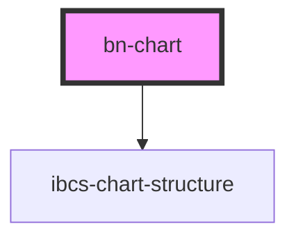

# bn-chart

<!-- Auto Generated Below -->

## Properties

| Property                 | Attribute         | Description                                                                                                                                                                                                        | Type       | Default     |
| ------------------------ | ----------------- | ------------------------------------------------------------------------------------------------------------------------------------------------------------------------------------------------------------------ | ---------- | ----------- |
| `canvasHeight`           | `canvas-height`   |                                                                                                                                                                                                                    | `number`   | `undefined` |
| `canvasWidth`            | `canvas-width`    |                                                                                                                                                                                                                    | `number`   | `undefined` |
| `hideCategories`         | `hide-categories` |                                                                                                                                                                                                                    | `boolean`  | `undefined` |
| `i18n`                   | `i-1-8n`          |                                                                                                                                                                                                                    | `string`   | `undefined` |
| `pixelPerUnit`           | `pixel-per-unit`  |                                                                                                                                                                                                                    | `number`   | `undefined` |
| `scenarios` _(required)_ | `scenarios`       | (mandatory) List of 4 scenarios.  the position of the scenario is maped to the datasource column scenario1 - scenario4  Valid scenarios are       values: ac \| fc \| py \| pl  (1-4)   example: ac, ac2, ac3, ac4 | `string`   | `undefined` |
| `styles`                 | `styles`          |                                                                                                                                                                                                                    | `"String"` | `undefined` |
| `variances`              | `variances`       |                                                                                                                                                                                                                    | `string`   | `undefined` |

## Dependencies

### Depends on

- ibcs-chart-structure

### Graph

----------------------------------------------

*Built with [StencilJS](https://stenciljs.com/)*
