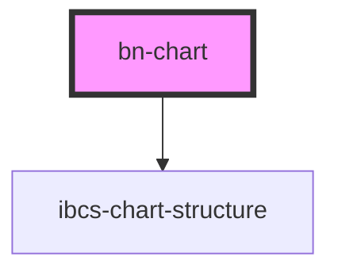

# bn-chart

<!-- Auto Generated Below -->

## Properties

| Property         | Attribute         | Description | Type      | Default     |
| ---------------- | ----------------- | ----------- | --------- | ----------- |
| `height`         | `height`          |             | `number`  | `undefined` |
| `hideCategories` | `hide-categories` |             | `boolean` | `undefined` |
| `pixelPerUnit`   | `pixel-per-unit`  |             | `number`  | `undefined` |
| `scenarios`      | `scenarios`       |             | `string`  | `undefined` |
| `variances`      | `variances`       |             | `string`  | `undefined` |
| `width`          | `width`           |             | `number`  | `undefined` |

## Dependencies

### Depends on

- ibcs-chart-structure

### Graph

----------------------------------------------

*Built with [StencilJS](https://stenciljs.com/)*
