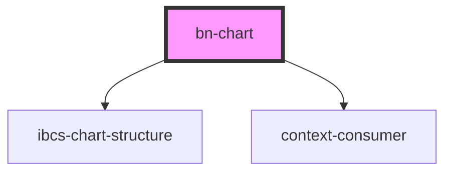

# bn-chart

<!-- Auto Generated Below -->

## Properties

| Property                   | Attribute          | Description                                                                                                                                                                                                                                                                                                                                                                                                                                                                                                                                                                                                                                                                                           | Type       | Default     |
| -------------------------- | ------------------ | ----------------------------------------------------------------------------------------------------------------------------------------------------------------------------------------------------------------------------------------------------------------------------------------------------------------------------------------------------------------------------------------------------------------------------------------------------------------------------------------------------------------------------------------------------------------------------------------------------------------------------------------------------------------------------------------------------- | ---------- | ----------- |
| `chartTitle`               | `chart-title`      | (optional) Name of Chart displayed on top of the axis                                                                                                                                                                                                                                                                                                                                                                                                                                                                                                                                                                                                                                                 | `string`   | `undefined` |
| `datasource`               | `datasource`       |                                                                                                                                                                                                                                                                                                                                                                                                                                                                                                                                                                                                                                                                                                       | `string`   | `undefined` |
| `datasourcesData`          | `datasources-data` |                                                                                                                                                                                                                                                                                                                                                                                                                                                                                                                                                                                                                                                                                                       | `any`      | `undefined` |
| `height`                   | `height`           |                                                                                                                                                                                                                                                                                                                                                                                                                                                                                                                                                                                                                                                                                                       | `number`   | `undefined` |
| `i18n`                     | `i-1-8n`           |                                                                                                                                                                                                                                                                                                                                                                                                                                                                                                                                                                                                                                                                                                       | `string`   | `undefined` |
| `scenarios` _(required)_   | `scenarios`        | (mandatory) List of Scenarios Map.  the position of the scenario is maped to the datasource column scenario1 - scenario4  if empty the main chart is hidden  Valid scenarios are     values: ac \| fc \| py \| pl  (1-4)   example: ac, ac2, ac3, ac4   list of additonal variances which   are calculated form the given scenarios.  the scenarios used in the variances have also   be defined in the *scenarios* property.    the variance is defiend as  (Scenario A -  SvenarioB)  neg and pos post fix defines which value is *good*   a negative or a positive value.   if empty variance charts are hidden    each variance creates a chart     pattern:  d<scenarioB>_<scenarioA>_[pos\|neg] | `string`   | `undefined` |
| `styles`                   | `styles`           |                                                                                                                                                                                                                                                                                                                                                                                                                                                                                                                                                                                                                                                                                                       | `"String"` | `undefined` |
| `unitScaling` _(required)_ | `unit-scaling`     | Name of the 'scaling-group' which the chart uses  scalig groups are maintained globaly    alternativly a number which represent the  pixel per measure unit directy. the                                                                                                                                                                                                                                                                                                                                                                                                                                                                                                                              | `string`   | `undefined` |
| `width`                    | `width`            |                                                                                                                                                                                                                                                                                                                                                                                                                                                                                                                                                                                                                                                                                                       | `number`   | `undefined` |

## Dependencies

### Depends on

- ibcs-chart-structure
- context-consumer

### Graph

----------------------------------------------

*Built with [StencilJS](https://stenciljs.com/)*
