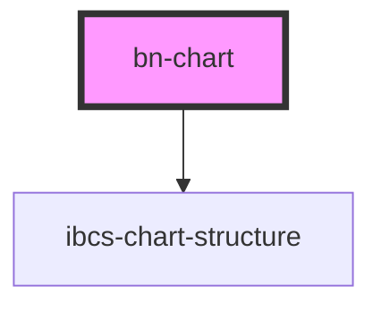

# bn-chart

**bn-chart**  is a report element and renderes data as structure-chart.
It supports the main chart with up to 4 scenarios and additonal variance charts (unlimited)

The **bn-chart** can be used within the bn-content element

## Mixins
@withStyle
@withComponentStatus
@withDataset


**Example**
```html
 <bn-body>
      <bn-chart
        internationalisation = null
        internationalisationMode = 'meta'
        level='category'
        order='category'
        order-direction='asc'
        scenarios='ac1,py1'
        styles=''
        unit-scaling='10'
        datasets="$marktwert"
      >
      </bn-chart>
</bn-body>
```
**Output**


**Custom BinoChartSyles Example**
```json
     {
      "scaleFactors": {
        barWidthYOffset: 0.95,
        fontNettoHeight: 0.7,
        needleWidthOffset: 0.7,
        barHeightOffset: 0.4,
        barWidthOffset: 0.3,
        pt2Px: 1.2,
        axisWidth: 0.1,
        rowHeight: 1.8,
      },
      "fontStyles": {
        font: "16px Calibri",
        size: 16,
        color: "#000000",
        backgroud: "#ffffff",
        leading: 1.8,
      },
      "axisStyles": {
        ac: {stroke: "#121212", fill: "#121212", width: 0.1},
        fc: {stroke: "#121212", fill: "#ffffff", width: 0.1, "dasharray": "10 5 5 5"},
        pp: {stroke: "#606060", fill: "#606060", width: 0.1},
        pl: {stroke: "#121212", fill: "#ffffff", width: 0.1},
      },
      "barStyles": {
        ac: {stroke: "#121212", fill: "#121212", width: 0.1},
        fc: {stroke: "#121212", fill: "#ffffff", width: 0.5, fillpattern: "fc"},
        pp: {stroke: "#606060", fill: "#606060", width: 0.1},
        pl: {stroke: "#121212", fill: "#ffffff", width: 0.1},
      },
      "varianceStyles": {
        pos: {stroke: "#AAFF00", fill: "#AAFF00", width: 0.1},
        neg: {stroke: "#FF0A0A", fill: "#FF0A0A", width: 0.1},
      },
      "padding": {
        top: 10,
        left: 10,
        right: 10,
        bottom: 10,
      },
      "pattern": new Map([["marker-up", {foreground: "", background: "", bgOffset: 0}],
        ["marker-down", {foreground: "", background: "", bgOffset: 0}]]),
    }
```
<!-- Auto Generated Below -->


## Properties

| Property                      | Attribute                   | Description                                                                                                                                                                                                                                                                                                                                                                                                                                                                                                                                                                                                                                                                                                                                                                                                                                                                                                                                                                | Type               | Default     |
| ----------------------------- | --------------------------- | -------------------------------------------------------------------------------------------------------------------------------------------------------------------------------------------------------------------------------------------------------------------------------------------------------------------------------------------------------------------------------------------------------------------------------------------------------------------------------------------------------------------------------------------------------------------------------------------------------------------------------------------------------------------------------------------------------------------------------------------------------------------------------------------------------------------------------------------------------------------------------------------------------------------------------------------------------------------------- | ------------------ | ----------- |
| `internationalisation`        | `internationalisation`      | Lookup Map of translation tokens. (TODO: SHE)                                                                                                                                                                                                                                                                                                                                                                                                                                                                                                                                                                                                                                                                                                                                                                                                                                                                                                                              | `string`           | `undefined` |
| `internationalisationMode`    | `internationalisation-mode` | Mode of Translation <br /><br /> values:<br /> ``` none // meta // all ``` <br /><br /> default:<br /> ``` meta ```                                                                                                                                                                                                                                                                                                                                                                                                                                                                                                                                                                                                                                                                                                                                                                                                                                                        | `string`           | `"meta"`    |
| `level` _(required)_          | `level`                     | Determines level on which the chart is aggregated on. <br /> <br />  values:<br/> ``` rowcategory // category // subcategory ``` <br /> <br />                                                                                                                                                                                                                                                                                                                                                                                                                                                                                                                                                                                                                                                                                                                                                                                                                             | `string`           | `undefined` |
| `order` _(required)_          | `order`                     | List of the primary scenarios on which the order direction are applied  valid scenarios are If order is set to a scenario it has also exists in scenariolist <br /><br /> values:<br /> ``` category // categoryindex // rowgroup // rowgroup // rowgroupindex // ac[1-4] // fc[1-4] // py[1-4] // pl[1-4] ```                                                                                                                                                                                                                                                                                                                                                                                                                                                                                                                                                                                                                                                             | `string`           | `undefined` |
| `orderDirection` _(required)_ | `order-direction`           | set sorting order direction <br /><br /> values:<br /> ```asc // desc```                                                                                                                                                                                                                                                                                                                                                                                                                                                                                                                                                                                                                                                                                                                                                                                                                                                                                                   | `string`           | `undefined` |
| `scenarios` _(required)_      | `scenarios`                 | List of Scenarios Map. <br /> <br /> per chart there are up to 4 different scenarios supported. The first 4 scenarios in the list are used, the rest ignored.  <br /> <br />  values:<br /> ```ac // fc // pp // pl  [1-4]```  example:<br /> ```ac1,ac2,ac3,ac4```  <br /> <br />   Variance chart can be added by seperating the scenarios   of each chart with ```;```<br />   The additonal variances which   are calculated form the given scenarios.   the scenarios used in the variances have also   be defined in the *scenarios* property. <br /> <br />   the variance is defiend as  (Scenario A -  ScenarioB)   neu. neg and pos post fix defines which value is *good*   a negative or a positive value. <br /> <br />   if empty variance charts are hidden <br /> <br />   each variance creates a chart <br /> <br />   pattern:<br />  ```d<scenarioB>_<scenarioA>_[pos/neg/neu]```     example: <br />```'ac1,pp1,fc1,fc2;dpp1_ac1_neg;dfc1_ac1_neg'``` | `string`           | `undefined` |
| `styles`                      | `styles`                    | Custom Styles for chart scnearios. <br /> <br /> feature is not yet activated <br /> <br /> interface for format is *BinoChartSyles*                                                                                                                                                                                                                                                                                                                                                                                                                                                                                                                                                                                                                                                                                                                                                                                                                                       | `string`           | `null`      |
| `unitScaling` _(required)_    | `unit-scaling`              | Name of the 'scaling-group' which the chart uses scalig groups are maintained globaly <br /> <br /> alternativly a number which represent the pixel per measure unit.                                                                                                                                                                                                                                                                                                                                                                                                                                                                                                                                                                                                                                                                                                                                                                                                      | `number \| string` | `undefined` |


## Dependencies

### Depends on

- ibcs-chart-structure

### Graph


----------------------------------------------

developed by Bino Bi
