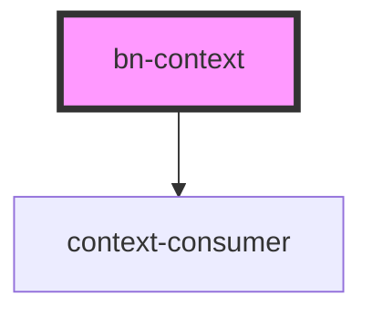

# bn-context

<!-- Auto Generated Below -->

## Properties

| Property    | Attribute    | Description                                    | Type      | Default |
| ----------- | ------------ | ---------------------------------------------- | --------- | ------- |
| `isPreview` | `is-preview` | Enable the preview mode to generate fake data. | `boolean` | `false` |

## Dependencies

### Depends on

- context-consumer

### Graph

----------------------------------------------

*Built with [StencilJS](https://stenciljs.com/)*
