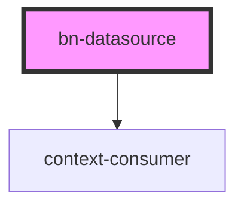

# bn-datasource

<!-- Auto Generated Below -->

## Properties

| Property           | Attribute    | Description                                    | Type                                                  | Default     |
| ------------------ | ------------ | ---------------------------------------------- | ----------------------------------------------------- | ----------- |
| `isPreview`        | `is-preview` |                                                | `boolean`                                             | `undefined` |
| `name`             | `name`       | Unique (template scope) name of the datasource | `string`                                              | `undefined` |
| `type`             | `type`       | single or collection                           | `string`                                              | `'single'`  |
| `updateDataSource` | --           |                                                | `(name: string, data: object, hash?: string) => void` | `undefined` |

## Methods

### `emitData(data: any, hash?: string) => Promise<void>`

#### Returns

Type: `Promise<void>`

## Dependencies

### Depends on

- context-consumer

### Graph

----------------------------------------------

*Built with [StencilJS](https://stenciljs.com/)*
