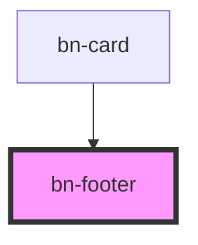

# bn-footer

<!-- Auto Generated Below -->

## Properties

| Property            | Attribute             | Description | Type      | Default     |
| ------------------- | --------------------- | ----------- | --------- | ----------- |
| `displayPageNumber` | `display-page-number` |             | `boolean` | `true`      |
| `pageNumber`        | `page-number`         |             | `number`  | `null`      |
| `text`              | `text`                |             | `string`  | `undefined` |

## Dependencies

### Used by

 - [bn-card](../bn-card)

### Graph

----------------------------------------------

*Built with [StencilJS](https://stenciljs.com/)*
