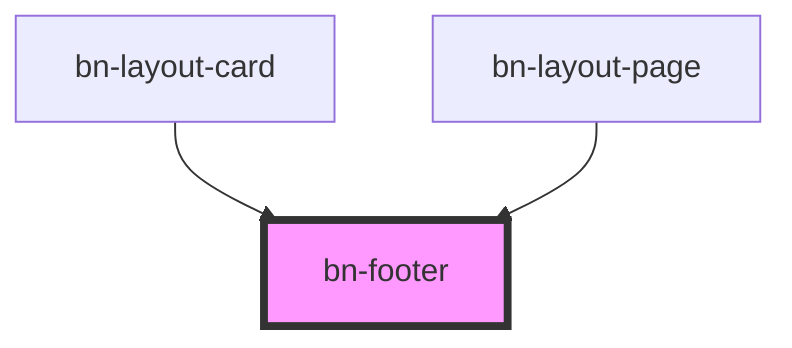

# bn-footer

Page or card footer with optional text and page number. Placed as the last child inside a [`<bn-page>`](../bn-page/readme.md).

## Usage

```html
<bn-page format="hd" orientation="landscape">
  <bn-body>...</bn-body>
  <bn-footer text="Source: ERP System" display-page-number="true"></bn-footer>
</bn-page>
```

### Page Numbers

Page numbers are assigned by `<bn-context>`, by position. A `page-number` you set yourself is kept, and it can be any text, for example `page-number="A-1"`. Toggle visibility:

```html
<!-- Show page number (default) -->
<bn-footer display-page-number="true"></bn-footer>

<!-- Hide page number -->
<bn-footer display-page-number="false"></bn-footer>
```

<!-- Auto Generated Below -->


## Properties

| Property            | Attribute             | Description                                                                                                             | Type      | Default     |
| ------------------- | --------------------- | ----------------------------------------------------------------------------------------------------------------------- | --------- | ----------- |
| `displayPageNumber` | `display-page-number` | Toggle if pagenumer label is displayed                                                                                  | `boolean` | `true`      |
| `pageNumber`        | `page-number`         | Page label: a number or any text, e.g. `3` or `A-1`. Is displayed if displayPageNumber == true                          | `string`  | `null`      |
| `selectedStyle`     | `selected-style`      | Name of the component style to use (the `name` of a `<bn-component-style>`). Its values go on top of the default style. | `string`  | `undefined` |
| `text`              | `text`                | Footer text. <br />If empty string (`''` or `null`) the footer row is omitted                                           | `string`  | `undefined` |


## Dependencies

### Used by

 - [bn-layout-card](../bn-layout-card)
 - [bn-layout-page](../bn-layout-page)

### Graph


----------------------------------------------

developed by Bino Bi
