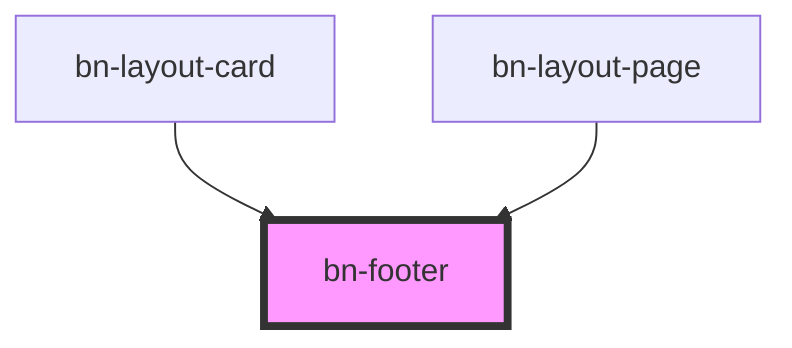

# bn-footer

Page or card footer with optional text, image, and page number. Placed as the last child inside a [`<bn-page>`](../bn-page/readme.md).

## Usage

```html
<bn-page format="hd" orientation="landscape">
  <bn-body>...</bn-body>
  <bn-footer text="Source: ERP System" display-page-number="true"></bn-footer>
</bn-page>
```

### With Code Image

Display a QR code or other image in the footer using an asset reference:

```html
<bn-asset name="qr-code">data:image/png;base64,...</bn-asset>
<bn-footer text="Confidential" code="qr-code"></bn-footer>
```

### Page Numbers

Page numbers are automatically assigned by `<bn-context>`. Toggle visibility:

```html
<!-- Show page number (default) -->
<bn-footer display-page-number="true"></bn-footer>

<!-- Hide page number -->
<bn-footer display-page-number="false"></bn-footer>
```

<!-- Auto Generated Below -->


## Properties

| Property            | Attribute             | Description                                                                                    | Type      | Default     |
| ------------------- | --------------------- | ---------------------------------------------------------------------------------------------- | --------- | ----------- |
| `code`              | `code`                | code . <br />If empty string (`''` or `null`) the footer row is omitted                        | `string`  | `undefined` |
| `displayPageNumber` | `display-page-number` | Toggle if pagenumer label is displayed                                                         | `boolean` | `true`      |
| `pageNumber`        | `page-number`         | Page label: a number or any text, e.g. `3` or `A-1`. Is displayed if displayPageNumber == true | `string`  | `null`      |
| `text`              | `text`                | Footer text. <br />If empty string (`''` or `null`) the footer row is omitted                  | `string`  | `undefined` |


## Dependencies

### Used by

 - [bn-layout-card](../bn-layout-card)
 - [bn-layout-page](../bn-layout-page)

### Graph


----------------------------------------------

developed by Bino Bi
