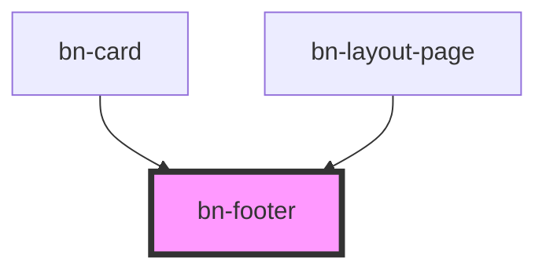

# bn-footer

**bn-footer** determines the area in which the footer-content of the report is placed.
The **bn-body** is a child element of bn-page and mandatory for a valid report template.

<!-- Auto Generated Below -->

## Properties

| Property            | Attribute             | Description                                                                   | Type      | Default     |
| ------------------- | --------------------- | ----------------------------------------------------------------------------- | --------- | ----------- |
| `code`              | `code`                | code .  If empty string (`''` or `null`) the footer row is omitted       | `string`  | `undefined` |
| `displayPageNumber` | `display-page-number` | Toggle if pagenumer label is displayed                                        | `boolean` | `true`      |
| `pageNumber`        | `page-number`         | Pagenumber value. Is displayed if displayPageNumber == true                   | `number`  | `null`      |
| `text`              | `text`                | Footer text.  If empty string (`''` or `null`) the footer row is omitted | `string`  | `undefined` |

## Dependencies

### Used by

 - [bn-card](../bn-card)
 - [bn-layout-page](../bn-layout-page)

### Graph

----------------------------------------------

developed by Bino Bi
