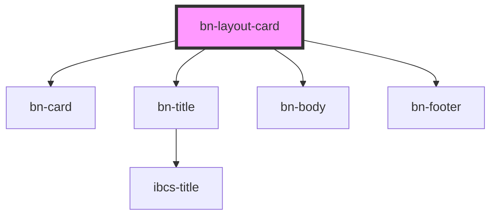

# bn-layout-card

Card component with built-in title, body, and footer layout, plus a configurable grid for arranging content. Similar to [`<bn-layout-page>`](../bn-layout-page/readme.md) but at the card level.

## Usage

```html
<bn-layout-card
  card-layout="split-vertical"
  title-business-unit="Sales Division"
  title-scenarios="ac1,pl1"
  footer-text="Source: ERP">

  <div slot="1">
    <bn-chart-time scenarios="ac1,pl1"></bn-chart-time>
  </div>
  <div slot="2">
    <bn-table scenarios="ac1,pl1"></bn-table>
  </div>
</bn-layout-card>
```

### Card Layouts

Same layout options as `<bn-layout-page>`: `full`, `split-vertical`, `split-horizontal`, `2x2`, `3x3`, `4x4`, `1-over-2`, `1-over-3`, `2-over-1`, `3-over-1`, `custom-template`.

### Title Props

Title configuration is passed through to the inner [`<bn-title>`](../bn-title/readme.md):

- `title-business-unit` — Organization name
- `title-scenarios` — Scenario list
- `title-variances` — Variance list
- `title-measures` — JSON measure array
- `title-image` — Image URL or asset name for the card header
- `title-order` / `title-order-direction` — Sort indicator
- `title-date-start` / `title-date-end` — Date range
- `title-date-format` / `title-date-link` — Date formatting

### Border

```html
<bn-layout-card card-show-border="true" card-layout="full">
  ...
</bn-layout-card>
```

<!-- Auto Generated Below -->


## Properties

| Property              | Attribute               | Description                                                                                                                                                                                                                                                                                                                                                                                                                                                                                                                                    | Type                                                                                                                                                       | Default         |
| --------------------- | ----------------------- | ---------------------------------------------------------------------------------------------------------------------------------------------------------------------------------------------------------------------------------------------------------------------------------------------------------------------------------------------------------------------------------------------------------------------------------------------------------------------------------------------------------------------------------------------- | ---------------------------------------------------------------------------------------------------------------------------------------------------------- | --------------- |
| `cardCustomTemplate`  | `card-custom-template`  | CSS `grid-template-areas` string used when `cardLayout` is set to `custom-template`. Each quoted row defines a grid row; letters map to slot indices in order of first appearance.                                                                                                                                                                                                                                                                                                                                                             | `string`                                                                                                                                                   | `'"a b" "c d"'` |
| `cardFitToContent`    | `card-fit-to-content`   | When `true`, the card shrinks to fit its content (`fit-content`) for both width and height. When `false` (default), the card stretches to fill its parent (`100%`). Use `false` when the card contains auto-scaling components.                                                                                                                                                                                                                                                                                                                                                                                      | `boolean`                                                                                                                                                  | `false`         |
| `cardGridGap`         | `card-grid-gap`         | Gap between grid cells in pixels.                                                                                                                                                                                                                                                                                                                                                                                                                                                                                                              | `string`                                                                                                                                                   | `"0"`           |
| `cardLayout`          | `card-layout`           | Layout mode that controls how child components are arranged inside the card body using CSS Grid. <br /><br /> values:<br /> ```full // split-vertical // split-horizontal // 2x2 // 3x3 // 4x4 // 1-over-2 // 1-over-3 // 2-over-1 // 3-over-1 // custom-template``` <br /><br /> `full`: single slot. `split-vertical`: two side-by-side slots. `split-horizontal`: two stacked slots. `NxN`: equal grid. `1-over-2`: one full-width slot on top, two below. `custom-template`: uses the `cardCustomTemplate` CSS grid-template-areas string. | `"1-over-2" \| "1-over-3" \| "2-over-1" \| "2x2" \| "3-over-1" \| "3x3" \| "4x4" \| "custom-template" \| "full" \| "split-horizontal" \| "split-vertical"` | `"full"`        |
| `cardShowBorder`      | `card-show-border`      | Whether to display a visible border around the card.                                                                                                                                                                                                                                                                                                                                                                                                                                                                                           | `boolean`                                                                                                                                                  | `true`          |
| `footerText`          | `footer-text`           | Text displayed in the card footer. If empty, the footer text is omitted.                                                                                                                                                                                                                                                                                                                                                                                                                                                                       | `string`                                                                                                                                                   | `""`            |
| `styles`              | `styles`                | JSON string of component-style overrides passed through to the inner `<bn-card>` element. Typically set via a `ComponentStyle` manifest rather than directly on the component.                                                                                                                                                                                                                                                                                                                                                                 | `string`                                                                                                                                                   | `undefined`     |
| `titleBusinessUnit`   | `title-business-unit`   | Name of the business unit displayed in the title header row. If empty, the business unit row is omitted.                                                                                                                                                                                                                                                                                                                                                                                                                                       | `string`                                                                                                                                                   | `""`            |
| `titleDateEnd`        | `title-date-end`        | End date displayed in the title date row. Accepts `yyyy-MM-dd` (e.g. `2024-12-31`) or ISO 8601 datetime (e.g. `2024-12-31T23:59:59Z`).                                                                                                                                                                                                                                                                                                                                                                                                         | `string`                                                                                                                                                   | `undefined`     |
| `titleDateFormat`     | `title-date-format`     | Date display format used in the title row. <br /><br /> values:<br /> ```year // quarter // month // week // day // time // auto // none``` <br /><br /> `year`: YYYY, `quarter`: Q[Q] YYYY, `month`: MMM YYYY, `week`: [KW]WW YYYY, `day`: DD.MM.YYYY, `time`: DD.MM.YYYY HH:mm:ss, `auto`: automatic detection, `none`: DD.MM.YYYY.                                                                                                                                                                                                          | `string`                                                                                                                                                   | `"none"`        |
| `titleDateLink`       | `title-date-link`       | Format in which the start and end dates are linked in the title. If set to `none` a plain date is shown. <br /><br /> values:<br /> ```avg // interval // cum // start // end // ytd // ytg // mat // none``` <br /><br /> `avg`: Ø[DATE], `interval`: [DATE]..[DATE2], `start`: .[DATE], `end`: [DATE]., `ytd`: _[DATE], `ytg`: [DATE]_, `cum`: [DATE]_[DATE2], `mat`: ~[DATE], `none`: [DATE].                                                                                                                                               | `string`                                                                                                                                                   | `"none"`        |
| `titleDateStart`      | `title-date-start`      | Start date displayed in the title date row. Accepts `yyyy-MM-dd` (e.g. `2024-01-01`) or ISO 8601 datetime (e.g. `2024-01-01T14:30:00Z`).                                                                                                                                                                                                                                                                                                                                                                                                       | `string`                                                                                                                                                   | `undefined`     |
| `titleImage`          | `title-image`           | URL or asset name of the image displayed next to the card title. The value is resolved via the scoped assets store: if it matches a registered asset name, the stored URL is used; otherwise the raw value is treated as a URL. The deprecated `asset:` prefix is still supported for backward compatibility. <br /><br /> If empty, the title image is omitted.                                                                                                                                                                               | `string`                                                                                                                                                   | `""`            |
| `titleMeasures`       | `title-measures`        | Array of measure objects with `name` and `unit` displayed in the title. Passed as a JSON string. If all units are the same, redundant units are reduced and names concatenated. If empty, the measure row is omitted.                                                                                                                                                                                                                                                                                                                          | `string`                                                                                                                                                   | `undefined`     |
| `titleNamespace`      | `title-namespace`       | Namespace used for title translations via the internationalization store.                                                                                                                                                                                                                                                                                                                                                                                                                                                                      | `string`                                                                                                                                                   | `"_system"`     |
| `titleOrder`          | `title-order`           | Primary column on which the order direction is applied. <br /><br /> values:<br /> ```category // categoryindex // rowgroup // rowgroupindex // ac // fc // py // pl```                                                                                                                                                                                                                                                                                                                                                                        | `string`                                                                                                                                                   | `"category"`    |
| `titleOrderDirection` | `title-order-direction` | Sorting order direction for the column specified by `titleOrder`. <br /><br /> values:<br /> ```asc // desc```                                                                                                                                                                                                                                                                                                                                                                                                                                 | `string`                                                                                                                                                   | `"asc"`         |
| `titleScenarios`      | `title-scenarios`       | List of scenarios displayed in the title header. <br /><br /> Comma-separated string or omitted. If empty, the scenarios row is omitted. <br /><br /> values:<br /> ```ac // fc // py // pl```                                                                                                                                                                                                                                                                                                                                                 | `string`                                                                                                                                                   | `undefined`     |
| `titleVariances`      | `title-variances`       | List of variances calculated from the given scenarios. The scenarios used in the variances must also be defined in the `titleScenarios` property. The variance is defined as (ScenarioA − ScenarioB). The pos/neg/neu postfix defines which direction is considered "good". <br /><br /> If empty, variance indicators are hidden. <br /><br /> pattern:<br /> ```d<scenarioB>_<scenarioA>_[pos/neg/neu]```                                                                                                                                    | `string`                                                                                                                                                   | `undefined`     |


## Methods

### `getNumberOfSlot(name: string) => Promise<number>`


#### Parameters

| Name   | Type     | Description |
| ------ | -------- | ----------- |
| `name` | `string` |             |

#### Returns

Type: `Promise<number>`


## Dependencies

### Depends on

- [bn-card](../bn-card)
- [bn-title](../bn-title)
- [bn-body](../bn-body)
- [bn-footer](../bn-footer)

### Graph


----------------------------------------------

developed by Bino Bi
