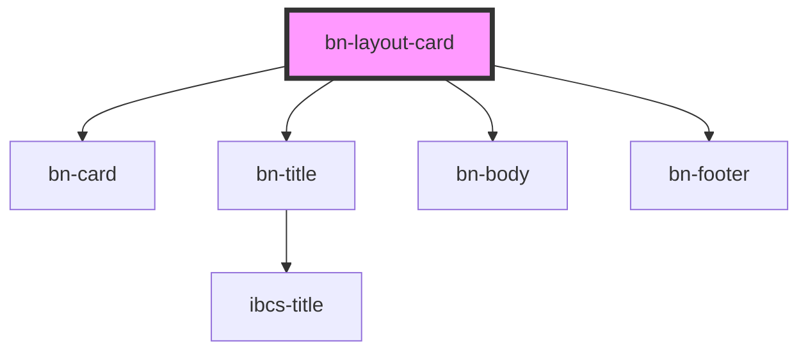

# bn-layout-page

<!-- Auto Generated Below -->

## Properties

| Property              | Attribute               | Description | Type                                                                                                                                                       | Default         |
| --------------------- | ----------------------- | ----------- | ---------------------------------------------------------------------------------------------------------------------------------------------------------- | --------------- |
| `cardCustomTemplate`  | `card-custom-template`  |             | `string`                                                                                                                                                   | `'"a b" "c d"'` |
| `cardFitToContent`    | `card-fit-to-content`   |             | `boolean`                                                                                                                                                  | `true`          |
| `cardGridGap`         | `card-grid-gap`         |             | `string`                                                                                                                                                   | `"0"`           |
| `cardLayout`          | `card-layout`           |             | `"1-over-2" \| "1-over-3" \| "2-over-1" \| "2x2" \| "3-over-1" \| "3x3" \| "4x4" \| "custom-template" \| "full" \| "split-horizontal" \| "split-vertical"` | `"full"`        |
| `cardShowBorder`      | `card-show-border`      |             | `boolean`                                                                                                                                                  | `true`          |
| `footerText`          | `footer-text`           |             | `string`                                                                                                                                                   | `""`            |
| `styles`              | `styles`                |             | `string`                                                                                                                                                   | `undefined`     |
| `titleBusinessUnit`   | `title-business-unit`   |             | `string`                                                                                                                                                   | `""`            |
| `titleDateEnd`        | `title-date-end`        |             | `string`                                                                                                                                                   | `undefined`     |
| `titleDateFormat`     | `title-date-format`     |             | `string`                                                                                                                                                   | `"none"`        |
| `titleDateLink`       | `title-date-link`       |             | `string`                                                                                                                                                   | `"none"`        |
| `titleDateStart`      | `title-date-start`      |             | `string`                                                                                                                                                   | `undefined`     |
| `titleImage`          | `title-image`           |             | `string`                                                                                                                                                   | `""`            |
| `titleMeasures`       | `title-measures`        |             | `string`                                                                                                                                                   | `undefined`     |
| `titleNamespace`      | `title-namespace`       |             | `string`                                                                                                                                                   | `"_system"`     |
| `titleOrder`          | `title-order`           |             | `string`                                                                                                                                                   | `"category"`    |
| `titleOrderDirection` | `title-order-direction` |             | `string`                                                                                                                                                   | `"asc"`         |
| `titleScenarios`      | `title-scenarios`       |             | `string`                                                                                                                                                   | `undefined`     |
| `titleVariances`      | `title-variances`       |             | `string`                                                                                                                                                   | `undefined`     |

## Methods

### `getNumberOfSlot(name: string) => Promise<number>`

#### Parameters

| Name   | Type     | Description |
| ------ | -------- | ----------- |
| `name` | `string` |             |

#### Returns

Type: `Promise<number>`

## Dependencies

### Depends on

- [bn-card](../bn-card)
- [bn-title](../bn-title)
- [bn-body](../bn-body)
- [bn-footer](../bn-footer)

### Graph

----------------------------------------------

developed by Bino Bi
