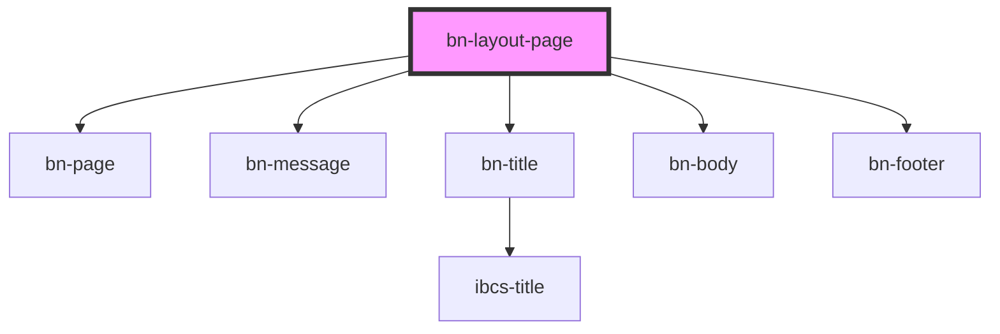

# bn-layout-page

High-level page component that combines a title, body, and footer with a configurable grid layout for arranging multiple cards or visualizations.

## Usage

```html
<bn-layout-page
  page-format="hd"
  page-orientation="landscape"
  page-layout="2x2"
  title-business-unit="ACME Corp"
  title-scenarios="ac1,pl1"
  title-measures='[{"name":"Revenue","unit":"mEUR"}]'
  footer-text="Confidential">

  <div slot="1">
    <bn-chart-time scenarios="ac1,pl1"></bn-chart-time>
  </div>
  <div slot="2">
    <bn-chart-structure scenarios="ac1,pl1"></bn-chart-structure>
  </div>
  <div slot="3">
    <bn-table scenarios="ac1,pl1"></bn-table>
  </div>
  <div slot="4">
    <bn-table scenarios="ac1,pp1"></bn-table>
  </div>
</bn-layout-page>
```

### Page Layouts

| Layout | Description |
|--------|-------------|
| `full` | Single content area (default) |
| `split-vertical` | Two columns side by side |
| `split-horizontal` | Two rows stacked |
| `2x2` | 2x2 grid (4 slots) |
| `3x3` | 3x3 grid (9 slots) |
| `4x4` | 4x4 grid (16 slots) |
| `1-over-2` | One row on top, two columns below |
| `1-over-3` | One row on top, three columns below |
| `2-over-1` | Two columns on top, one row below |
| `3-over-1` | Three columns on top, one row below |
| `custom-template` | Custom CSS grid-template-areas |

### Custom Template

```html
<bn-layout-page
  page-layout="custom-template"
  page-custom-template='"header header" "left right"'>

  <div slot="header">...</div>
  <div slot="left">...</div>
  <div slot="right">...</div>
</bn-layout-page>
```

### Title Props

Title configuration is passed through to the inner [`<bn-title>`](../bn-title/readme.md):

- `title-business-unit` — Organization name
- `title-scenarios` — Scenario list
- `title-variances` — Variance list
- `title-measures` — JSON measure array
- `title-order` / `title-order-direction` — Sort indicator
- `title-date-start` / `title-date-end` — Date range
- `title-date-format` / `title-date-link` — Date formatting

<!-- Auto Generated Below -->


## Properties

| Property                  | Attribute                    | Description | Type                                                                                                                                                       | Default         |
| ------------------------- | ---------------------------- | ----------- | ---------------------------------------------------------------------------------------------------------------------------------------------------------- | --------------- |
| `footerDisplayPageNumber` | `footer-display-page-number` |             | `boolean`                                                                                                                                                  | `true`          |
| `footerText`              | `footer-text`                |             | `string`                                                                                                                                                   | `undefined`     |
| `messageImage`            | `message-image`              |             | `string`                                                                                                                                                   | `""`            |
| `messageText`             | `message-text`               |             | `string`                                                                                                                                                   | `""`            |
| `pageCustomTemplate`      | `page-custom-template`       |             | `string`                                                                                                                                                   | `'"a b" "c d"'` |
| `pageFitToContent`        | `page-fit-to-content`        |             | `boolean`                                                                                                                                                  | `true`          |
| `pageFormat`              | `page-format`                |             | `string`                                                                                                                                                   | `undefined`     |
| `pageGridGap`             | `page-grid-gap`              |             | `string`                                                                                                                                                   | `"0"`           |
| `pageLayout`              | `page-layout`                |             | `"1-over-2" \| "1-over-3" \| "2-over-1" \| "2x2" \| "3-over-1" \| "3x3" \| "4x4" \| "custom-template" \| "full" \| "split-horizontal" \| "split-vertical"` | `"full"`        |
| `pageNumber`              | `page-number`                |             | `string`                                                                                                                                                   | `undefined`     |
| `pageOrientation`         | `page-orientation`           |             | `string`                                                                                                                                                   | `undefined`     |
| `styles`                  | `styles`                     |             | `string`                                                                                                                                                   | `undefined`     |
| `titleBusinessUnit`       | `title-business-unit`        |             | `string`                                                                                                                                                   | `""`            |
| `titleDateEnd`            | `title-date-end`             |             | `string`                                                                                                                                                   | `undefined`     |
| `titleDateFormat`         | `title-date-format`          |             | `string`                                                                                                                                                   | `"none"`        |
| `titleDateLink`           | `title-date-link`            |             | `string`                                                                                                                                                   | `"none"`        |
| `titleDateStart`          | `title-date-start`           |             | `string`                                                                                                                                                   | `undefined`     |
| `titleMeasures`           | `title-measures`             |             | `string`                                                                                                                                                   | `undefined`     |
| `titleNamespace`          | `title-namespace`            |             | `string`                                                                                                                                                   | `"_system"`     |
| `titleOrder`              | `title-order`                |             | `string`                                                                                                                                                   | `"category"`    |
| `titleOrderDirection`     | `title-order-direction`      |             | `string`                                                                                                                                                   | `"asc"`         |
| `titleScenarios`          | `title-scenarios`            |             | `string`                                                                                                                                                   | `undefined`     |
| `titleVariances`          | `title-variances`            |             | `string`                                                                                                                                                   | `undefined`     |


## Methods

### `getNumberOfSlot(name: string) => Promise<number>`


#### Parameters

| Name   | Type     | Description |
| ------ | -------- | ----------- |
| `name` | `string` |             |

#### Returns

Type: `Promise<number>`


## Dependencies

### Depends on

- [bn-page](../bn-page)
- [bn-message](../bn-message)
- [bn-title](../bn-title)
- [bn-body](../bn-body)
- [bn-footer](../bn-footer)

### Graph


----------------------------------------------

developed by Bino Bi
