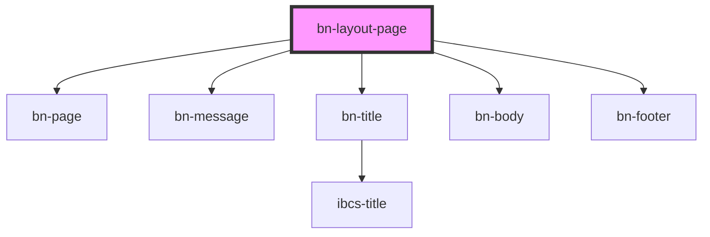

# bn-layout-page

High-level page component that combines a title, body, and footer with a configurable grid layout for arranging multiple cards or visualizations.

## Usage

```html
<bn-layout-page
  page-format="hd"
  page-orientation="landscape"
  page-layout="2x2"
  title-business-unit="ACME Corp"
  title-scenarios="ac1,pl1"
  title-measures='[{"name":"Revenue","unit":"mEUR"}]'
  footer-text="Confidential">

  <div slot="1">
    <bn-chart-time scenarios="ac1,pl1"></bn-chart-time>
  </div>
  <div slot="2">
    <bn-chart-structure scenarios="ac1,pl1"></bn-chart-structure>
  </div>
  <div slot="3">
    <bn-table scenarios="ac1,pl1"></bn-table>
  </div>
  <div slot="4">
    <bn-table scenarios="ac1,pp1"></bn-table>
  </div>
</bn-layout-page>
```

### Page Layouts

| Layout | Description |
|--------|-------------|
| `full` | Single content area (default) |
| `split-vertical` | Two columns side by side |
| `split-horizontal` | Two rows stacked |
| `2x2` | 2x2 grid (4 slots) |
| `3x3` | 3x3 grid (9 slots) |
| `4x4` | 4x4 grid (16 slots) |
| `1-over-2` | One row on top, two columns below |
| `1-over-3` | One row on top, three columns below |
| `2-over-1` | Two columns on top, one row below |
| `3-over-1` | Three columns on top, one row below |
| `custom-template` | Custom CSS grid-template-areas |

### Custom Template

```html
<bn-layout-page
  page-layout="custom-template"
  page-custom-template='"header header" "left right"'>

  <div slot="header">...</div>
  <div slot="left">...</div>
  <div slot="right">...</div>
</bn-layout-page>
```

### Title Props

Title configuration is passed through to the inner [`<bn-title>`](../bn-title/readme.md):

- `title-business-unit` — Organization name
- `title-scenarios` — Scenario list
- `title-variances` — Variance list
- `title-measures` — JSON measure array
- `title-order` / `title-order-direction` — Sort indicator
- `title-date-start` / `title-date-end` — Date range
- `title-date-format` / `title-date-link` — Date formatting

<!-- Auto Generated Below -->


## Properties

| Property                  | Attribute                    | Description                                                                                                                                                                                                                                                                                                                                                                                                                                                                                                                                | Type                                                                                                                                                       | Default         |
| ------------------------- | ---------------------------- | ------------------------------------------------------------------------------------------------------------------------------------------------------------------------------------------------------------------------------------------------------------------------------------------------------------------------------------------------------------------------------------------------------------------------------------------------------------------------------------------------------------------------------------------ | ---------------------------------------------------------------------------------------------------------------------------------------------------------- | --------------- |
| `footerDisplayPageNumber` | `footer-display-page-number` | Whether to display the page number in the footer.                                                                                                                                                                                                                                                                                                                                                                                                                                                                                          | `boolean`                                                                                                                                                  | `true`          |
| `footerText`              | `footer-text`                | Text displayed in the page footer. If empty, the footer text is omitted.                                                                                                                                                                                                                                                                                                                                                                                                                                                                   | `string`                                                                                                                                                   | `undefined`     |
| `messageImage`            | `message-image`              | URL or asset name of the image displayed in the message row. If the value is not an HTTP URL it is looked up in the asset store. If empty, the image is omitted.                                                                                                                                                                                                                                                                                                                                                                           | `string`                                                                                                                                                   | `""`            |
| `messageText`             | `message-text`               | Message text displayed in the message row above the title. If empty, the message row is omitted.                                                                                                                                                                                                                                                                                                                                                                                                                                           | `string`                                                                                                                                                   | `""`            |
| `pageCustomTemplate`      | `page-custom-template`       | CSS `grid-template-areas` string used when `pageLayout` is set to `custom-template`. Each quoted row defines a grid row; letters map to slot indices in order of first appearance.                                                                                                                                                                                                                                                                                                                                                         | `string`                                                                                                                                                   | `'"a b" "c d"'` |
| `pageFitToContent`        | `page-fit-to-content`        | When `true`, the page body height shrinks to fit its content (`fit-content`). When `false` (default), the body stretches to fill the full page height (`100%`). Width is always `100%` regardless of this setting. <br /><br /> Use `false` (default) when the page contains components with auto-scaling (e.g. `unit-scaling="auto"` or `scale="auto"`), because auto-scaling needs a fixed parent height to calculate dimensions.                                                                                                        | `boolean`                                                                                                                                                  | `false`         |
| `pageFormat`              | `page-format`                | Page size format. Determines the pixel dimensions of the rendered page. <br /><br /> values:<br /> ```xga // hd // full-hd // 4k // 4k2k // a4 // a3 // a2 // a1 // a0 // letter // legal```                                                                                                                                                                                                                                                                                                                                               | `string`                                                                                                                                                   | `undefined`     |
| `pageGridGap`             | `page-grid-gap`              | Gap between grid cells in pixels.                                                                                                                                                                                                                                                                                                                                                                                                                                                                                                          | `string`                                                                                                                                                   | `"0"`           |
| `pageLayout`              | `page-layout`                | Layout mode that controls how child components are arranged in the page body using CSS Grid. <br /><br /> values:<br /> ```full // split-vertical // split-horizontal // 2x2 // 3x3 // 4x4 // 1-over-2 // 1-over-3 // 2-over-1 // 3-over-1 // custom-template``` <br /><br /> `full`: single slot. `split-vertical`: two side-by-side slots. `split-horizontal`: two stacked slots. `NxN`: equal grid. `1-over-2`: one full-width slot on top, two below. `custom-template`: uses the `pageCustomTemplate` CSS grid-template-areas string. | `"1-over-2" \| "1-over-3" \| "2-over-1" \| "2x2" \| "3-over-1" \| "3x3" \| "4x4" \| "custom-template" \| "full" \| "split-horizontal" \| "split-vertical"` | `"full"`        |
| `pageNumber`              | `page-number`                | Page number displayed in the footer. If empty, no page number is shown (unless `footerDisplayPageNumber` is also set).                                                                                                                                                                                                                                                                                                                                                                                                                     | `string`                                                                                                                                                   | `undefined`     |
| `pageOrientation`         | `page-orientation`           | Page orientation. Default depends on the chosen format. <br /><br /> values:<br /> ```landscape // portrait```                                                                                                                                                                                                                                                                                                                                                                                                                             | `string`                                                                                                                                                   | `undefined`     |
| `selectedStyle`           | `selected-style`             | Name of a registered component style (see `bn-component-style`) passed through to the inner `<bn-page>` element as its `selected-style` attribute.                                                                                                                                                                                                                                                                                                                                                                                         | `string`                                                                                                                                                   | `undefined`     |
| `styles`                  | `styles`                     | JSON string of component-style overrides passed through to the inner `<bn-page>` element. Typically set via a `ComponentStyle` manifest rather than directly on the component.                                                                                                                                                                                                                                                                                                                                                             | `string`                                                                                                                                                   | `undefined`     |
| `titleBusinessUnit`       | `title-business-unit`        | Name of the business unit displayed in the title header row. If empty, the business unit row is omitted.                                                                                                                                                                                                                                                                                                                                                                                                                                   | `string`                                                                                                                                                   | `""`            |
| `titleDateEnd`            | `title-date-end`             | End date displayed in the title date row. Accepts `yyyy-MM-dd` (e.g. `2024-12-31`) or ISO 8601 datetime (e.g. `2024-12-31T23:59:59Z`).                                                                                                                                                                                                                                                                                                                                                                                                     | `string`                                                                                                                                                   | `undefined`     |
| `titleDateFormat`         | `title-date-format`          | Date display format used in the title row. <br /><br /> values:<br /> ```year // quarter // month // week // day // time // auto // none``` <br /><br /> `year`: YYYY, `quarter`: Q[Q] YYYY, `month`: MMM YYYY, `week`: [KW]WW YYYY, `day`: DD.MM.YYYY, `time`: DD.MM.YYYY HH:mm:ss, `auto`: automatic detection, `none`: DD.MM.YYYY.                                                                                                                                                                                                      | `string`                                                                                                                                                   | `"none"`        |
| `titleDateLink`           | `title-date-link`            | Format in which the start and end dates are linked in the title. If set to `none` a plain date is shown. <br /><br /> values:<br /> ```avg // interval // cum // start // end // ytd // ytg // mat // none``` <br /><br /> `avg`: Ø[DATE], `interval`: [DATE]..[DATE2], `start`: .[DATE], `end`: [DATE]., `ytd`: _[DATE], `ytg`: [DATE]_, `cum`: [DATE]_[DATE2], `mat`: ~[DATE], `none`: [DATE].                                                                                                                                           | `string`                                                                                                                                                   | `"none"`        |
| `titleDateStart`          | `title-date-start`           | Start date displayed in the title date row. Accepts `yyyy-MM-dd` (e.g. `2024-01-01`) or ISO 8601 datetime (e.g. `2024-01-01T14:30:00Z`).                                                                                                                                                                                                                                                                                                                                                                                                   | `string`                                                                                                                                                   | `undefined`     |
| `titleMeasures`           | `title-measures`             | Array of measure objects with `name` and `unit` displayed in the title. Passed as a JSON string. If all units are the same, redundant units are reduced and names concatenated. If empty, the measure row is omitted.                                                                                                                                                                                                                                                                                                                      | `string`                                                                                                                                                   | `undefined`     |
| `titleNamespace`          | `title-namespace`            | Namespace used for title translations via the internationalization store.                                                                                                                                                                                                                                                                                                                                                                                                                                                                  | `string`                                                                                                                                                   | `"_system"`     |
| `titleOrder`              | `title-order`                | Primary column on which the order direction is applied. <br /><br /> values:<br /> ```category // categoryindex // rowgroup // rowgroupindex // ac // fc // py // pl```                                                                                                                                                                                                                                                                                                                                                                    | `string`                                                                                                                                                   | `"category"`    |
| `titleOrderDirection`     | `title-order-direction`      | Sorting order direction for the column specified by `titleOrder`. <br /><br /> values:<br /> ```asc // desc```                                                                                                                                                                                                                                                                                                                                                                                                                             | `string`                                                                                                                                                   | `"asc"`         |
| `titleScenarios`          | `title-scenarios`            | List of scenarios displayed in the title header. <br /><br /> Comma-separated string or omitted. If empty, the scenarios row is omitted. <br /><br /> values:<br /> ```ac // fc // py // pl```                                                                                                                                                                                                                                                                                                                                             | `string`                                                                                                                                                   | `undefined`     |
| `titleVariances`          | `title-variances`            | List of variances calculated from the given scenarios. The scenarios used in the variances must also be defined in the `titleScenarios` property. The variance is defined as (ScenarioA − ScenarioB). The pos/neg/neu postfix defines which direction is considered "good". <br /><br /> If empty, variance indicators are hidden. <br /><br /> pattern:<br /> ```d<scenarioB>_<scenarioA>_[pos/neg/neu]```                                                                                                                                | `string`                                                                                                                                                   | `undefined`     |


## Methods

### `getNumberOfSlot(name: string) => Promise<number>`


#### Parameters

| Name   | Type     | Description |
| ------ | -------- | ----------- |
| `name` | `string` |             |

#### Returns

Type: `Promise<number>`


## Dependencies

### Depends on

- [bn-page](../bn-page)
- [bn-message](../bn-message)
- [bn-title](../bn-title)
- [bn-body](../bn-body)
- [bn-footer](../bn-footer)

### Graph


----------------------------------------------

developed by Bino Bi
