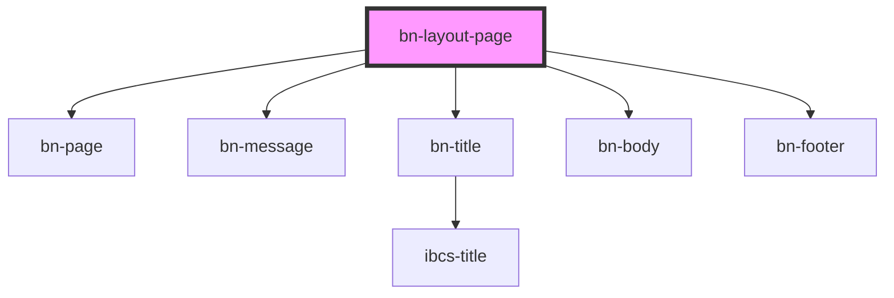

# bn-layout-page

<!-- Auto Generated Below -->

## Properties

| Property                  | Attribute                    | Description | Type                                                                                                                                                       | Default             |
| ------------------------- | ---------------------------- | ----------- | ---------------------------------------------------------------------------------------------------------------------------------------------------------- | ------------------- |
| `footerDisplayPageNumber` | `footer-display-page-number` |             | `boolean`                                                                                                                                                  | `true`              |
| `footerText`              | `footer-text`                |             | `string`                                                                                                                                                   | `undefined`         |
| `messageImage`            | `message-image`              |             | `string`                                                                                                                                                   | `''`                |
| `messageText`             | `message-text`               |             | `string`                                                                                                                                                   | `''`                |
| `pageCustomTemplate`      | `page-custom-template`       |             | `string`                                                                                                                                                   | `"\"a b\" \"c d\""` |
| `pageFitToContent`        | `page-fit-to-content`        |             | `boolean`                                                                                                                                                  | `true`              |
| `pageFormat`              | `page-format`                |             | `string`                                                                                                                                                   | `undefined`         |
| `pageGridGap`             | `page-grid-gap`              |             | `string`                                                                                                                                                   | `"0"`               |
| `pageLayout`              | `page-layout`                |             | `"1-over-2" \| "1-over-3" \| "2-over-1" \| "2x2" \| "3-over-1" \| "3x3" \| "4x4" \| "custom-template" \| "full" \| "split-horizontal" \| "split-vertical"` | `'full'`            |
| `pageNumber`              | `page-number`                |             | `string`                                                                                                                                                   | `undefined`         |
| `pageOrientation`         | `page-orientation`           |             | `string`                                                                                                                                                   | `undefined`         |
| `styles`                  | `styles`                     |             | `string`                                                                                                                                                   | `undefined`         |
| `titleBusinessUnit`       | `title-business-unit`        |             | `string`                                                                                                                                                   | `''`                |
| `titleDateEnd`            | `title-date-end`             |             | `string`                                                                                                                                                   | `undefined`         |
| `titleDateFormat`         | `title-date-format`          |             | `string`                                                                                                                                                   | `'none'`            |
| `titleDateLink`           | `title-date-link`            |             | `string`                                                                                                                                                   | `'none'`            |
| `titleDateStart`          | `title-date-start`           |             | `string`                                                                                                                                                   | `undefined`         |
| `titleMeasures`           | `title-measures`             |             | `string`                                                                                                                                                   | `undefined`         |
| `titleNamespace`          | `title-namespace`            |             | `string`                                                                                                                                                   | `'_system'`         |
| `titleOrder`              | `title-order`                |             | `string`                                                                                                                                                   | `'category'`        |
| `titleOrderDirection`     | `title-order-direction`      |             | `string`                                                                                                                                                   | `'asc'`             |
| `titleScenarios`          | `title-scenarios`            |             | `string`                                                                                                                                                   | `undefined`         |
| `titleVariances`          | `title-variances`            |             | `string`                                                                                                                                                   | `undefined`         |

## Methods

### `getNumberOfSlot(name: string) => Promise<number>`

#### Parameters

| Name   | Type     | Description |
| ------ | -------- | ----------- |
| `name` | `string` |             |

#### Returns

Type: `Promise<number>`

## Dependencies

### Depends on

- [bn-page](../bn-page)
- [bn-message](../bn-message)
- [bn-title](../bn-title)
- [bn-body](../bn-body)
- [bn-footer](../bn-footer)

### Graph

----------------------------------------------

developed by Bino Bi
