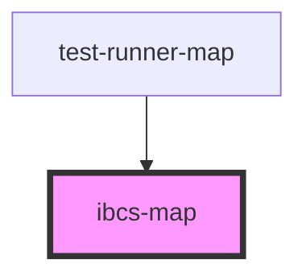

# ibcs-map

https://{s}.tile.openstreetmap.org/{z}/{x}/{y}.png
https://stamen-tiles-{s}.a.ssl.fastly.net/toner-background/{z}/{x}/{y}{r}.{ext}
https://{s}.basemaps.cartocdn.com/light_nolabels/{z}/{x}/{y}{r}.png
https://{s}.basemaps.cartocdn.com/dark_nolabels/{z}/{x}/{y}{r}.png
https://stamen-tiles-{s}.a.ssl.fastly.net/toner-lite/{z}/{x}/{y}{r}.{ext}
https://{s}.tile.jawg.io/jawg-dark/{z}/{x}/{y}{r}.png?access-token={accessToken}
https://{s}.tile.jawg.io/jawg-light/{z}/{x}/{y}{r}.png?access-token={accessToken}

var CartoDB_PositronNoLabels = L.tileLayer('https://{s}.basemaps.cartocdn.com/light_nolabels/{z}/{x}/{y}{r}.png', {
<!-- Auto Generated Below -->

## Properties

| Property            | Attribute             | Description | Type                       | Default                   |
| ------------------- | --------------------- | ----------- | -------------------------- | ------------------------- |
| `attribution`       | `attribution`         |             | `string`                   | `this._attribution`       |
| `customView`        | `custom-view`         |             | `boolean`                  | `this._customView`        |
| `geojsons`          | `geojsons`            |             | `GeoJsonLayer[] \| string` | `this._geojsons`          |
| `gpxs`              | `gpxs`                |             | `GpxLayer[] \| string`     | `this._gpxs`              |
| `latitude`          | `latitude`            |             | `number`                   | `this._latitude`          |
| `longitude`         | `longitude`           |             | `number`                   | `this._longitude`         |
| `manualPosOverride` | `manual-pos-override` |             | `boolean`                  | `this._manualPosOverride` |
| `markers`           | `markers`             |             | `Marker[] \| string`       | `this._markers`           |
| `scale`             | `scale`               |             | `number`                   | `this._scale`             |
| `showScale`         | `show-scale`          |             | `boolean`                  | `this._showScale`         |
| `showZoom`          | `show-zoom`           |             | `boolean`                  | `this._showZoom`          |
| `tileLayer`         | `tile-layer`          |             | `string`                   | `this._tileLayer`         |

## Events

| Event           | Description | Type               |
| --------------- | ----------- | ------------------ |
| `dragZoomEnded` |             | `CustomEvent<any>` |
| `stateUpdated`  |             | `CustomEvent<any>` |

## Methods

### `setProps(data: Partial<IbcsMap>) => Promise<void>`

#### Parameters

| Name   | Type                                                                                                                                                                                                                                                                                                                                                                                                                                                                                                                                                                                                                                                                                                                                                                                                                                                                                                                                                                                                                                                                                                                                                                                                                                                                                                                                                                                                                                                                                                                                                                                                                                                                                                                                                                                                                                                                                                                                                                                                                                                                                                                                                                                                                                                                                                  | Description |
| ------ | ----------------------------------------------------------------------------------------------------------------------------------------------------------------------------------------------------------------------------------------------------------------------------------------------------------------------------------------------------------------------------------------------------------------------------------------------------------------------------------------------------------------------------------------------------------------------------------------------------------------------------------------------------------------------------------------------------------------------------------------------------------------------------------------------------------------------------------------------------------------------------------------------------------------------------------------------------------------------------------------------------------------------------------------------------------------------------------------------------------------------------------------------------------------------------------------------------------------------------------------------------------------------------------------------------------------------------------------------------------------------------------------------------------------------------------------------------------------------------------------------------------------------------------------------------------------------------------------------------------------------------------------------------------------------------------------------------------------------------------------------------------------------------------------------------------------------------------------------------------------------------------------------------------------------------------------------------------------------------------------------------------------------------------------------------------------------------------------------------------------------------------------------------------------------------------------------------------------------------------------------------------------------------------------------------- | ----------- |
| `data` | `{ setProps?: ((data: Partial<IbcsMap>) => Promise<void>) \| undefined; unSetProps?: ((data: Partial<IbcsMap>) => Promise<void>) \| undefined; drawElement?: HTMLElement \| undefined; tileLayer?: string \| undefined; parseTileLayer?: ((tileLayer: any) => void) \| undefined; manualPosOverride?: boolean \| undefined; parseManualPosOverride?: ((manualPosOverride: any) => void) \| undefined; latitude?: number \| undefined; parseLatitude?: ((latitude: any) => void) \| undefined; longitude?: number \| undefined; parseLongitude?: ((longitude: any) => void) \| undefined; scale?: number \| undefined; parseScale?: ((scale: any) => void) \| undefined; customView?: boolean \| undefined; parseCustomView?: ((customView: any) => void) \| undefined; showScale?: boolean \| undefined; parseShowScale?: ((showScale: any) => void) \| undefined; showZoom?: boolean \| undefined; parseShowZoom?: ((showZoom: any) => void) \| undefined; attribution?: string \| undefined; parseAttribution?: ((attribution: any) => void) \| undefined; gpxs?: string \| GpxLayer[] \| undefined; parseGpxLayers?: ((gpxs: any) => void) \| undefined; markers?: string \| Marker[] \| undefined; parseMarkers?: ((markers: any) => void) \| undefined; geojsons?: string \| GeoJsonLayer[] \| undefined; parseGeoJson?: ((geojsons: any) => void) \| undefined; stateUpdated?: EventEmitter<any> \| undefined; dragZoomEnded?: EventEmitter<any> \| undefined; render?: (() => any) \| undefined; gpxLayerUpdate?: ((gpxOptionsLayers: GpxLayer[]) => void) \| undefined; mapMarkerUpdate?: ((markes: Marker[]) => void) \| undefined; geoJsonUpdate?: ((geojsons: GeoJsonLayer[]) => void) \| undefined; componentWillLoad?: (() => void) \| undefined; componentDidLoad?: (() => void) \| undefined; disconnectedCallback?: (() => void) \| undefined; componentDidUpdate?: (() => void) \| undefined; dragZoomEnd?: (() => void) \| undefined; setView?: (() => void) \| undefined; setTileLayer?: (() => void) \| undefined; setAttribution?: (() => void) \| undefined; setShowScale?: (() => void) \| undefined; setShowZoom?: (() => void) \| undefined; setGPXLayer?: (() => void) \| undefined; setMarker?: (() => void) \| undefined; setGeoJsonLayer?: (() => void) \| undefined; }` |             |

#### Returns

Type: `Promise<void>`

### `unSetProps(data: Partial<IbcsMap>) => Promise<void>`

#### Parameters

| Name   | Type                                                                                                                                                                                                                                                                                                                                                                                                                                                                                                                                                                                                                                                                                                                                                                                                                                                                                                                                                                                                                                                                                                                                                                                                                                                                                                                                                                                                                                                                                                                                                                                                                                                                                                                                                                                                                                                                                                                                                                                                                                                                                                                                                                                                                                                                                                  | Description |
| ------ | ----------------------------------------------------------------------------------------------------------------------------------------------------------------------------------------------------------------------------------------------------------------------------------------------------------------------------------------------------------------------------------------------------------------------------------------------------------------------------------------------------------------------------------------------------------------------------------------------------------------------------------------------------------------------------------------------------------------------------------------------------------------------------------------------------------------------------------------------------------------------------------------------------------------------------------------------------------------------------------------------------------------------------------------------------------------------------------------------------------------------------------------------------------------------------------------------------------------------------------------------------------------------------------------------------------------------------------------------------------------------------------------------------------------------------------------------------------------------------------------------------------------------------------------------------------------------------------------------------------------------------------------------------------------------------------------------------------------------------------------------------------------------------------------------------------------------------------------------------------------------------------------------------------------------------------------------------------------------------------------------------------------------------------------------------------------------------------------------------------------------------------------------------------------------------------------------------------------------------------------------------------------------------------------------------- | ----------- |
| `data` | `{ setProps?: ((data: Partial<IbcsMap>) => Promise<void>) \| undefined; unSetProps?: ((data: Partial<IbcsMap>) => Promise<void>) \| undefined; drawElement?: HTMLElement \| undefined; tileLayer?: string \| undefined; parseTileLayer?: ((tileLayer: any) => void) \| undefined; manualPosOverride?: boolean \| undefined; parseManualPosOverride?: ((manualPosOverride: any) => void) \| undefined; latitude?: number \| undefined; parseLatitude?: ((latitude: any) => void) \| undefined; longitude?: number \| undefined; parseLongitude?: ((longitude: any) => void) \| undefined; scale?: number \| undefined; parseScale?: ((scale: any) => void) \| undefined; customView?: boolean \| undefined; parseCustomView?: ((customView: any) => void) \| undefined; showScale?: boolean \| undefined; parseShowScale?: ((showScale: any) => void) \| undefined; showZoom?: boolean \| undefined; parseShowZoom?: ((showZoom: any) => void) \| undefined; attribution?: string \| undefined; parseAttribution?: ((attribution: any) => void) \| undefined; gpxs?: string \| GpxLayer[] \| undefined; parseGpxLayers?: ((gpxs: any) => void) \| undefined; markers?: string \| Marker[] \| undefined; parseMarkers?: ((markers: any) => void) \| undefined; geojsons?: string \| GeoJsonLayer[] \| undefined; parseGeoJson?: ((geojsons: any) => void) \| undefined; stateUpdated?: EventEmitter<any> \| undefined; dragZoomEnded?: EventEmitter<any> \| undefined; render?: (() => any) \| undefined; gpxLayerUpdate?: ((gpxOptionsLayers: GpxLayer[]) => void) \| undefined; mapMarkerUpdate?: ((markes: Marker[]) => void) \| undefined; geoJsonUpdate?: ((geojsons: GeoJsonLayer[]) => void) \| undefined; componentWillLoad?: (() => void) \| undefined; componentDidLoad?: (() => void) \| undefined; disconnectedCallback?: (() => void) \| undefined; componentDidUpdate?: (() => void) \| undefined; dragZoomEnd?: (() => void) \| undefined; setView?: (() => void) \| undefined; setTileLayer?: (() => void) \| undefined; setAttribution?: (() => void) \| undefined; setShowScale?: (() => void) \| undefined; setShowZoom?: (() => void) \| undefined; setGPXLayer?: (() => void) \| undefined; setMarker?: (() => void) \| undefined; setGeoJsonLayer?: (() => void) \| undefined; }` |             |

#### Returns

Type: `Promise<void>`

## Dependencies

### Used by

 - [test-runner-map](../../test-runner)

### Graph

----------------------------------------------

*Built with [StencilJS](https://stenciljs.com/)*
