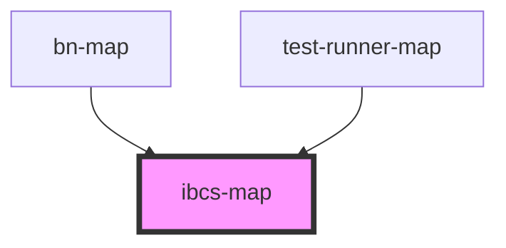

# ibcs-map

https://{s}.tile.openstreetmap.org/{z}/{x}/{y}.png
https://stamen-tiles-{s}.a.ssl.fastly.net/toner-background/{z}/{x}/{y}{r}.{ext}
https://{s}.basemaps.cartocdn.com/light_nolabels/{z}/{x}/{y}{r}.png
https://{s}.basemaps.cartocdn.com/dark_nolabels/{z}/{x}/{y}{r}.png
https://stamen-tiles-{s}.a.ssl.fastly.net/toner-lite/{z}/{x}/{y}{r}.{ext}
https://{s}.tile.jawg.io/jawg-dark/{z}/{x}/{y}{r}.png?access-token={accessToken}
https://{s}.tile.jawg.io/jawg-light/{z}/{x}/{y}{r}.png?access-token={accessToken}

var CartoDB_PositronNoLabels = L.tileLayer('https://{s}.basemaps.cartocdn.com/light_nolabels/{z}/{x}/{y}{r}.png', {
<!-- Auto Generated Below -->

## Properties

| Property            | Attribute             | Description | Type                       | Default                   |
| ------------------- | --------------------- | ----------- | -------------------------- | ------------------------- |
| `attribution`       | `attribution`         |             | `string`                   | `this._attribution`       |
| `customView`        | `custom-view`         |             | `boolean`                  | `this._customView`        |
| `geojsons`          | `geojsons`            |             | `GeoJsonLayer[] \| string` | `this._geojsons`          |
| `gpxs`              | `gpxs`                |             | `GpxLayer[] \| string`     | `this._gpxs`              |
| `latitude`          | `latitude`            |             | `number`                   | `this._latitude`          |
| `longitude`         | `longitude`           |             | `number`                   | `this._longitude`         |
| `manualPosOverride` | `manual-pos-override` |             | `boolean`                  | `this._manualPosOverride` |
| `markers`           | `markers`             |             | `Marker[] \| string`       | `this._markers`           |
| `scale`             | `scale`               |             | `number`                   | `this._scale`             |
| `showScale`         | `show-scale`          |             | `boolean`                  | `this._showScale`         |
| `showZoom`          | `show-zoom`           |             | `boolean`                  | `this._showZoom`          |
| `tileLayer`         | `tile-layer`          |             | `string`                   | `this._tileLayer`         |

## Events

| Event           | Description | Type               |
| --------------- | ----------- | ------------------ |
| `dragZoomEnded` |             | `CustomEvent<any>` |
| `stateUpdated`  |             | `CustomEvent<any>` |

## Methods

### `setProps(data: Partial<IbcsMap>) => Promise<void>`

#### Parameters

| Name   | Type                                                                                                                                                                                                                                                                                                                                                                                                                                                                                                                                                                                                                                                                                                                                                                                                                                                                                                                                                                                                                                                                                                                                                                                                                                                                                                                                                                                                                                                                                                                                                                                                              | Description |
| ------ | ----------------------------------------------------------------------------------------------------------------------------------------------------------------------------------------------------------------------------------------------------------------------------------------------------------------------------------------------------------------------------------------------------------------------------------------------------------------------------------------------------------------------------------------------------------------------------------------------------------------------------------------------------------------------------------------------------------------------------------------------------------------------------------------------------------------------------------------------------------------------------------------------------------------------------------------------------------------------------------------------------------------------------------------------------------------------------------------------------------------------------------------------------------------------------------------------------------------------------------------------------------------------------------------------------------------------------------------------------------------------------------------------------------------------------------------------------------------------------------------------------------------------------------------------------------------------------------------------------------------- | ----------- |
| `data` | `{ setProps?: (data: Partial<IbcsMap>) => Promise<void>; unSetProps?: (data: Partial<IbcsMap>) => Promise<void>; drawElement?: HTMLElement; tileLayer?: string; parseTileLayer?: (tileLayer: any) => void; manualPosOverride?: boolean; parseManualPosOverride?: (manualPosOverride: any) => void; latitude?: number; parseLatitude?: (latitude: any) => void; longitude?: number; parseLongitude?: (longitude: any) => void; scale?: number; parseScale?: (scale: any) => void; customView?: boolean; parseCustomView?: (customView: any) => void; showScale?: boolean; parseShowScale?: (showScale: any) => void; showZoom?: boolean; parseShowZoom?: (showZoom: any) => void; attribution?: string; parseAttribution?: (attribution: any) => void; gpxs?: string \| GpxLayer[]; parseGpxLayers?: (gpxs: any) => void; markers?: string \| Marker[]; parseMarkers?: (markers: any) => void; geojsons?: string \| GeoJsonLayer[]; parseGeoJson?: (geojsons: any) => void; stateUpdated?: EventEmitter<any>; dragZoomEnded?: EventEmitter<any>; render?: () => any; gpxLayerUpdate?: (gpxOptionsLayers: GpxLayer[]) => void; mapMarkerUpdate?: (markes: Marker[]) => void; geoJsonUpdate?: (geojsons: GeoJsonLayer[]) => void; componentWillLoad?: () => void; componentDidLoad?: () => void; disconnectedCallback?: () => void; componentDidUpdate?: () => void; dragZoomEnd?: () => void; setView?: () => void; setTileLayer?: () => void; setAttribution?: () => void; setShowScale?: () => void; setShowZoom?: () => void; setGPXLayer?: () => void; setMarker?: () => void; setGeoJsonLayer?: () => void; }` |             |

#### Returns

Type: `Promise<void>`

### `unSetProps(data: Partial<IbcsMap>) => Promise<void>`

#### Parameters

| Name   | Type                                                                                                                                                                                                                                                                                                                                                                                                                                                                                                                                                                                                                                                                                                                                                                                                                                                                                                                                                                                                                                                                                                                                                                                                                                                                                                                                                                                                                                                                                                                                                                                                              | Description |
| ------ | ----------------------------------------------------------------------------------------------------------------------------------------------------------------------------------------------------------------------------------------------------------------------------------------------------------------------------------------------------------------------------------------------------------------------------------------------------------------------------------------------------------------------------------------------------------------------------------------------------------------------------------------------------------------------------------------------------------------------------------------------------------------------------------------------------------------------------------------------------------------------------------------------------------------------------------------------------------------------------------------------------------------------------------------------------------------------------------------------------------------------------------------------------------------------------------------------------------------------------------------------------------------------------------------------------------------------------------------------------------------------------------------------------------------------------------------------------------------------------------------------------------------------------------------------------------------------------------------------------------------- | ----------- |
| `data` | `{ setProps?: (data: Partial<IbcsMap>) => Promise<void>; unSetProps?: (data: Partial<IbcsMap>) => Promise<void>; drawElement?: HTMLElement; tileLayer?: string; parseTileLayer?: (tileLayer: any) => void; manualPosOverride?: boolean; parseManualPosOverride?: (manualPosOverride: any) => void; latitude?: number; parseLatitude?: (latitude: any) => void; longitude?: number; parseLongitude?: (longitude: any) => void; scale?: number; parseScale?: (scale: any) => void; customView?: boolean; parseCustomView?: (customView: any) => void; showScale?: boolean; parseShowScale?: (showScale: any) => void; showZoom?: boolean; parseShowZoom?: (showZoom: any) => void; attribution?: string; parseAttribution?: (attribution: any) => void; gpxs?: string \| GpxLayer[]; parseGpxLayers?: (gpxs: any) => void; markers?: string \| Marker[]; parseMarkers?: (markers: any) => void; geojsons?: string \| GeoJsonLayer[]; parseGeoJson?: (geojsons: any) => void; stateUpdated?: EventEmitter<any>; dragZoomEnded?: EventEmitter<any>; render?: () => any; gpxLayerUpdate?: (gpxOptionsLayers: GpxLayer[]) => void; mapMarkerUpdate?: (markes: Marker[]) => void; geoJsonUpdate?: (geojsons: GeoJsonLayer[]) => void; componentWillLoad?: () => void; componentDidLoad?: () => void; disconnectedCallback?: () => void; componentDidUpdate?: () => void; dragZoomEnd?: () => void; setView?: () => void; setTileLayer?: () => void; setAttribution?: () => void; setShowScale?: () => void; setShowZoom?: () => void; setGPXLayer?: () => void; setMarker?: () => void; setGeoJsonLayer?: () => void; }` |             |

#### Returns

Type: `Promise<void>`

## Dependencies

### Used by

 - [bn-map](..)
 - [test-runner-map](../../../test-runner)

### Graph

----------------------------------------------

developed by Bino Bi
