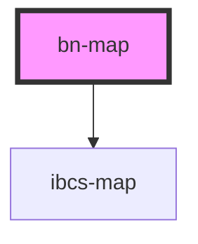

# bn-map

Interactive [Leaflet](https://leafletjs.com/) map with support for markers, GPX tracks, and GeoJSON overlays.

## Usage

```html
<bn-map latitude="48.8566" longitude="2.3522" scale="13"></bn-map>
```

### Markers

Pass markers as a JSON array:

```html
<bn-map
  latitude="48.8566"
  longitude="2.3522"
  scale="13"
  markers='[
    {"latitude": 48.8566, "longitude": 2.3522, "iconUrl": "https://example.com/pin.png", "iconWidth": 32, "iconHeight": 32}
  ]'>
</bn-map>
```

Markers can also be loaded dynamically from a dataset by setting `markers-dataset-name`.

### GPX Tracks

```html
<bn-map
  gpxs='[
    {"file": "https://example.com/route.gpx", "color": "#FC5200", "opacity": 0.75, "weight": 3, "lineCap": "round"}
  ]'>
</bn-map>
```

When GPX files are provided, the map viewport auto-fits to the track bounds.

### Tile Layer

Change the map tile provider:

```html
<bn-map tile-layer="https://{s}.tile.openstreetmap.org/{z}/{x}/{y}.png"></bn-map>
```

See [Leaflet Providers](https://leaflet-extras.github.io/leaflet-providers/preview/) for available tile layers.

<!-- Auto Generated Below -->


## Properties

| Property             | Attribute              | Description                                                                                                                                                                                                                   | Type      | Default                                                                 |
| -------------------- | ---------------------- | ----------------------------------------------------------------------------------------------------------------------------------------------------------------------------------------------------------------------------- | --------- | ----------------------------------------------------------------------- |
| `attribution`        | `attribution`          | Set Footer label                                                                                                                                                                                                              | `string`  | `""`                                                                    |
| `geojsons`           | `geojsons`             |                                                                                                                                                                                                                               | `string`  | `null`                                                                  |
| `gpxs`               | `gpxs`                 | GPX Parameter example ["file": "http://URL_TO_GPX.gpx",          "color": "#FC5200",          "opacity": 0.75,          "weight": 3,          "lineCap": "round"}]                                                            | `string`  | `null`                                                                  |
| `gpxsDatasetName`    | `gpxs-dataset-name`    | Name of the gpxs Dataset used in map  default: $gpxs                                                                                                                                                                          | `string`  | `"$gpxs"`                                                               |
| `latitude`           | `latitude`             | Latitude of the maps viewport center, the selected value will be ignored if gpx files are selected                                                                                                                            | `number`  | `50.137634`                                                             |
| `longitude`          | `longitude`            | Latitude of the maps viewport center, the selected value will be ignored if gpx files are selected                                                                                                                            | `number`  | `8.679129`                                                              |
| `manualPosOverride`  | `manual-pos-override`  |                                                                                                                                                                                                                               | `boolean` | `true`                                                                  |
| `markers`            | `markers`              | Marker Parameter example [{"latitude": 50.137634,           "longitude": 8.679129,           "iconUrl": "http://localhost:3333/build/assets/icons/marker-example.png",           "iconWidth": 64,           "iconHeight":64}] | `string`  | `null`                                                                  |
| `markersDatasetName` | `markers-dataset-name` | Name of the makers Dataset used in map  default: $markers                                                                                                                                                                     | `string`  | `"$markers"`                                                            |
| `scale`              | `scale`                | scale / zoom factor of the maps viewport. Decrease the value to zoom out. Increase the value to zoom in. the selected value will be ignored if gpx files are selected                                                         | `number`  | `11`                                                                    |
| `showScale`          | `show-scale`           | Activates/ Deactivates Map Scale                                                                                                                                                                                              | `boolean` | `false`                                                                 |
| `tileLayer`          | `tile-layer`           | URL for maplayer provider example provers https://leaflet-extras.github.io/leaflet-providers/preview/                                                                                                                         | `string`  | `"https://{s}.basemaps.cartocdn.com/light_nolabels/{z}/{x}/{y}{r}.png"` |


## Events

| Event             | Description | Type               |
| ----------------- | ----------- | ------------------ |
| `bnDragZoomEnded` |             | `CustomEvent<any>` |
| `bnStateUpdated`  |             | `CustomEvent<any>` |


## Dependencies

### Depends on

- [ibcs-map](ibcs-map)

### Graph


----------------------------------------------

developed by Bino Bi
