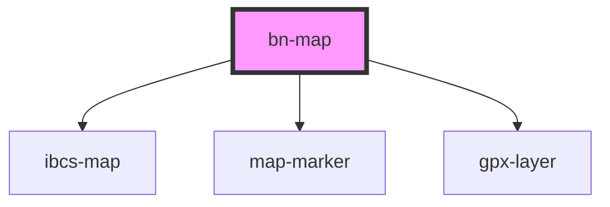

# bn-map

<!-- Auto Generated Below -->

## Properties

| Property      | Attribute     | Description                                                                                                                                                                                                                   | Type      | Default                                                                 |
| ------------- | ------------- | ----------------------------------------------------------------------------------------------------------------------------------------------------------------------------------------------------------------------------- | --------- | ----------------------------------------------------------------------- |
| `attribution` | `attribution` | Set Footer label                                                                                                                                                                                                              | `string`  | `''`                                                                    |
| `gpxs`        | `gpxs`        | GPX Parameter example ["file": "http://URL_TO_GPX.gpx",          "color": "#FC5200",          "opacity": 0.75,          "weight": 3,          "lineCap": "round"}]                                                            | `string`  | `null`                                                                  |
| `latitude`    | `latitude`    | Latitude of the maps viewport center, the selected value will be ignored if gpx files are selected                                                                                                                            | `number`  | `50.137634`                                                             |
| `longitude`   | `longitude`   | Latitude of the maps viewport center, the selected value will be ignored if gpx files are selected                                                                                                                            | `number`  | `8.679129`                                                              |
| `markers`     | `markers`     | Marker Parameter example [{"latitude": 50.137634,           "longitude": 8.679129,           "iconUrl": "http://localhost:3333/build/assets/icons/marker-example.png",           "iconWidth": 64,           "iconHeight":64}] | `string`  | `null`                                                                  |
| `scale`       | `scale`       | scale / zoom factor of the maps viewport. Decrease the value to zoom out. Increase the value to zoom in. the selected value will be ignored if gpx files are selected                                                         | `number`  | `11`                                                                    |
| `showScale`   | `show-scale`  | Activates/ Deactivates Map Scale                                                                                                                                                                                              | `boolean` | `false`                                                                 |
| `titleLayer`  | `title-layer` | URL for maplayer provider example provers https://leaflet-extras.github.io/leaflet-providers/preview/                                                                                                                         | `string`  | `'https://{s}.basemaps.cartocdn.com/light_nolabels/{z}/{x}/{y}{r}.png'` |

## Dependencies

### Depends on

- ibcs-map
- map-marker
- gpx-layer

### Graph

----------------------------------------------

developed by Bino Bi
