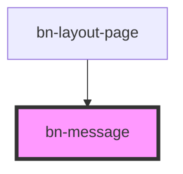

# bn-message

Displays a message with optional text and image, typically used in page headers via [`<bn-layout-page>`](../bn-layout-page/readme.md).

## Usage

```html
<bn-message text="Draft Report" image="company-logo"></bn-message>
```

When used inside `<bn-layout-page>`, set the message props on the layout component instead:

```html
<bn-layout-page message-text="Draft Report" message-image="company-logo">
  ...
</bn-layout-page>
```

The `image` prop accepts either an HTTP URL or a registered asset name.

### HTML Content

The `text` prop is rendered as HTML. Safe inline tags (`<b>`, `<i>`, `<strong>`, `<em>`, `<br>`, `<a>`, …) are
allowed. Any other element is removed together with its content. Event handlers are removed. `href` and `src` keep
only `http:`, `https:`, `mailto:` and relative URLs (`src` also `data:`). Use `<br />` for an explicit line
break - a newline character in the value does not break the line.

```html
<bn-message text="Revenue <b>above plan</b><br />Q3 2026"></bn-message>
```

<!-- Auto Generated Below -->


## Properties

| Property        | Attribute        | Description                                                                                                                                                                                                                                                                                                                                                                           | Type     | Default     |
| --------------- | ---------------- | ------------------------------------------------------------------------------------------------------------------------------------------------------------------------------------------------------------------------------------------------------------------------------------------------------------------------------------------------------------------------------------- | -------- | ----------- |
| `image`         | `image`          | /**    Url of the cards logo/ pictogram.    <br />    if not http it looks up the url in the components asset folder    <br />    If empty string (`''` or `null`) the image is omitted   <br /><br />    example:<br /> ```debug/concordia.png```                                                                                                                                    | `string` | `undefined` |
| `selectedStyle` | `selected-style` | Name of the component style to use (the `name` of a `<bn-component-style>`). Its values go on top of the default style.                                                                                                                                                                                                                                                               | `string` | `undefined` |
| `text`          | `text`           | Message text. Rendered as HTML, sanitized against XSS (only safe tags such as `br`, `b`, `i`, `strong`, `em`, `a` and their attributes are kept; any other element is removed with its content, and links keep only `http:`, `https:`, `mailto:` and relative URLs). <br />Use `<br />` for an explicit line break. <br />If empty string (`''` or `null`) the message row is omitted | `string` | `undefined` |


## Dependencies

### Used by

 - [bn-layout-page](../bn-layout-page)

### Graph


----------------------------------------------

developed by Bino Bi
