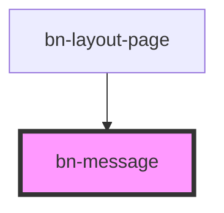

# bn-footer

**bn-footer** determines the area in which the footer-content of the report is placed.
The **bn-body** is a child element of bn-page and mandatory for a valid report template.

<!-- Auto Generated Below -->


## Properties

| Property | Attribute | Description                                                                                                                                                                                                                                        | Type     | Default     |
| -------- | --------- | -------------------------------------------------------------------------------------------------------------------------------------------------------------------------------------------------------------------------------------------------- | -------- | ----------- |
| `image`  | `image`   | /**    Url of the cards logo/ pictogram.    <br />    if not http it looks up the url in the components asset folder    <br />    If empty string (`''` or `null`) the image is omitted   <br /><br />    example:<br /> ```debug/concordia.png``` | `string` | `undefined` |
| `text`   | `text`    | Message text. <br />If empty string (`''` or `null`) the footer row is omitted                                                                                                                                                                     | `string` | `undefined` |


## Dependencies

### Used by

 - [bn-layout-page](../bn-layout-page)

### Graph


----------------------------------------------

developed by Bino Bi
