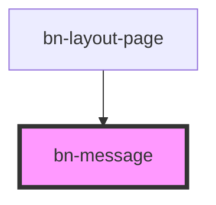

# bn-message

Displays a message with optional text and image, typically used in page headers via [`<bn-layout-page>`](../bn-layout-page/readme.md).

## Usage

```html
<bn-message text="Draft Report" image="company-logo"></bn-message>
```

When used inside `<bn-layout-page>`, set the message props on the layout component instead:

```html
<bn-layout-page message-text="Draft Report" message-image="company-logo">
  ...
</bn-layout-page>
```

The `image` prop accepts either an HTTP URL or a registered asset name.

<!-- Auto Generated Below -->


## Properties

| Property | Attribute | Description                                                                                                                                                                                                                                        | Type     | Default     |
| -------- | --------- | -------------------------------------------------------------------------------------------------------------------------------------------------------------------------------------------------------------------------------------------------- | -------- | ----------- |
| `image`  | `image`   | /**    Url of the cards logo/ pictogram.    <br />    if not http it looks up the url in the components asset folder    <br />    If empty string (`''` or `null`) the image is omitted   <br /><br />    example:<br /> ```debug/concordia.png``` | `string` | `undefined` |
| `text`   | `text`    | Message text. <br />If empty string (`''` or `null`) the footer row is omitted                                                                                                                                                                     | `string` | `undefined` |


## Dependencies

### Used by

 - [bn-layout-page](../bn-layout-page)

### Graph


----------------------------------------------

developed by Bino Bi
