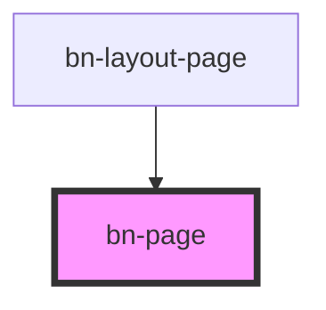

# bn-page

Page container that defines the output dimensions and orientation. Place [`<bn-title>`](../bn-title/readme.md), [`<bn-body>`](../bn-body/readme.md), and [`<bn-footer>`](../bn-footer/readme.md) inside it.

## Usage

```html
<bn-page format="hd" orientation="landscape">
  <bn-title business-unit="ACME Corp" scenarios="ac1,pl1"></bn-title>
  <bn-body>
    <bn-table scenarios="ac1,pl1"></bn-table>
  </bn-body>
  <bn-footer text="Confidential"></bn-footer>
</bn-page>
```

### Page Formats

| Format | Size | Native orientation |
|--------|------|--------------------|
| `xga` | 1024 x 768 px | landscape |
| `hd` | 1280 x 720 px | landscape |
| `full-hd` | 1920 x 1080 px | landscape |
| `4k` | 3840 x 2160 px | landscape |
| `4k2k` | 4096 x 2160 px | landscape |
| `a6` | 4.13 x 5.83 in | portrait |
| `a5` | 5.83 x 8.27 in | portrait |
| `a4` | 8.27 x 11.69 in | portrait |
| `a3` | 11.69 x 16.54 in | portrait |
| `a2` | 16.54 x 23.39 in | portrait |
| `a1` | 23.39 x 33.11 in | portrait |
| `a0` | 33.11 x 46.81 in | portrait |
| `letter` | 8.5 x 11 in | portrait |
| `legal` | 8.5 x 14 in | portrait |
| `tabloid` | 11 x 17 in | portrait |
| `ledger` | 17 x 11 in | landscape |

Without `format` the page is `xga`. An unknown format is reported as `ERR_format` and also draws the `xga` size.

### Orientation

- `landscape` - wider than tall
- `portrait` - taller than wide

Without `orientation` a format has its native orientation. `orientation` has no effect without `format`.

### Printing

A page has exactly the size of a sheet. The first `<bn-context>` of a document writes one `@page` rule with the size its first page is drawn in, so the sheet of a browser that honours CSS page sizes (`preferCSSPageSize` of `printToPDF`) has the size of the page.

- The rule sets only the size, not the margin. Print without margins, otherwise a page does not fit on its sheet.
- A caller that prints with a fixed paper size instead must pass the size from the table. With another size Chrome fits the page into the sheet.
- The document must not add a margin of its own around the pages (`body { margin: 0 }`).
- A document is printed in one orientation. Set it as `render-orientation` on `<bn-context>`: a `<bn-layout-page>` with the other orientation is then turned onto the sheet. A plain `<bn-page>` is never turned.
- All pages of a document should have the format of the first page: there is one sheet size per document.

<!-- Auto Generated Below -->


## Properties

| Property      | Attribute     | Description                                                                                                                                                                                                                  | Type     | Default     |
| ------------- | ------------- | ---------------------------------------------------------------------------------------------------------------------------------------------------------------------------------------------------------------------------- | -------- | ----------- |
| `format`      | `format`      | Defines the size of the page <br /><br /> values: <br /> ``` xga // hd // full-hd // 4k // 4k2k // a6 // a5 // a4 // a3 // a2 // a1 // a0 // letter // legal // tabloid // ledger ``` <br /><br /> default: <br /> ```xga``` | `string` | `undefined` |
| `orientation` | `orientation` | Defines page orientation <br /><br /> values: <br /> ``` landscape // portrait ``` <br /><br /> default: <br /> based on the given format                                                                                    | `string` | `undefined` |


## Dependencies

### Used by

 - [bn-layout-page](../bn-layout-page)

### Graph


----------------------------------------------

developed by Bino Bi
