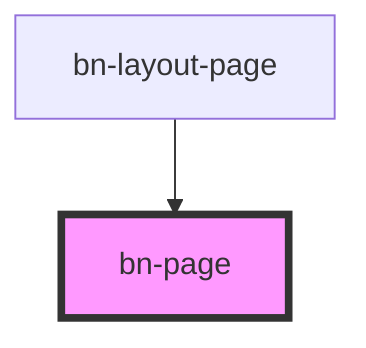

# bn-page

Page container that defines the output dimensions and orientation. Place [`<bn-title>`](../bn-title/readme.md), [`<bn-body>`](../bn-body/readme.md), and [`<bn-footer>`](../bn-footer/readme.md) inside it.

## Usage

```html
<bn-page format="hd" orientation="landscape">
  <bn-title business-unit="ACME Corp" scenarios="ac1,pl1"></bn-title>
  <bn-body>
    <bn-table scenarios="ac1,pl1"></bn-table>
  </bn-body>
  <bn-footer text="Confidential"></bn-footer>
</bn-page>
```

### Page Formats

| Format | Resolution |
|--------|------------|
| `xga` | 1024 x 768 |
| `hd` | 1280 x 720 |
| `full-hd` | 1920 x 1080 |
| `4k` | 3840 x 2160 |
| `4k2k` | 4096 x 2160 |
| `a4` | A4 paper |
| `a3` | A3 paper |
| `a2` | A2 paper |
| `a1` | A1 paper |
| `a0` | A0 paper |
| `letter` | US Letter |
| `legal` | US Legal |

### Orientation

- `landscape` — wider than tall (default for screen formats)
- `portrait` — taller than wide

<!-- Auto Generated Below -->


## Properties

| Property      | Attribute     | Description                                                                                                                                                                                 | Type     | Default     |
| ------------- | ------------- | ------------------------------------------------------------------------------------------------------------------------------------------------------------------------------------------- | -------- | ----------- |
| `format`      | `format`      | Defines the size of the page <br /><br /> values: <br /> ``` xga // hd // full-hd // 4k // 4k2k // a4 // a3 // a2 // a1 // a0 // letter // legal ``` <br /><br /> default: <br /> ```xga``` | `string` | `undefined` |
| `orientation` | `orientation` | Defines page orientation <br /><br /> values: <br /> ``` landscape // portrait ``` <br /><br /> default: <br /> based on the given format                                                   | `string` | `undefined` |


## Dependencies

### Used by

 - [bn-layout-page](../bn-layout-page)

### Graph


----------------------------------------------

developed by Bino Bi
