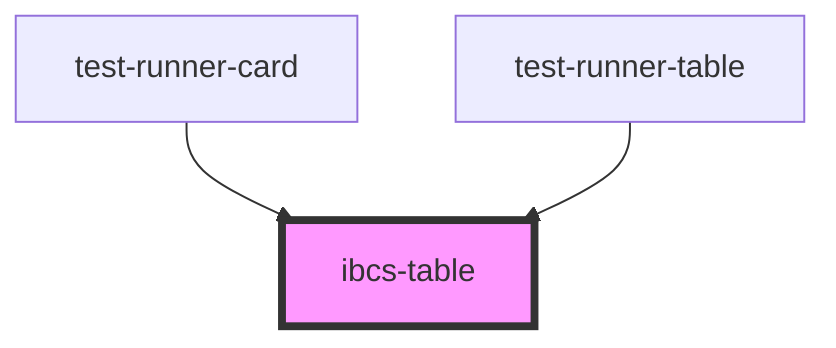

# my-component

<!-- Auto Generated Below -->

## Properties

| Property              | Attribute               | Description | Type                                                                                                                                                                                                           | Default                                                       |
| --------------------- | ----------------------- | ----------- | -------------------------------------------------------------------------------------------------------------------------------------------------------------------------------------------------------------- | ------------------------------------------------------------- |
| `categoryWidth`       | `category-width`        |             | `TableCategoryWidth.INF \| TableCategoryWidth.W10 \| TableCategoryWidth.W100 \| TableCategoryWidth.W15 \| TableCategoryWidth.W20 \| TableCategoryWidth.W25 \| TableCategoryWidth.W5 \| TableCategoryWidth.W50` | `TableCategoryWidth.INF`                                      |
| `categorythereof`     | --                      |             | `Map<string, any>`                                                                                                                                                                                             | `new Map()`                                                   |
| `data`                | --                      |             | `ITableDataRow[]`                                                                                                                                                                                              | `[]`                                                          |
| `dataFormatDigits`    | --                      |             | `IDataFormatDigits`                                                                                                                                                                                            | `{ percent: 2, decimal: 1 }`                                  |
| `filter`              | `filter`                |             | `string`                                                                                                                                                                                                       | `""`                                                          |
| `grouped`             | `grouped`               |             | `boolean \| undefined`                                                                                                                                                                                         | `false`                                                       |
| `i18n`                | --                      |             | `Map<string, string>`                                                                                                                                                                                          | `new Map()`                                                   |
| `i18nMode`            | `i18n-mode`             |             | `I18nMode.ALL \| I18nMode.META`                                                                                                                                                                                | `I18nMode.ALL`                                                |
| `limit`               | `limit`                 |             | `number`                                                                                                                                                                                                       | `0`                                                           |
| `measureScale`        | `measure-scale`         |             | `string`                                                                                                                                                                                                       | `"_"`                                                         |
| `measureType`         | `measure-type`          |             | `MeasureType.CURRENCY \| MeasureType.VOLUME`                                                                                                                                                                   | `MeasureType.VOLUME`                                          |
| `measureUnit`         | `measure-unit`          |             | `string`                                                                                                                                                                                                       | `""`                                                          |
| `order`               | --                      |             | `IOrder`                                                                                                                                                                                                       | `{     hierarchy: [],     direction: OrderDirection.ASC,   }` |
| `partof`              | --                      |             | `ITableDrillGroup[]`                                                                                                                                                                                           | `[]`                                                          |
| `scenarios`           | --                      |             | `string[]`                                                                                                                                                                                                     | `[]`                                                          |
| `scenariosDataFormat` | `scenarios-data-format` |             | `DataFormat.DECIMAL \| DataFormat.PERCENT`                                                                                                                                                                     | `DataFormat.DECIMAL`                                          |
| `showGroupTitle`      | `show-group-title`      |             | `boolean`                                                                                                                                                                                                      | `true`                                                        |
| `showMeasureScale`    | `show-measure-scale`    |             | `boolean`                                                                                                                                                                                                      | `true`                                                        |
| `tableTitle`          | `table-title`           |             | `string`                                                                                                                                                                                                       | `"SUM_TOTAL"`                                                 |
| `thereof`             | --                      |             | `ITableDrillGroup[]`                                                                                                                                                                                           | `[]`                                                          |
| `type`                | `type`                  |             | `TableType.LIST \| TableType.OPT \| TableType.OPTNOTOTAL \| TableType.SUM \| TableType.SUMNOTOTAL`                                                                                                             | `TableType.LIST`                                              |

## Dependencies

### Used by

 - [test-runner-card](../../test-runner)
 - [test-runner-table](../../test-runner)

### Graph

----------------------------------------------

*Built with [StencilJS](https://stenciljs.com/)*
