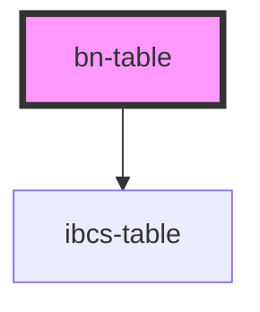

# bn-table

  

<!-- Auto Generated Below -->

## Properties

| Property                      | Attribute                    | Description                                                                                                                                                                                                                                                                                                                                                                                                                                                                                                                                                                                                                                                                                                                                                                                                                                                                                                                                                 | Type                | Default      |
| ----------------------------- | ---------------------------- | ----------------------------------------------------------------------------------------------------------------------------------------------------------------------------------------------------------------------------------------------------------------------------------------------------------------------------------------------------------------------------------------------------------------------------------------------------------------------------------------------------------------------------------------------------------------------------------------------------------------------------------------------------------------------------------------------------------------------------------------------------------------------------------------------------------------------------------------------------------------------------------------------------------------------------------------------------------- | ------------------- | ------------ |
| `categoryWidth`               | `category-width`             | set width of category columns  values: W5 \| W10 \| W15 \| W20 \| W25 \| W50 \| INF default: W15                                                                                                                                                                                                                                                                                                                                                                                                                                                                                                                                                                                                                                                                                                                                                                                                                                                            | `string`            | `undefined`  |
| `dataFormat` _(required)_     | `data-format`                | (optional) Scenario Unit Type   percent all data values are converted into percent  (0.02 ->  2%)   default volume  values: percent \| decimal                                                                                                                                                                                                                                                                                                                                                                                                                                                                                                                                                                                                                                                                                                                                                                                                              | `string`            | `undefined`  |
| `dataFormatDigitsDecimal`     | `data-format-digits-decimal` |                                                                                                                                                                                                                                                                                                                                                                                                                                                                                                                                                                                                                                                                                                                                                                                                                                                                                                                                                             | `number`            | `undefined`  |
| `dataFormatDigitsPercent`     | `data-format-digits-percent` |                                                                                                                                                                                                                                                                                                                                                                                                                                                                                                                                                                                                                                                                                                                                                                                                                                                                                                                                                             | `number`            | `undefined`  |
| `grouped` _(required)_        | `grouped`                    | Toggles of data should be grouped by 'rowgroup'.  values: true \| false default: true                                                                                                                                                                                                                                                                                                                                                                                                                                                                                                                                                                                                                                                                                                                                                                                                                                                                       | `boolean \| string` | `undefined`  |
| `internationalisation`        | `internationalisation`       |                                                                                                                                                                                                                                                                                                                                                                                                                                                                                                                                                                                                                                                                                                                                                                                                                                                                                                                                                             | `string`            | `undefined`  |
| `internationalisationMode`    | `internationalisation-mode`  | Mode of Translation,  values: none\| meta\| all  default: meta                                                                                                                                                                                                                                                                                                                                                                                                                                                                                                                                                                                                                                                                                                                                                                                                                                                                                              | `string`            | `"meta"`     |
| `limit`                       | `limit`                      | (optional) Set the maximum number of rows for each group. The value 0 means *no limit*  rows wich where cut by the limit are cumulated as REST                                                                                                                                                                                                                                                                                                                                                                                                                                                                                                                                                                                                                                                                                                                                                                                                              | `number`            | `0`          |
| `measureScale`                | `measure-scale`              | Sets the SiPrefix of the Mesaurements and converts the original value.   values:  _ \| k \| M \| G \| T \| P \| E \|Z \|Y \|m \|μ \| n \| p \|P \| f \| a \|z \|y \| GREATEST \|LEAST  default: GREATEST   SiPrefix overview:      "Y":  1E+24,       "Z":  1E+21,       "E":  1E+18,       "P":  1E+15,       "T":  1E+12,       "G":  1000000000,       "M":  1000000,       "k":  1000,        "m":  0.001,       "μ":  0.000001,       "n":  0.000000001,       "p":  0.000000000001,       "f":  0.000000000000001,       "a":  0.000000000000000001,       "z":  0.000000000000000000001,       "y":  0.000000000000000000000001,  Special modes: GREATEST seaches for the bigest (farest to zero) Value in the dataset and sets this value to SiPrefix LEAST    searches for smallest (closest to zero) Value in the dataset and sets this value to SiPrefix  _        is the value for no SiPrefix the value is displayed as in the dataset stored. | `string`            | `"GREATEST"` |
| `measureType`                 | `measure-type`               | Sets the Measure Type of the Table volume is different displayed and interpreted as currency names of siprefix are adapted.  values: volume \|currency default: currency                                                                                                                                                                                                                                                                                                                                                                                                                                                                                                                                                                                                                                                                                                                                                                                    | `string`            | `"VOLUME"`   |
| `order` _(required)_          | `order`                      | List of the primary scenarios on which the order direction are applied  valid scenarios are If order is set to a scenario it has also exists in scenariolist  values: category \| categoryindex \| rowgroup \| rowgroup \| rowgroupindex \| ac \| fc \| pp \| pl                                                                                                                                                                                                                                                                                                                                                                                                                                                                                                                                                                                                                                                                                            | `string`            | `undefined`  |
| `orderDirection` _(required)_ | `order-direction`            | set sorting order directon  values: asc \| desc                                                                                                                                                                                                                                                                                                                                                                                                                                                                                                                                                                                                                                                                                                                                                                                                                                                                                                             | `string`            | `undefined`  |
| `partof`                      | `partof`                     | (optional) stringified Array of Partof Objects {        "rowgroup": string,        "category": string      }, rowgroup, categroy defines the location of the drill percentage of category in rowgorup  example: [{ "rowgroup":"Umsatz", "category": "Applications", },]                                                                                                                                                                                                                                                                                                                                                                                                                                                                                                                                                                                                                                                                                     | `string`            | `'[]'`       |
| `scenarios` _(required)_      | `scenarios`                  | (optional) List of scenarios. Valid scenarios are   variances pattern d<scenario_baseScenario>  relative variance pattern dr<scenario_baseScenario>   values: ac \| fc \| pp \| pl \| dfc_ac \| drfc_ac                                                                                                                                                                                                                                                                                                                                                                                                                                                                                                                                                                                                                                                                                                                                                     | `string`            | `undefined`  |
| `showGroupTitle` _(required)_ | `show-group-title`           | Toggles a title header for each (row-)group the title header value is found set by 'rowgroup'  values: true \| false default: true                                                                                                                                                                                                                                                                                                                                                                                                                                                                                                                                                                                                                                                                                                                                                                                                                          | `boolean \| string` | `undefined`  |
| `tableTitle` _(required)_     | `table-title`                | A not mundane tile for the shard, which describes the shown data.                                                                                                                                                                                                                                                                                                                                                                                                                                                                                                                                                                                                                                                                                                                                                                                                                                                                                           | `string`            | `undefined`  |
| `thereof`                     | `thereof`                    | (optional) stringified Array of drilldown Objects {        "rowgroup": string,        "category": string,        "subcategory": string,      }, rowgroup, categroy defines the location of the drill subcategory is the displayed label of the data row  example: [{ "rowgroup":"Umsatz", "category": "Applications", "subcategory": "Applications-A", },]                                                                                                                                                                                                                                                                                                                                                                                                                                                                                                                                                                                                  | `string`            | `'[]'`       |
| `type` _(required)_           | `type`                       | Set the table type  list \| sum \| opt \| sumnototal \| optnototal                                                                                                                                                                                                                                                                                                                                                                                                                                                                                                                                                                                                                                                                                                                                                                                                                                                                                          | `string`            | `undefined`  |

## Dependencies

### Depends on

- ibcs-table

### Graph

----------------------------------------------

*Built with [StencilJS](https://stenciljs.com/)*
