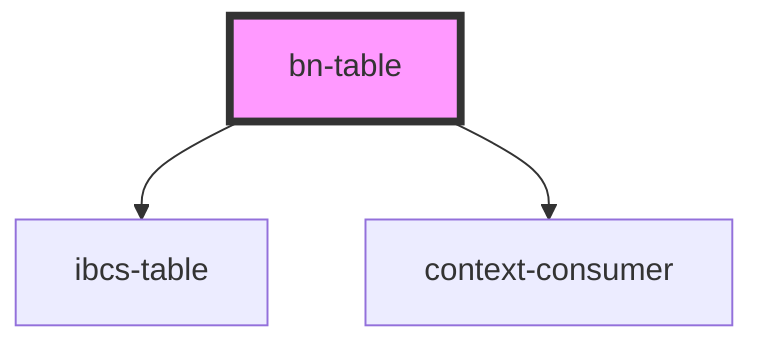

# bn-table

  

<!-- Auto Generated Below -->

## Properties

| Property                      | Attribute          | Description                                                                                                                                                                                                                                                                                                                                                                                                  | Type      | Default     |
| ----------------------------- | ------------------ | ------------------------------------------------------------------------------------------------------------------------------------------------------------------------------------------------------------------------------------------------------------------------------------------------------------------------------------------------------------------------------------------------------------ | --------- | ----------- |
| `datasource`                  | `datasource`       |                                                                                                                                                                                                                                                                                                                                                                                                              | `string`  | `undefined` |
| `datasourcesData`             | `datasources-data` |                                                                                                                                                                                                                                                                                                                                                                                                              | `any`     | `undefined` |
| `grouped` _(required)_        | `grouped`          | Toggles of data should be grouped by 'rowgroup'.  values: true \| false default: true                                                                                                                                                                                                                                                                                                                        | `boolean` | `undefined` |
| `i18nMode`                    | `i-1-8n-mode`      | set translaton mode.  values:   ALL \| NONE \| META                                                                                                                                                                                                                                                                                                                                                          | `string`  | `"NONE"`    |
| `limit`                       | `limit`            | (optional) Set the maximum number of rows for each group. The value 0 means *no limit*  rows wich where cut by the limit are cumulated as REST                                                                                                                                                                                                                                                               | `number`  | `0`         |
| `order` _(required)_          | `order`            | List of the primary scenarios on which the order direction are applied  valid scenarios are If order is set to a scenario it has also exists in scenariolist  values: category \| categoryindex \| rowgroup \| rowgroup \| rowgroupindex \| ac \| fc \| py \| pl                                                                                                                                             | `string`  | `undefined` |
| `orderDirection` _(required)_ | `order-direction`  | set sorting order directon  values: asc \| desc                                                                                                                                                                                                                                                                                                                                                              | `string`  | `undefined` |
| `scenarios` _(required)_      | `scenarios`        | (optional) List of scenarios. Valid scenarios are   values: ac \| fc \| py \| pl                                                                                                                                                                                                                                                                                                                             | `string`  | `undefined` |
| `showGroupTitle` _(required)_ | `show-group-title` | Toggles a title header for each (row-)group the title header value is found set by 'rowgroup'  values: true \| false default: true                                                                                                                                                                                                                                                                           | `boolean` | `undefined` |
| `tableTitle` _(required)_     | `table-title`      | A not mondane tile for the shard, which discribes the shown data.                                                                                                                                                                                                                                                                                                                                            | `string`  | `undefined` |
| `thereof`                     | `thereof`          | (optional) stringified Array of drilldown Objects {        "rowgroup": string,        "category": string,        "subcategory": string,        "partof": string      }, rowgroup, categroy defines the location of the drill subcategory is the displayed label of the data row  example: [{        "rowgroup":"Umsatz",        "category": "Applications",        "subcategory": "Applications-A",      },] | `string`  | `'[]'`      |
| `type` _(required)_           | `type`             | Set the table type  LIST \| SUM \| OPT                                                                                                                                                                                                                                                                                                                                                                       | `string`  | `undefined` |

## Dependencies

### Depends on

- ibcs-table
- context-consumer

### Graph

----------------------------------------------

*Built with [StencilJS](https://stenciljs.com/)*
