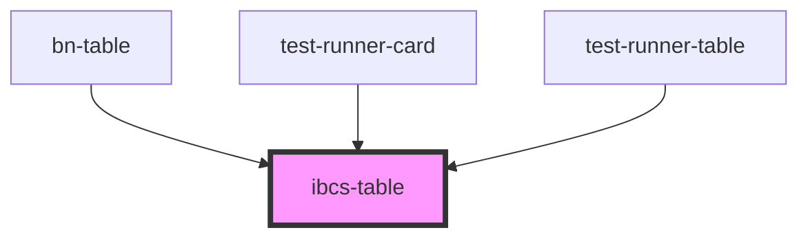

# bn-table

Component to create Tables.  The scenarios can be piced from the datasource.
the order of the scenarios is detemined by the parmeter scenarios.
Variances are calculated dynamicly.

## Mixins
@withStyle
@withComponentStatus
@withDataset
@withTranslation

**Example**
```html
      <bn-table
        datasets            ="$marktwert"
        category-width      ='inf'
        categorythereof     = '{"ac1": [{"name": "DE", "subGroups": ["Frankfurt"]}]}'
        data-format         ="decimal"
        data-format-digits-decimal = "2"
        data-format-digits-percent = "2"
        grouped             ="true"
        internationalisation = ''
        internationalisation-mode = ''
        limit               ='0'
        measure-scale       ='least'
        measure-type        ='currency'
        order               ='ac1'
        order-direction     ='desc'
        partof              ='[]'
        scenarios           ='ac1,pp1,dpp1_ac1_pos,drpp1_ac1_pos'
        show-group-title    ='true'
        table-title         ='Example Table'
        thereof             ='[
          {
            "rowgroup":     "Kosten",
            "category":     "lime",
            "subcategory":  ""
          }
          ]'
        type                ='opt' >
      </bn-table>
```
**Output**


<!-- Auto Generated Below -->


## Properties

| Property              | Attribute               | Description | Type                                                                                                                                                                                                           | Default                                                       |
| --------------------- | ----------------------- | ----------- | -------------------------------------------------------------------------------------------------------------------------------------------------------------------------------------------------------------- | ------------------------------------------------------------- |
| `barColumns`          | --                      |             | `string[]`                                                                                                                                                                                                     | `[]`                                                          |
| `categoryWidth`       | `category-width`        |             | `TableCategoryWidth.INF \| TableCategoryWidth.W10 \| TableCategoryWidth.W100 \| TableCategoryWidth.W15 \| TableCategoryWidth.W20 \| TableCategoryWidth.W25 \| TableCategoryWidth.W5 \| TableCategoryWidth.W50` | `TableCategoryWidth.INF`                                      |
| `categorythereof`     | --                      |             | `Map<string, Record<string, unknown>[]>`                                                                                                                                                                       | `new Map()`                                                   |
| `data`                | --                      |             | `TableDataRow[]`                                                                                                                                                                                               | `[]`                                                          |
| `dataFormatDigits`    | --                      |             | `DataFormatDigits`                                                                                                                                                                                             | `{ percent: 2, decimal: 1 }`                                  |
| `filter`              | `filter`                |             | `string`                                                                                                                                                                                                       | `""`                                                          |
| `grouped`             | `grouped`               |             | `boolean`                                                                                                                                                                                                      | `false`                                                       |
| `i18n`                | --                      |             | `Map<string, string>`                                                                                                                                                                                          | `new Map()`                                                   |
| `i18nMode`            | `i18n-mode`             |             | `I18nMode.ALL \| I18nMode.META`                                                                                                                                                                                | `I18nMode.ALL`                                                |
| `limit`               | `limit`                 |             | `number`                                                                                                                                                                                                       | `0`                                                           |
| `measureScale`        | `measure-scale`         |             | `string`                                                                                                                                                                                                       | `"_"`                                                         |
| `measureType`         | `measure-type`          |             | `MeasureType.CURRENCY \| MeasureType.VOLUME`                                                                                                                                                                   | `MeasureType.VOLUME`                                          |
| `measureUnit`         | `measure-unit`          |             | `string`                                                                                                                                                                                                       | `""`                                                          |
| `order`               | --                      |             | `Order`                                                                                                                                                                                                        | `{     hierarchy: [],     direction: OrderDirection.ASC,   }` |
| `partof`              | --                      |             | `TableDrillGroup[]`                                                                                                                                                                                            | `[]`                                                          |
| `percentageScaling`   | `percentage-scaling`    |             | `number`                                                                                                                                                                                                       | `0.5`                                                         |
| `scaleFactor`         | `scale-factor`          |             | `number`                                                                                                                                                                                                       | `1`                                                           |
| `scenarios`           | --                      |             | `string[]`                                                                                                                                                                                                     | `[]`                                                          |
| `scenariosDataFormat` | `scenarios-data-format` |             | `DataFormat.DECIMAL \| DataFormat.PERCENT`                                                                                                                                                                     | `DataFormat.DECIMAL`                                          |
| `showGroupTitle`      | `show-group-title`      |             | `boolean`                                                                                                                                                                                                      | `true`                                                        |
| `showMeasureScale`    | `show-measure-scale`    |             | `boolean`                                                                                                                                                                                                      | `true`                                                        |
| `tableTitle`          | `table-title`           |             | `string`                                                                                                                                                                                                       | `"SUM_TOTAL"`                                                 |
| `thereof`             | --                      |             | `TableDrillGroup[]`                                                                                                                                                                                            | `[]`                                                          |
| `type`                | `type`                  |             | `TableType.LIST \| TableType.OPT \| TableType.OPTNOTOTAL \| TableType.SUM \| TableType.SUMNOTOTAL`                                                                                                             | `TableType.LIST`                                              |
| `unitScaling`         | `unit-scaling`          |             | `number`                                                                                                                                                                                                       | `0.01`                                                        |


## Dependencies

### Used by

 - [bn-table](.)
 - [test-runner-card](../../test-runner)
 - [test-runner-table](../../test-runner)

### Graph


----------------------------------------------

developed by Bino Bi
